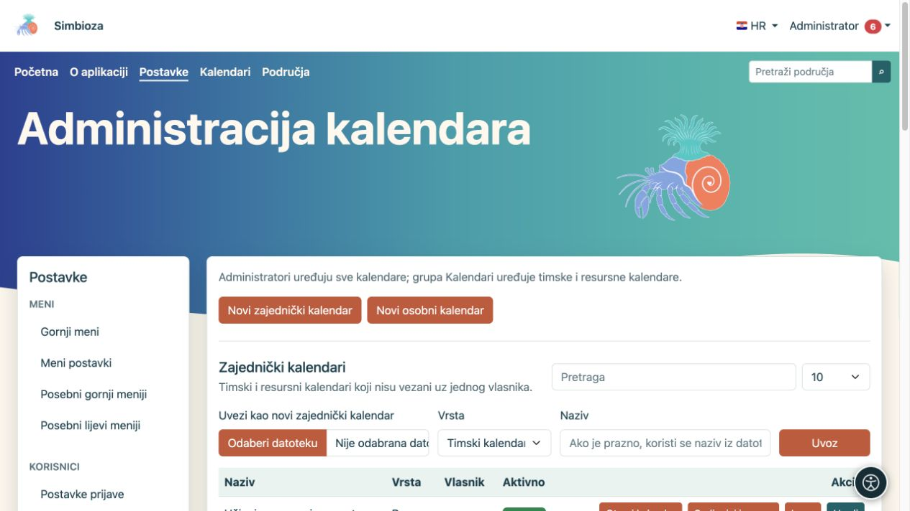
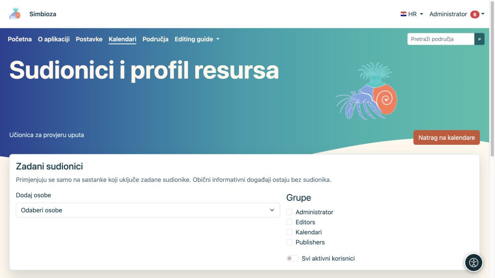
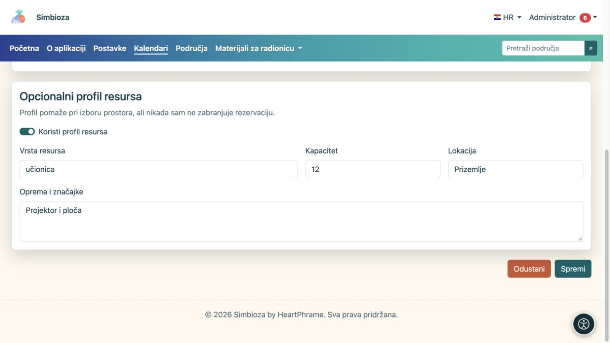

# Administracija kalendara

**Za koga:** administrator cijele instalacije upravlja svim kalendarima. Član sistemske grupe **Kalendari** upravlja timskim i resursnim kalendarima kroz **Kalendari → Upravljanje zajedničkim kalendarima**; ne dobiva time pristup svim Postavkama ni tuđim osobnim kalendarima.

Administrator otvara **Postavke → Kalendari → Administracija kalendara**. Pregled, događaji i korisničke pretplate opisani su u [Kalendari](kalendari_hr.md), a dogovaranje termina u [Sastanci](sastanci_hr.md).

## Stvorite zajednički kalendar

*Administracija odvaja zajedničke i osobne kalendare te nudi uvoz ICS datoteke kao novog zajedničkog kalendara.*

1. Odaberite **Novi zajednički kalendar**.
2. Za događaje tima odaberite **Timski kalendar**; za prostor ili opremu **Resursni kalendar**.
3. Unesite razumljiv naziv i opis te boju za razlikovanje u zajedničkom pregledu.
4. Ostavite **Aktivno** uključeno ako se kalendar odmah koristi.
5. Podesite čitanje i dodajte osobe ili grupe kojima trebaju dodatna prava.
6. Odaberite **Spremi kalendar** i otvorite kalendar iz popisa.

**Rezultat:** zajednički kalendar postoji i vidljiv je prema spremljenim pravima. Nov kalendar sam po sebi nije javan.

## Razumijte vidljivost i prava

| Kontrola | Učinak |
|---|---|
| Prijavljeni korisnici mogu čitati | Čitanje svim prijavljenim korisnicima, bez pojedinačnog dodavanja. |
| Javno čitanje | Čitanje posjetiteljima bez prijave. Uključite samo za javne podatke. |
| Čitanje uz osobu/grupu | Čitanje samo odabranim osobama/članovima, uz ostala postojeća prava. |
| Pisanje uz osobu/grupu | Uređivanje sadržaja kalendara u dopuštenom opsegu. |
| Prikaži događaje na javnoj stranici | Uključuje događaje javno čitljivog kalendara u javni pregled. Samo označavanje ne zaobilazi pravo čitanja. |
| Prikaži poveznicu na javnoj stranici | Prikazuje poveznicu na javno dostupan kalendar. |
| Javni redoslijed | Određuje raspored javnog prikaza; početna vrijednost novog obrasca je 100. |

Nove osobe tražite u polju za odabir korisnika. Za svaku dodanu osobu ili grupu zasebno odaberite čitanje i pisanje. Provjerite i članstvo u grupama; ograničenje u jednom retku ne poništava neovisno šire pravo iz drugog izvora.

## Osobni kalendari

Administrator može otvoriti dio osobnih kalendara i stvoriti kalendar za odabranog vlasnika. Odaberite vlasnika, tip **Službeni**, **Osobni** ili **Prilagođeni** te, za prilagođeni tip, jedinstveni nastavak naziva. Naziv se izvodi iz korisnikova prikaznog imena. To nije postupak za stvaranje zajedničkog kalendara ustanove.

Popisi imaju pretragu i izbor 10, 25, 50 ili 100 redaka. Otvorite **Uredi** na pravom retku; spremanje jednoga kalendara ne mijenja druge.

## Zadani sudionici i resurs

*U postavkama odabranog kalendara birate zadane sudionike i grupe.*

Na odgovarajućem kalendaru otvorite **Sudionici i resurs**. Dodajte osobe, odaberite grupe ili **Svi aktivni korisnici**. Ti su sudionici zadani samo za sastanak koji uključi zadane sudionike; obični informativni događaj ostaje bez sudionika.

Resursnom kalendaru možete uključiti profil resursa i unijeti vrstu, kapacitet, lokaciju te opremu. Profil pomaže pri odabiru, ali sam po sebi ne zabranjuje rezervaciju zbog kapaciteta ili opreme. Pravila odobravanja i dostupnost termina provjeravaju se pri planiranju sastanka.

*Opcionalni profil resursa opisuje vrstu, kapacitet, lokaciju i opremu.*

## Uvoz, izvoz i brisanje

ICS datoteku možete uvesti kao novi zajednički kalendar ili u postojeći kalendar. U drugom slučaju pročitajte izbor postupanja s jednakim UID-om događaja prije potvrde. Izvoz preuzima događaje kalendara u ICS; ne zamjenjuje [potpunu sigurnosnu kopiju](admin-sigurnosne-kopije_hr.md) prava i sastanaka.

**Obriši kalendar** koristite tek nakon provjere odabranog kalendara i poruke potvrde. Za privremeni prestanak uporabe najprije razmotrite isključivanje umjesto brisanja. Nakon promjene javnog čitanja provjerite kalendar odjavljenim preglednikom i računom bez dodatnih prava.

Opće omogućavanje CalDAV-a dio je instalacijske konfiguracije koju održava osoba za poslužitelj; ovaj ekran ne nudi prekidač za sve CalDAV klijente. Korisnikov pristup klijenta opisuje [vodič za kalendare](kalendari_hr.md).
