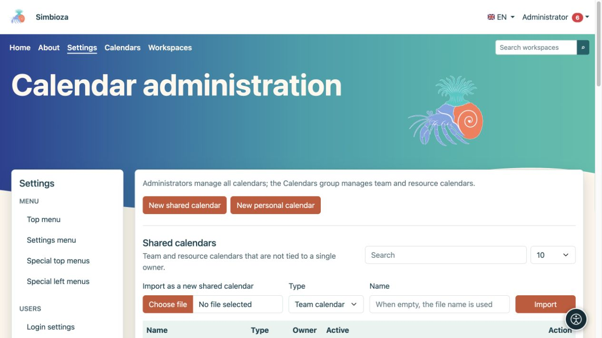
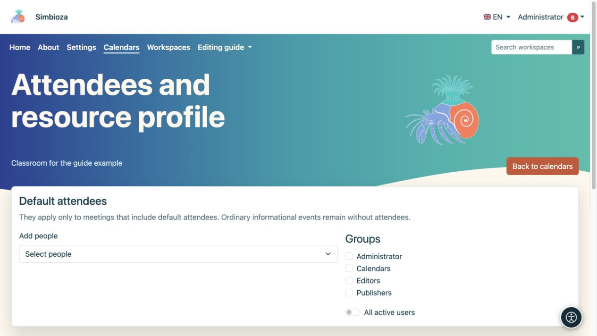
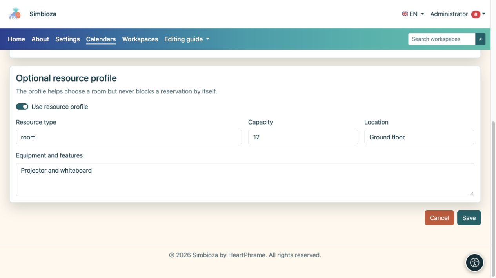

# Amministrazione del calendario

> Le schermate mostrano l’interfaccia in inglese.

**Pubblico:** l'amministratore dell'installazione può gestire tutti i calendari. I membri del gruppo di sistema **Calendari** gestiscono i calendari del team e delle risorse tramite **Calendari → Gestisci calendari condivisi**; l'abbonamento non garantisce l'accesso a tutte le Impostazioni o ai calendari personali di altre persone.

Gli amministratori aprono **Impostazioni → Calendari → Amministrazione calendario**. Le visualizzazioni del calendario, gli eventi e gli abbonamenti degli utenti sono trattati in [Calendari](kalendari_it.md); l'organizzazione degli appuntamenti è trattata in [Riunioni](sastanci_it.md).

## Crea un calendario condiviso

*L'amministrazione separa i calendari condivisi da quelli personali e offre l'importazione ICS come nuovo calendario condiviso.*

1. Scegli **Nuovo calendario condiviso**.
2. Seleziona **Calendario del gruppo** per gli eventi di un gruppo oppure **Calendario delle risorse** per una sala o un'attrezzatura.
3. Inserisci un nome e una descrizione chiari, quindi scegli un colore per la visualizzazione combinata.
4. Mantieni **Attivo** abilitato se il calendario verrà utilizzato immediatamente.
5. Configura l'accesso in lettura e aggiungi persone o gruppi che necessitano di diritti aggiuntivi.
6. Scegli **Salva calendario**, quindi aprilo dall'elenco.

**Risultato:** il calendario condiviso esiste ed è visibile in base alle autorizzazioni salvate. Un nuovo calendario non è automaticamente pubblico.

## Comprendere la visibilità e le autorizzazioni

| Controllare | Effetto |
|---|---|
| Gli utenti autenticati possono leggere | Tutti gli utenti che hanno effettuato l'accesso possono leggere senza concessioni individuali. |
| Lettura pubblica | I visitatori possono leggere senza effettuare l'accesso. Abilita solo per informazioni pubbliche. |
| Leggi accanto a una persona/gruppo | Le persone o i membri selezionati possono leggere, insieme ad altri diritti esistenti. |
| Scrivi accanto a una persona/gruppo | Consente la modifica del contenuto del calendario nell'ambito consentito. |
| Mostra gli eventi sulla pagina pubblica | Include eventi da un calendario leggibile pubblicamente nella visualizzazione pubblica. Selezionandolo non si ignora l'autorizzazione di lettura. |
| Mostra il collegamento sulla pagina pubblica | Mostra un collegamento a un calendario disponibile pubblicamente. |
| Ordine pubblico | Determina l'ordine di visualizzazione pubblica; un nuovo modulo parte da 100. |

Trova nuove persone nel selettore utente. Seleziona leggi e scrivi separatamente per ogni persona o gruppo. Controlla anche l'appartenenza al gruppo: una riga limitata non annulla una concessione separata più ampia.

## Calendari personali

Gli amministratori possono aprire la sezione del calendario personale e creare un calendario per un proprietario selezionato. Scegli il proprietario e la preimpostazione **Ufficiale**, **Personale** o **Personalizzata**; inserisci un suffisso nome univoco per un calendario personalizzato. Il suo nome deriva dal nome visualizzato dell'utente. Questa non è la procedura per creare il calendario condiviso di un'organizzazione.

Gli elenchi offrono la ricerca e 10, 25, 50 o 100 righe per pagina. Scegli **Modifica** sulla riga corretta; il salvataggio di un calendario non ne modifica un altro.

## Partecipanti predefiniti e dettagli delle risorse

*Scegli i partecipanti e i gruppi predefiniti nelle impostazioni del calendario selezionate.*

Apri **Partecipanti e risorse** per il calendario pertinente. Aggiungi persone, seleziona gruppi o scegli **Tutti gli utenti attivi**. Questi partecipanti sono predefiniti solo per una riunione che include partecipanti predefiniti; un evento informativo ordinario rimane senza partecipanti.

Per un calendario delle risorse, è possibile abilitare un profilo di risorsa e inserirne il tipo, la capacità, l'ubicazione e l'attrezzatura. Il profilo aiuta le persone a scegliere una risorsa, ma non blocca di per sé una prenotazione a causa della capacità o dell'attrezzatura. Le regole di approvazione e la disponibilità di tempo vengono verificate durante la pianificazione di una riunione.

*Il profilo risorsa opzionale descrive il tipo, la capacità, l'ubicazione e l'attrezzatura.*

## Importazione, esportazione ed eliminazione

Un file ICS può essere importato come nuovo calendario condiviso o in un calendario esistente. Nel secondo caso, leggi l'opzione per la corrispondenza degli UID degli eventi prima di confermare. Esporta scarica gli eventi come ICS; non sostituisce un [backup completo](admin-sigurnosne-kopije_it.md) di autorizzazioni e riunioni.

Utilizza **Elimina calendario** solo dopo aver controllato il calendario selezionato e il messaggio di conferma. In caso di mancato utilizzo temporaneo, valutare prima la possibilità di disabilitarlo. Dopo aver modificato l'accesso in lettura pubblica, controlla il calendario mentre sei disconnesso e con un account che non dispone di diritti aggiuntivi.

L'abilitazione generale CalDAV è la configurazione di installazione gestita dal manutentore del server; questa schermata non ha alcun interruttore per tutti i client CalDAV. L'accesso client a livello utente è descritto nella [guida al calendario](kalendari_it.md).
