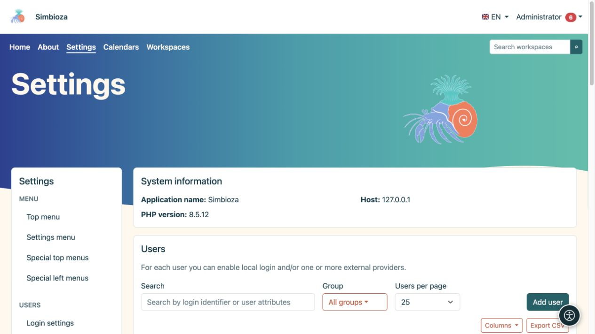

# Benutzer, Gruppen und Administratorzugriff

> Die Bildschirmaufnahmen zeigen die englische Benutzeroberfläche.

**Zielgruppe:** der Administrator der gesamten Installation. Detaillierte Formulare für lokale Konten, Gruppen, Attribute und externe Anmeldung werden unter [Anmeldung und Benutzer](prijava-i-korisnici_de.md) beschrieben. In diesem Kapitel wird erläutert, wie Sie diese Einstellungen sicher mit den anderen Modulen verbinden.

*Die Benutzerliste bietet Suche, einen Gruppenfilter und Benutzererstellung; Detaillierte Vorgehensweisen finden Sie im Anmelde- und Benutzerhandbuch.*

## Wählen Sie die entsprechende Berechtigung

| Person | Gewähren |
|---|---|
| Liest Inhalte | Lesezugriff auf den erforderlichen Arbeitsbereich oder die erforderliche Seite. |
| Bearbeitet Inhalte | Herausgeberberechtigung im erforderlichen Umfang. |
| Verwaltet einen Arbeitsbereich | Verwaltungsberechtigung für diesen Arbeitsbereich. |
| Erstellt oder veröffentlicht Umfragen | Die entsprechenden Umfrageberechtigungen; es ist kein Administratorkonto erforderlich. |
| Verwaltet freigegebene Kalender | Mitgliedschaft in der Systemgruppe „Kalender“. |
| Konfiguriert die Anwendung, Module und Anmeldung | Administratorzugriff. |

Benutzer- und Gruppenzuschüsse werden gemäß den Regeln jedes Moduls kombiniert. Wenn jemand mehreren Gruppen angehört, überprüfen Sie jede Zugriffsquelle. Durch das Ausblenden eines Menüeintrags wird der Zugriff nicht widerrufen: Die Inhaltsanfrage selbst wird ebenfalls überprüft.

## Gewähren Sie Zugriff auf eine Gruppe

1. Öffnen oder erstellen Sie unter **Einstellungen → Benutzer → Gruppen** eine eindeutig benannte Gruppe.
2. Konfigurieren Sie die Mitgliedschaft und die erforderlichen Zuschüsse wie in den [Gruppenanweisungen](prijava-i-korisnici_de.md#groups) beschrieben.
3. Fügen Sie im Zielmodul die Gruppe hinzu und wählen Sie genau aus, welche Aktionen sie ausführen darf.
4. Speichern und dann mit einem Mitglied und einem Nichtmitglied testen.

**Ergebnis:** Berechtigungen gehören zu der von der Gruppe repräsentierten Rolle, ohne unnötige individuelle Gewährungen.

## Überprüfen Sie die Anmeldung und den Administratormodus

Ein aktives Konto und die Berechtigung zum Bearbeiten von Inhalten machen jemanden nicht zum Administrator. Ein Administratorkonto bietet möglicherweise einen separaten Zugriffsmodus im persönlichen Menü. Durch Deaktivieren dieses Modus wird die normale Ansicht wiederhergestellt. Das Konto wird dadurch nicht gelöscht.

Befolgen Sie die vorhandenen Anweisungen für die lokale Anmeldung und SSO. Ein externes Anbieterprofil erfordert korrekte Zuordnungen erforderlicher Attribute und einen erfolgreichen Test. Deaktivieren Sie Ihre aktuelle Anmeldemethode nicht, bevor Sie einen Ersatz überprüft haben. Die Anmeldung nur für eine [Umfrage](ankete-autentikacija_de.md) erfolgt getrennt von der Anwendungsanmeldung und erstellt selbst kein Organisationsmitglied.

## Testen Sie ohne Administratorrechte

Öffnen Sie den Inhalt nach dem Speichern der Berechtigungen mit einem anderen Konto. Überprüfen Sie das Menü, den Baum und den Direktlink. Eine Person ohne Berechtigung darf keine privaten Inhalte erhalten, indem sie lediglich deren URL herausfindet. Gäste, angemeldete Leser, Redakteure und Arbeitsbereichsmanager erhalten allein durch ihre Inhaltsrolle keinen Zugriff auf **Einstellungen**.

Ein [API-Schlüssel](admin-api_de.md) fungiert auch als sein Besitzer: Scopes legen zusätzliche Einschränkungen fest und ersetzen nicht die Berechtigungen des Besitzers.
