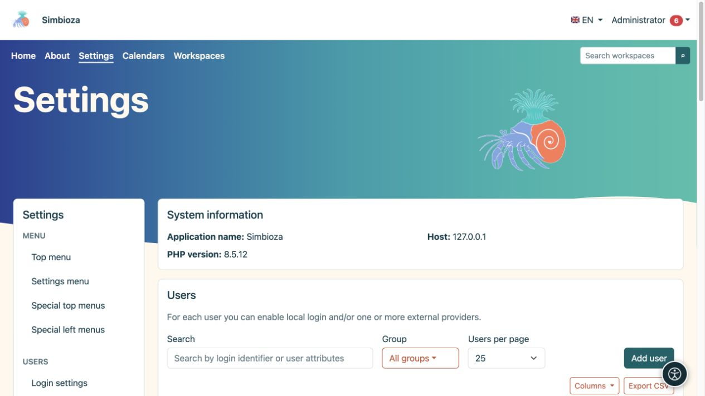

# Users, groups, and administrator access

**Audience:** the administrator of the entire installation. Detailed forms for local accounts, groups, attributes, and external sign-in are described in [Sign-in and users](prijava-i-korisnici_en.md). This chapter explains how to connect those settings safely with the other modules.

*The user list offers search, a group filter, and user creation; detailed procedures are in the login and user guide.*

## Choose the appropriate permission

| Person | Grant |
|---|---|
| Reads content | Read access to the required workspace or page. |
| Edits content | Editor permission within the required scope. |
| Manages a workspace | Management permission for that workspace. |
| Creates or publishes surveys | The relevant survey permissions; no administrator account is needed. |
| Manages shared calendars | Membership of the Calendars system group. |
| Configures the application, modules, and sign-in | Administrator access. |

User and group grants combine according to each module's rules. When someone belongs to several groups, review every source of access. Hiding a menu entry does not revoke access: the content request itself is also checked.

## Grant access to a group

1. Under **Settings → Users → Groups**, open or create a clearly named group.
2. Configure membership and the necessary grants as described in the [group instructions](prijava-i-korisnici_en.md#groups).
3. In the target module, add the group and select exactly which actions it may perform.
4. Save, then test with a member and a non-member.

**Result:** permissions belong to the role represented by the group, without unnecessary individual grants.

## Check sign-in and administrator mode

An active account and content-editing permission do not make someone an administrator. An administrator account may offer a separate access mode in the personal menu. Disabling that mode restores the ordinary view; it does not delete the account.

Follow the existing instructions for local sign-in and SSO. An external-provider profile needs correct required-attribute mappings and a successful test. Do not disable your current sign-in method before verifying a replacement. Sign-in only for a [survey](ankete-autentikacija_en.md) is separate from application sign-in and does not itself create an organisation member.

## Test without administrator privileges

After saving permissions, open the content with another account. Check the menu, tree, and direct link. A person without permission must not receive private content merely by discovering its URL. Guests, signed-in readers, editors, and workspace managers do not gain **Settings** access from their content role alone.

An [API key](admin-api_en.md) also acts as its owner: scopes impose additional limits and do not replace the owner's permissions.
