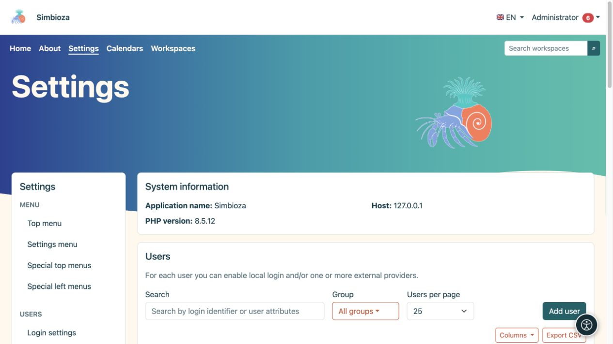

# Usuarios, grupos y acceso de administración

> Las capturas de pantalla muestran la interfaz en inglés.

**Audiencia:** el administrador de toda la instalación. Los formularios detallados para cuentas locales, grupos, atributos e inicio de sesión externo se describen en [Inicio de sesión y usuarios](prijava-i-korisnici_es.md). Este capítulo explica cómo conectar esas configuraciones de forma segura con los otros módulos.

*La lista de usuarios ofrece búsqueda, filtro de grupos y creación de usuarios; Los procedimientos detallados se encuentran en la guía de inicio de sesión y del usuario.*

## Elija el permiso apropiado

| Persona | Conceder |
|---|---|
| Lee contenido | Acceso de lectura al espacio de trabajo o página requerida. |
| Edita contenido | Permiso de editor dentro del alcance requerido. |
| Gestiona un espacio de trabajo | Permiso de administración para ese espacio de trabajo. |
| Crea o publica encuestas | Los permisos de encuesta pertinentes; no se necesita ninguna cuenta de administrador. |
| Gestiona calendarios compartidos | Pertenencia al grupo del sistema Calendarios. |
| Configura la aplicación, los módulos y el inicio de sesión. | Acceso de administrador. |

Las permisos para usuarios y grupos se combinan según las reglas de cada módulo. Cuando alguien pertenece a varios grupos, revise todas las fuentes de acceso. Ocultar una entrada del menú no revoca el acceso: también se verifica la solicitud de contenido en sí.

## Conceder acceso a un grupo

1. En **Configuración → Usuarios → Grupos**, abra o cree un grupo con un nombre claro.
2. Configure la membresía y las permisos necesarias como se describe en las [instrucciones del grupo](prijava-i-korisnici_es.md#groups).
3. En el módulo de destino, agregue el grupo y seleccione exactamente qué acciones puede realizar.
4. Guarde y luego pruebe con un miembro y un no miembro.

**Resultado:** los permisos pertenecen al rol representado por el grupo, sin concesiones individuales innecesarias.

## Verifique el modo de inicio de sesión y administrador

Una cuenta activa y un permiso de edición de contenido no convierten a alguien en administrador. Una cuenta de administrador puede ofrecer un modo de acceso independiente en el menú personal. Al desactivar ese modo se restaura la vista normal; no elimina la cuenta.

Siga las instrucciones existentes para el inicio de sesión local y SSO. Un perfil de proveedor externo necesita asignaciones correctas de atributos requeridos y una prueba exitosa. No desactive su método de inicio de sesión actual antes de verificar un reemplazo. El inicio de sesión solo para una [encuesta](ankete-autentikacija_es.md) es independiente del inicio de sesión en la aplicación y no crea en sí mismo un miembro de la organización.

## Prueba sin privilegios de administrador

Después de guardar los permisos, abra el contenido con otra cuenta. Consulte el menú, el árbol y el enlace directo. Una persona sin permiso no debe recibir contenido privado simplemente descubriendo su URL. Los invitados, los lectores registrados, los editores y los gestores del espacio de trabajo no obtienen acceso a **Configuración** únicamente desde su función de contenido.

Una [clave de API](admin-api_es.md) también actúa como su propietario: los ámbitos imponen límites adicionales y no reemplazan los permisos del propietario.
