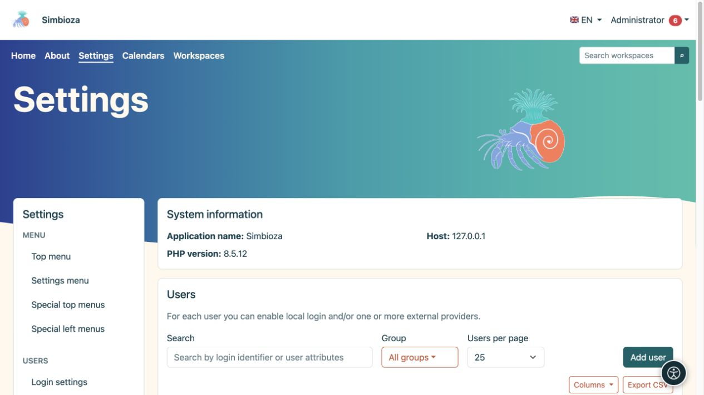

# Utilisateurs, groupes et accès administrateur

> Les captures d’écran présentent l’interface en anglais.

**Public :** l'administrateur de l'ensemble de l'installation. Les formulaires détaillés pour les comptes locaux, les groupes, les attributs et la connexion externe sont décrits dans [Connexion et utilisateurs](prijava-i-korisnici_fr.md). Ce chapitre explique comment connecter ces paramètres en toute sécurité avec les autres modules.

*La liste d'utilisateurs propose une recherche, un filtre de groupe et la création d'utilisateurs ; les procédures détaillées se trouvent dans le guide de connexion et d'utilisation.*

## Choisissez l'autorisation appropriée

| Personne | Accorder |
|---|---|
| Lit le contenu | Accès en lecture à l’espace de travail ou à la page requis. |
| Modifie le contenu | Autorisation d’éditeur dans la portée requise. |
| Gère un espace de travail | Autorisation de gestion pour cet espace de travail. |
| Crée ou publie des sondages | Les autorisations de sondage pertinentes ; aucun compte administrateur n'est nécessaire. |
| Gère les calendriers partagés | Appartenance au groupe système Calendriers. |
| Configure l'application, les modules et la connexion | Accès administrateur. |

Les droits des utilisateurs et des groupes se combinent selon les règles de chaque module. Lorsqu’une personne appartient à plusieurs groupes, examinez chaque source d’accès. Masquer un élément du menu ne retire pas l’accès : la demande de contenu elle-même est également contrôlée.

## Accorder l'accès à un groupe

1. Sous **Paramètres → Utilisateurs → Groupes**, ouvrez ou créez un groupe clairement nommé.
2. Configurez l'adhésion et les autorisations nécessaires comme décrit dans les [instructions du groupe](prijava-i-korisnici_fr.md#groups).
3. Dans le module cible, ajoutez le groupe et sélectionnez exactement les actions qu'il peut effectuer.
4. Enregistrez, puis testez avec un membre et un non-membre.

**Résultat :** les autorisations appartiennent au rôle représenté par le groupe, sans autorisations individuelles inutiles.

## Vérifiez la connexion et le mode administrateur

Un compte actif et une autorisation de modification de contenu ne font pas de quelqu'un un administrateur. Un compte administrateur peut proposer un mode d'accès distinct dans le menu personnel. La désactivation de ce mode restaure la vue ordinaire ; cela ne supprime pas le compte.

Suivez les instructions existantes pour la connexion locale et SSO. Un profil de fournisseur externe nécessite des mappages d’attributs requis corrects et un test réussi. Ne désactivez pas votre méthode de connexion actuelle avant de vérifier un remplacement. La connexion uniquement pour un [sondage](ankete-autentikacija_fr.md) est distincte de la connexion à l'application et ne crée pas elle-même un membre de l'organisation.

## Test sans privilèges d'administrateur

Après avoir enregistré les autorisations, ouvrez le contenu avec un autre compte. Vérifiez le menu, l'arborescence et le lien direct. Une personne sans autorisation ne doit pas recevoir de contenu privé simplement en découvrant son URL. Les invités, les lecteurs connectés, les éditeurs et les gestionnaires d'espace de travail n'obtiennent pas l'accès aux **Paramètres** uniquement à partir de leur rôle de contenu.

Une [API key](admin-api_fr.md) agit également en tant que propriétaire : les étendues imposent des limites supplémentaires et ne remplacent pas les autorisations du propriétaire.
