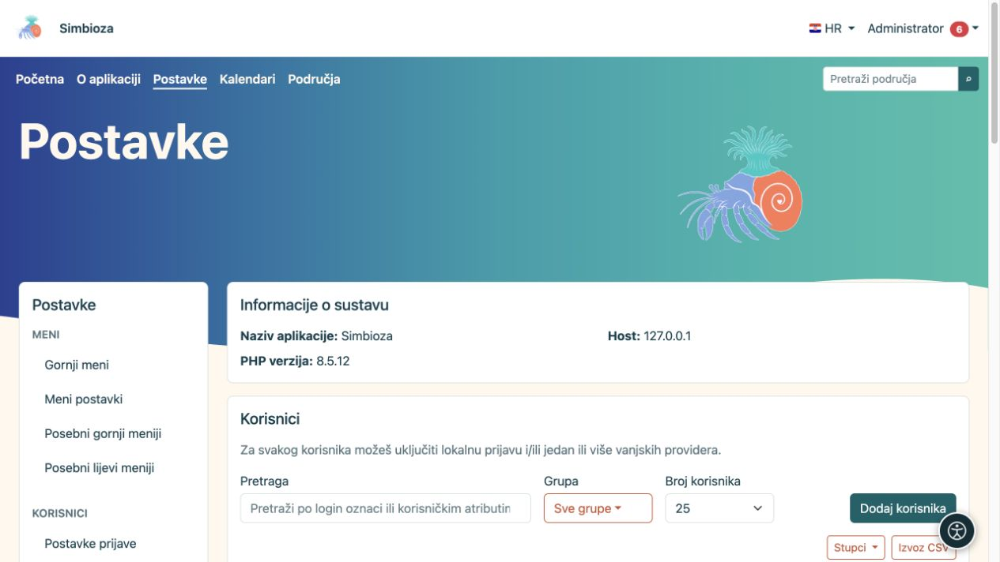

# Korisnici, grupe i administratorski pristup

**Za koga:** administrator cijele instalacije. Detaljni obrasci za lokalne račune, grupe, atribute i vanjske prijave opisani su u [Prijava i korisnici](prijava-i-korisnici_hr.md). Ovdje je pregled kako sigurno povezati te postavke s ostalim modulima.

*Popis korisnika nudi pretragu, grupni filtar i dodavanje korisnika; detaljni postupci nalaze se u uputama za prijavu i korisnike.*

## Odaberite odgovarajuću ovlast

| Osoba | Što joj dodijeliti |
|---|---|
| Čita sadržaj | Pravo čitanja potrebnog područja ili stranice. |
| Uređuje sadržaj | Uredničko pravo u potrebnom opsegu. |
| Upravlja područjem | Upravljačko pravo za to područje. |
| Sastavlja ili objavljuje ankete | Odgovarajuće ovlasti anketa; ne treba administratorski račun. |
| Upravlja zajedničkim kalendarima | Članstvo u sistemskoj grupi Kalendari. |
| Podešava cijelu aplikaciju, module i prijavu | Administratorski pristup. |

Prava korisnika i grupa zbrajaju se prema pravilima pojedinog modula. Kad osoba pripada više grupa, provjerite sve izvore ovlasti. Sakrivanje stavke izbornika ne ukida pravo pristupa: zaštitu provjerava i sam zahtjev za sadržajem.

## Dodijelite prava grupi

1. U **Postavke → Korisnici → Grupe** otvorite ili izradite grupu jasnog naziva.
2. Uredite članstvo i potrebne ovlasti prema [uputi za grupe](prijava-i-korisnici_hr.md#grupe).
3. U ciljnom modulu dodajte grupu i označite točne radnje koje smije obavljati.
4. Spremite i provjerite pristup jednim članom i jednim nečlanom.

**Rezultat:** prava su dodijeljena ulozi koju grupa predstavlja, a ne nepotrebno svakom korisniku zasebno.

## Provjerite prijavu i administratorski način

Aktivan korisnički račun i pravo uređivanja sadržaja ne znače da je osoba administrator. Administratorski račun može imati zaseban način pristupa u osobnom izborniku. Isključivanje tog načina vraća uobičajeni prikaz; ne briše račun.

Za lokalnu prijavu i SSO slijedite postojeće upute. Profil vanjskog providera mora imati ispravno mapirane obavezne atribute i uspješan test. Nemojte isključiti trenutačni način prijave dok ne provjerite zamjenski pristup. Prijava samo za [anketu](ankete-autentikacija_hr.md) zasebna je od prijave u aplikaciju i sama ne stvara člana vaše organizacije.

## Provjera bez administratorske prednosti

Nakon spremanja prava otvorite sadržaj drugim računom. Provjerite vidljivi izbornik, stablo i izravnu poveznicu. Osoba bez prava ne smije dobiti privatni sadržaj samo zato što je saznala URL. Gost, prijavljeni čitatelj, urednik i upravitelj područja ne dobivaju pristup **Postavkama** samo zbog svoje sadržajne uloge.

[API ključ](admin-api_hr.md) također radi u ime svojeg vlasnika: njegovi scopeovi su dodatno ograničenje, a ne zamjena za korisnikove ovlasti.
