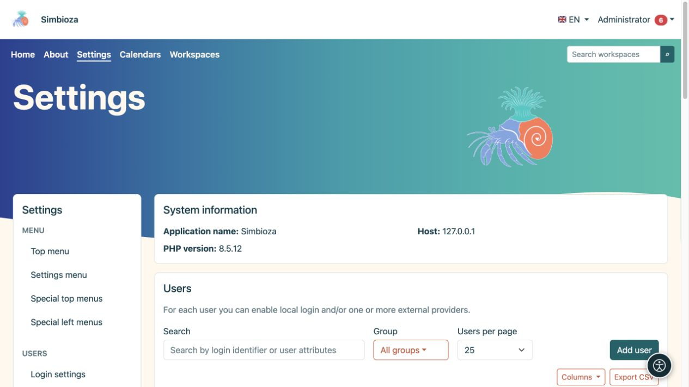

# Utenti, gruppi e accesso amministratore

> Le schermate mostrano l’interfaccia in inglese.

**Pubblico:** l'amministratore dell'intera installazione. I moduli dettagliati per account locali, gruppi, attributi e accesso esterno sono descritti in [Accesso e utenti](prijava-i-korisnici_it.md). Questo capitolo spiega come connettere queste impostazioni in modo sicuro con gli altri moduli.

*L'elenco degli utenti offre la ricerca, un filtro di gruppo e la creazione di utenti; le procedure dettagliate si trovano nel login e nella guida utente.*

## Scegli l'autorizzazione appropriata

| Persona | Concessione |
|---|---|
| Legge il contenuto | Accesso in lettura all'area di lavoro o alla pagina richiesta. |
| Modifica il contenuto | Autorizzazione editor nell'ambito richiesto. |
| Gestisce un'area di lavoro | Autorizzazione di gestione per quell'area di lavoro. |
| Crea o pubblica sondaggi | I relativi permessi di sondaggio; non è necessario alcun account amministratore. |
| Gestisce i calendari condivisi | Appartenenza al gruppo di sistema Calendari. |
| Configura l'applicazione, i moduli e l'accesso | Accesso amministratore. |

Le concessioni per utenti e gruppi si combinano in base alle regole di ciascun modulo. Quando qualcuno appartiene a più gruppi, controlla ogni fonte di accesso. Nascondere una voce di menu non revoca l'accesso: viene controllata anche la richiesta di contenuto stessa.

## Concedere l'accesso a un gruppo

1. In **Impostazioni → Utenti → Gruppi**, apri o crea un gruppo con un nome chiaro.
2. Configurare l'appartenenza e le autorizzazioni necessarie come descritto nelle [istruzioni del gruppo](prijava-i-korisnici_it.md#groups).
3. Nel modulo di destinazione, aggiungi il gruppo e seleziona esattamente quali azioni può eseguire.
4. Salva, quindi prova con un membro e un non membro.

**Risultato:** i permessi appartengono al ruolo rappresentato dal gruppo, senza inutili concessioni individuali.

## Controlla l'accesso e la modalità amministratore

Un account attivo e l'autorizzazione alla modifica dei contenuti non rendono qualcuno un amministratore. Un account amministratore può offrire una modalità di accesso separata nel menu personale. Disabilitare quella modalità ripristina la visualizzazione ordinaria; non elimina l'account.

Seguire le istruzioni esistenti per l'accesso locale e SSO. Un profilo di fornitore esterno necessita di mappature corrette degli attributi richiesti e di un test riuscito. Non disattivare il metodo di accesso corrente prima di aver verificato una sostituzione. L'accesso solo per un [sondaggio](ankete-autentikacija_it.md) è separato dall'accesso all'applicazione e non crea di per sé un membro dell'organizzazione.

## Prova senza privilegi di amministratore

Dopo aver salvato le autorizzazioni, apri il contenuto con un altro account. Controlla il menu, l'albero e il collegamento diretto. Una persona senza autorizzazione non deve ricevere contenuti privati semplicemente scoprendone l'URL. Gli ospiti, i lettori, gli editor e i gestori dell'area di lavoro che hanno effettuato l'accesso non ottengono l'accesso alle **Impostazioni** solo dal loro ruolo di contenuto.

Una [API chiave](admin-api_it.md) funge anche da proprietario: gli ambiti impongono limiti aggiuntivi e non sostituiscono le autorizzazioni del proprietario.
