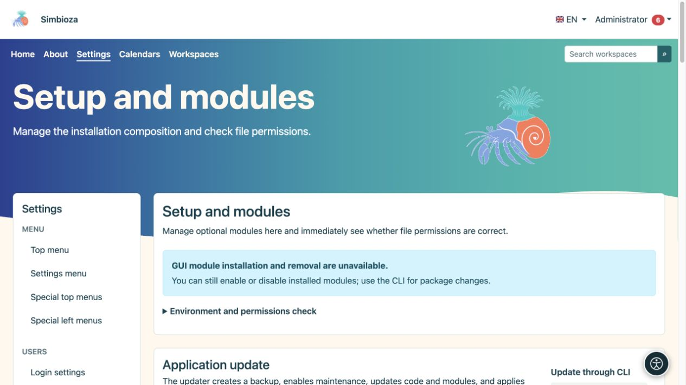
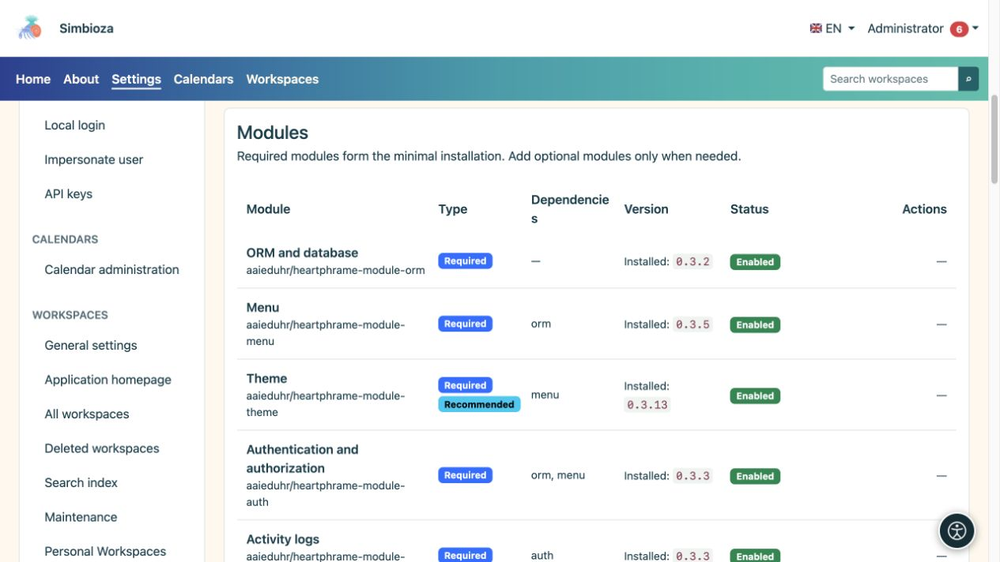

# Einrichtung, Module und Aktualisierungen

> Die Bildschirmaufnahmen zeigen die englische Benutzeroberfläche.

**Zielgruppe:** der Administrator der gesamten Installation. Öffnen Sie **Einstellungen → Setup → Module und Prüfungen** (Seitentitel: **Setup und Module**). Dieser Bildschirm zeigt die Komponenten der Installation, verfügbare Releases und Änderungen, die der Server sicher durchführen kann.

## Lesen Sie den Status, bevor Sie handeln

*Der Bildschirm trennt Umgebungsprüfungen und Updates; die verfügbaren Aktionen hängen vom Installationstyp ab.*

| Status | Bedeutung |
|---|---|
| Installierte Version | Die derzeit verwendete Version. |
| Update verfügbar | Es wurde eine neuere kompatible Version gefunden. Durch die Überprüfung wird es nicht installiert. |
| Ermöglicht | Das Modul ist installiert und seine Funktionalität ist aktiv. |
| Deaktiviert | Das Modul bleibt installiert, ist aber inaktiv. Seine Daten bleiben erhalten. |
| Nicht installiert | Die Funktionalität wurde dieser Installation nicht hinzugefügt. |
| Entfernt, Datensicherung vorhanden | Das Modul wurde deinstalliert und das System verfügt über ein Backup für die angebotene Wiederherstellung. |

Simbioza ist eine vollständige Anwendung; die Modularität ermöglicht auch eine engere Auswahl an Funktionen. **Auth, ORM, Menü, Design, Backup und Audit** sind obligatorische gemeinsame Grundlagen. Bei Bedarf können weitere Module hinzugefügt werden, wobei erforderliche Abhängigkeiten vom System überprüft werden.

## Fügen Sie ein Modul hinzu oder aktivieren Sie es

*Die Liste unterscheidet zwischen erforderlichen und optionalen Modulen, ihrem Status und ihren Abhängigkeiten.*

1. Suchen Sie das Modul und lesen Sie seinen Status und seine Abhängigkeiten.
2. Wenn es nicht installiert ist, wählen Sie die angebotene Installationsaktion. Wenn eine frühere Sicherung vorhanden ist, wählen Sie sorgfältig zwischen der Wiederherstellung der Daten und dem Starten einer neuen, leeren Installation.
3. Warten Sie auf die letzte Nachricht. Wenn das installierte Modul immer noch deaktiviert ist, wählen Sie **Aktivieren**.
4. Öffnen Sie den Eintrag und konfigurieren Sie die Berechtigungen. Durch die Installation einer Funktion erhält nicht jeder Benutzer Zugriff auf seine privaten Daten.

**Ergebnis:** Das Modul ist in derselben Simbioza-Installation verfügbar. Vorhandene Inhalte bleiben bestehen. Nach dem Hinzufügen von Arbeitsbereichen bleiben beispielsweise vorhandene eigenständige HTML-Seiten eigenständig, bis ein Administrator sie absichtlich über den [HTML-Editor](admin-html-editor_de.md) in einen Arbeitsbereich verschiebt.

## Deaktivierung und Deinstallation sind unterschiedlich

Verwenden Sie **Deaktivieren**, wenn Sie eine Funktion vorübergehend nicht benötigen. **Uninstall** entfernt sein Paket und seine Tabellen nach dem Modul-Backup-Vorgang. Lesen Sie vor der Bestätigung, was entfernt wird. Das System kann einen Vorgang ablehnen, der die Abhängigkeiten eines anderen Moduls zerstören würde. Erstellen Sie außerdem ein [Standort-Backup](admin-sigurnosne-kopije_de.md), um die Installation vollständig zu schützen.

## Überprüfen Sie es und wenden Sie ein Upgrade an

1. Suchen Sie nach verfügbaren Versionen und lesen Sie die Ergebnisse. Eine nicht verfügbare Quelle bedeutet eine teilweise Überprüfung; es stellt nicht sicher, dass alles aktuell ist.
2. Sichern Sie die Daten und vereinbaren Sie einen geeigneten Zeitpunkt, wenn Personen aktiv arbeiten.
3. Wenn auf dem Bildschirm ein sicheres Upgrade für die gesamte Anwendung angezeigt wird, starten Sie es und bestätigen Sie.
4. Verfolgen Sie die Phase und das Ergebnis. Die Verarbeitung läuft im Hintergrund weiter; Starten Sie keinen weiteren Versuch, während einer läuft.
5. Aktualisieren Sie nach dem Erfolg die Anwendung, überprüfen Sie die neue Version und öffnen Sie wichtige Inhalte.

GUI-Upgrades sind verfügbar, wenn eine gesicherte FPM-Installation korrekt konfiguriert ist und alle erforderlichen Prüfungen erfolgreich sind. Andere klassische Installationen zeigen eine CLI-Prozedur für den Serverbetreuer. Docker-Bereitstellungen ersetzen das Image und führen Migrationen aus, wie in den Installationsanweisungen beschrieben.

Die während eines Upgrades durchgeführte automatische Sicherung des Anwendungscodes ersetzt nicht eine separate Sicherung der Geschäftsdaten. Wenn ein Vorgang fehlschlägt, bewahren Sie die Meldung und die Uhrzeit auf und überprüfen Sie dann das [technische Protokoll](admin-dnevnici_de.md), bevor Sie es erneut versuchen. Umgehen Sie eine fehlgeschlagene Prüfung nicht, indem Sie willkürliche Änderungen an den Dateiberechtigungen vornehmen.

[Sprachen](admin-jezici_de.md) werden in einem separaten Abschnitt auf demselben Bildschirm verwaltet. [Barrierefreiheit](admin-pristupacnost_de.md) verfügt auch über einen eigenen Administratoreintrag.
