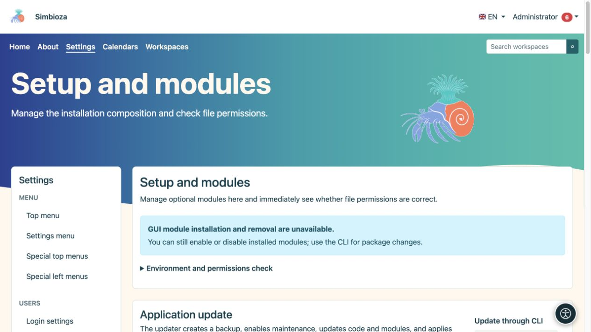
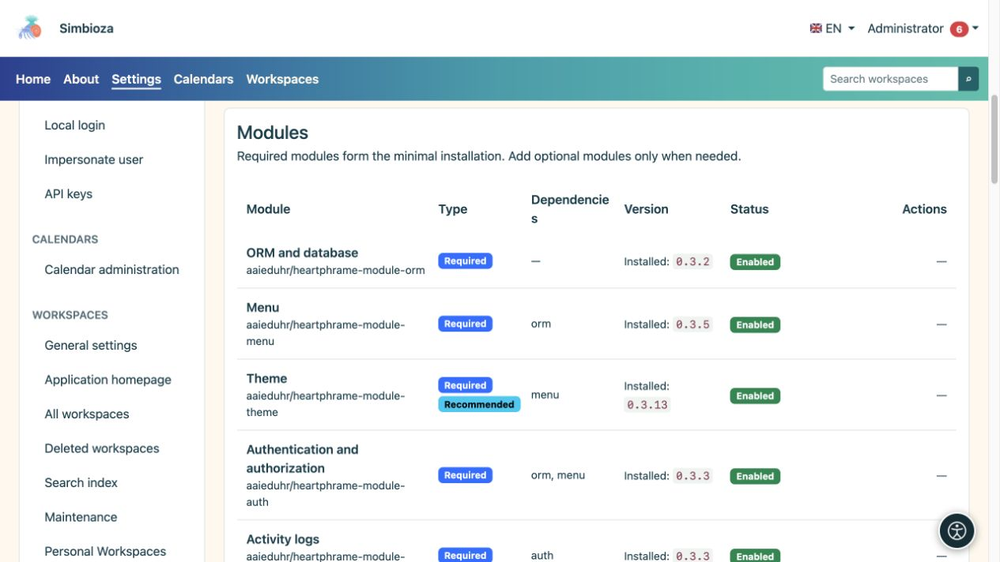

# Setup, modules, and upgrades

**Audience:** the administrator of the entire installation. Open **Settings → Setup → Modules and checks** (page title: **Setup and modules**). This screen shows the installation's components, available releases, and changes the server can safely perform.

## Read the status before acting

*The screen separates environment checks from updates; available actions depend on the installation type.*

| Status | Meaning |
|---|---|
| Installed version | The release currently in use. |
| Update available | A newer compatible release was found. Checking does not install it. |
| Enabled | The module is installed and its functionality is active. |
| Disabled | The module remains installed but is inactive. Its data is preserved. |
| Not installed | The functionality has not been added to this installation. |
| Removed, data backup exists | The module was uninstalled and the system has its backup for the offered restore. |

Simbioza is a complete application; modularity also permits a narrower selection of features. **Auth, ORM, Menu, Theme, Backup, and Audit** are mandatory shared foundations. Other modules can be added as needed, with required dependencies checked by the system.

## Add or enable a module

*The list distinguishes required and optional modules, their state, and dependencies.*

1. Find the module and read its status and dependencies.
2. If it is not installed, choose the offered installation action. Where an earlier backup exists, carefully choose between restoring data and starting a new empty installation.
3. Wait for the final message. If the installed module is still disabled, choose **Enable**.
4. Open its entry and configure permissions. Installing a feature does not give every user access to its private data.

**Result:** the module is available in the same Simbioza installation. Existing content remains in place. For example, after adding Workspaces, existing standalone HTML pages remain standalone until an administrator deliberately moves them into a workspace through the [HTML editor](admin-html-editor_en.md).

## Disabling and uninstalling are different

Use **Disable** when you temporarily do not need a feature. **Uninstall** removes its package and tables after the module-backup procedure. Read what will be removed before confirming; the system may refuse an operation that would break another module's dependencies. Also create a [site backup](admin-sigurnosne-kopije_en.md) for complete installation protection.

## Check and apply an upgrade

1. Check for available releases and read the results. An unavailable source means a partial check; it does not establish that everything is current.
2. Back up the data and arrange a suitable time if people are actively working.
3. When the screen offers a safe whole-application upgrade, start it and confirm.
4. Follow the stage and result. Processing continues in the background; do not start another attempt while one is running.
5. After success, refresh the application, check the new version, and open important content.

GUI upgrades are available when a secured FPM installation is configured correctly and all required checks pass. Other classic installations show a CLI procedure for the server maintainer. Docker deployments replace the image and run migrations as described in their installation instructions.

The automatic application-code backup made during an upgrade does not replace a separate business-data backup. If an operation fails, retain the message and time, then inspect the [technical log](admin-dnevnici_en.md) before retrying. Do not bypass a failed check by making arbitrary file-permission changes.

[Languages](admin-jezici_en.md) are managed in a separate section on the same screen. [Accessibility](admin-pristupacnost_en.md) also has its own administrator entry.
