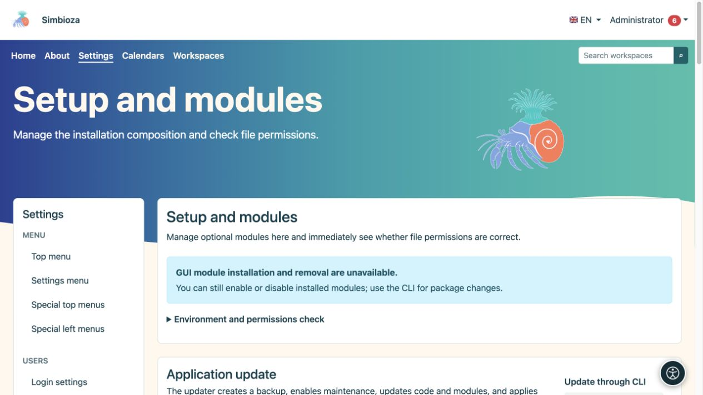
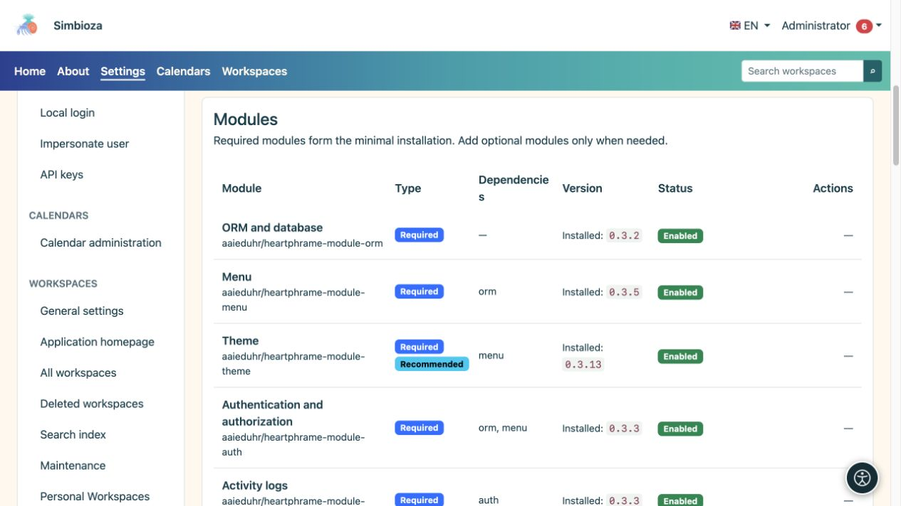

# Configuración inicial, módulos y actualizaciones

> Las capturas de pantalla muestran la interfaz en inglés.

**Audiencia:** el administrador de toda la instalación. Abra **Configuración → Configuración → Módulos y comprobaciones** (título de la página: **Configuración y módulos**). Esta pantalla muestra los componentes de la instalación, las versiones disponibles y los cambios que el servidor puede realizar de forma segura.

## Leer el estado antes de actuar

*La pantalla separa las comprobaciones del entorno de las actualizaciones; Las acciones disponibles dependen del tipo de instalación.*

| Estado | Significado |
|---|---|
| Versión instalada | La versión actualmente en uso. |
| Actualización disponible | Se encontró una versión compatible más reciente. La verificación no lo instala. |
| Activado | El módulo está instalado y su funcionalidad está activa. |
| Desactivado | El módulo permanece instalado pero está inactivo. Sus datos se conservan. |
| No instalado | La funcionalidad no se ha agregado a esta instalación. |
| Eliminado, existe una copia de seguridad de los datos. | El módulo fue desinstalado y el sistema tiene su copia de seguridad para la restauración ofrecida. |

Simbioza es una aplicación completa; la modularidad también permite elegir un conjunto más reducido de funciones. **Auth, ORM, Menu, Theme, Backup y Audit** son la base compartida obligatoria. Se pueden añadir otros módulos según sea necesario; el sistema comprueba las dependencias requeridas.

## Agregar o habilitar un módulo

*La lista distingue los módulos obligatorios y opcionales, su estado y dependencias.*

1. Busque el módulo y lea su estado y dependencias.
2. Si no está instalado, elija la acción de instalación ofrecida. Cuando exista una copia de seguridad anterior, elija cuidadosamente entre restaurar los datos o iniciar una nueva instalación vacía.
3. Espere el mensaje final. Si el módulo instalado aún está deshabilitado, elija **Habilitar**.
4. Abra su entrada y configure los permisos. La instalación de una función no otorga a todos los usuarios acceso a sus datos privados.

**Resultado:** el módulo está disponible en la misma instalación Simbioza. El contenido existente permanece en su lugar. Por ejemplo, después de agregar espacios de trabajo, las páginas HTML independientes existentes permanecen independientes hasta que un administrador las mueve deliberadamente a un espacio de trabajo a través del [HTML editor](admin-html-editor_es.md).

## Deshabilitar y desinstalar son diferentes

Utilice **Desactivar** cuando temporalmente no necesite una función. **Desinstalar** elimina su paquete y sus tablas después del procedimiento de copia de seguridad del módulo. Lea lo que se eliminará antes de confirmar; el sistema puede rechazar una operación que rompería las dependencias de otro módulo. Cree también una [copia de seguridad del sitio](admin-sigurnosne-kopije_es.md) para una protección completa de la instalación.

## Verificar y aplicar una actualización

1. Consulte las versiones disponibles y lea los resultados. Una fuente no disponible significa una verificación parcial; no establece que todo esté vigente.
2. Haga una copia de seguridad de los datos y programe un horario adecuado si hay personas trabajando activamente.
3. Cuando la pantalla ofrezca una actualización segura de toda la aplicación, iníciela y confirme.
4. Sigue el escenario y el resultado. El procesamiento continúa en segundo plano; no inicie otro intento mientras uno esté en ejecución.
5. Después del éxito, actualice la aplicación, verifique la nueva versión y abra contenido importante.

Las actualizaciones de la GUI están disponibles cuando una instalación segura de FPM está configurada correctamente y se pasan todas las comprobaciones requeridas. Otras instalaciones clásicas muestran un procedimiento CLI para el mantenedor del servidor. Las implementaciones de Docker reemplazan la imagen y ejecutan migraciones como se describe en sus instrucciones de instalación.

La copia de seguridad automática del código de la aplicación realizada durante una actualización no reemplaza una copia de seguridad de los datos comerciales por separado. Si una operación falla, conserve el mensaje y la hora, luego inspeccione el [registro técnico](admin-dnevnici_es.md) antes de volver a intentarlo. No omita una verificación fallida realizando cambios arbitrarios en los permisos de archivos.

[Idiomas](admin-jezici_es.md) se administran en una sección separada en la misma pantalla. [Accesibilidad](admin-pristupacnost_es.md) también tiene su propia entrada de administrador.
