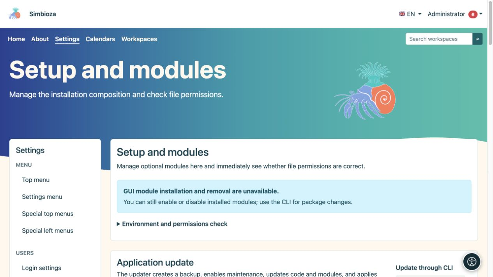
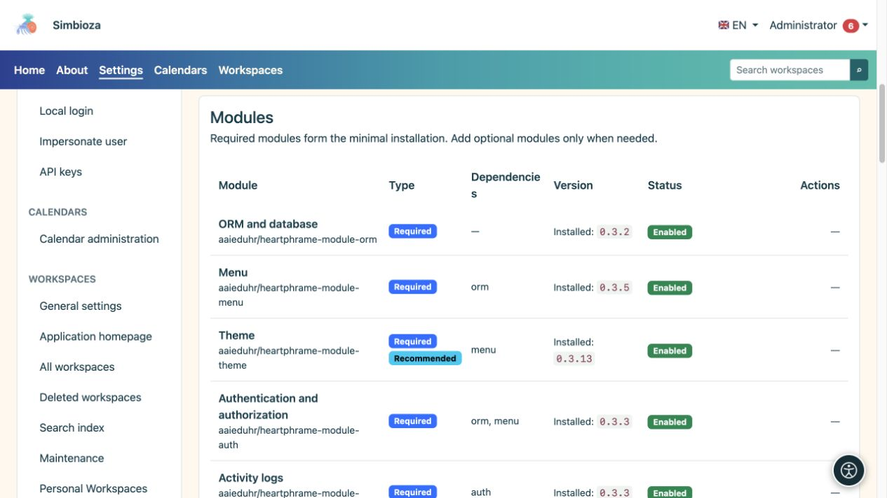

# Configuration, modules et mises à niveau

> Les captures d’écran présentent l’interface en anglais.

**Public :** l'administrateur de l'ensemble de l'installation. Ouvrez **Paramètres → Configuration → Modules et contrôles** (titre de la page : **Configuration et modules**). Cet écran affiche les composants de l'installation, les versions disponibles et les modifications que le serveur peut effectuer en toute sécurité.

## Lire le statut avant d'agir

*L'écran sépare les vérifications d'environnement des mises à jour ; les actions disponibles dépendent du type d'installation.*

| Statut | Signification |
|---|---|
| Version installée | La version actuellement utilisée. |
| Mise à jour disponible | Une version compatible plus récente a été trouvée. La vérification ne l'installe pas. |
| Activé | Le module est installé et sa fonctionnalité est active. |
| Désactivé | Le module reste installé mais est inactif. Ses données sont conservées. |
| Non installé | La fonctionnalité n'a pas été ajoutée à cette installation. |
| Supprimé, la sauvegarde des données existe | Le module a été désinstallé et le système dispose de sa sauvegarde pour la restauration proposée. |

Simbioza est une application complète ; la modularité permet également une sélection plus restreinte de fonctionnalités. **Auth, ORM, Menu, Theme, Backup et Audit** sont des fondations partagées obligatoires. D'autres modules peuvent être ajoutés selon les besoins, les dépendances requises étant vérifiées par le système.

## Ajouter ou activer un module

*La liste distingue les modules obligatoires et facultatifs, leur état et leurs dépendances.*

1. Recherchez le module et lisez son statut et ses dépendances.
2. S'il n'est pas installé, choisissez l'action d'installation proposée. Lorsqu'une sauvegarde antérieure existe, choisissez soigneusement entre restaurer les données et démarrer une nouvelle installation vide.
3. Attendez le dernier message. Si le module installé est toujours désactivé, choisissez **Activer**.
4. Ouvrez son entrée et configurez les autorisations. L'installation d'une fonctionnalité ne donne pas à chaque utilisateur l'accès à ses données privées.

**Résultat :** le module est disponible dans la même installation Simbioza. Le contenu existant reste en place. Par exemple, après l'ajout d'espaces de travail, les pages HTML autonomes existantes restent autonomes jusqu'à ce qu'un administrateur les déplace délibérément dans un espace de travail via l'[éditeur HTML](admin-html-editor_fr.md).

## La désactivation et la désinstallation sont différentes

Utilisez **Désactiver** lorsque vous n'avez temporairement pas besoin d'une fonctionnalité. **Désinstallation** supprime son package et ses tables après la procédure de sauvegarde du module. Lisez ce qui sera supprimé avant de confirmer ; le système peut refuser une opération qui briserait les dépendances d'un autre module. Créez également une [sauvegarde du site](admin-sigurnosne-kopije_fr.md) pour une protection complète de l'installation.

## Vérifier et appliquer une mise à niveau

1. Vérifiez les versions disponibles et lisez les résultats. Une source indisponible signifie une vérification partielle ; cela ne prouve pas que tout est à jour.
2. Sauvegardez les données et fixez un moment approprié si les personnes travaillent activement.
3. Lorsque l'écran propose une mise à niveau sécurisée de l'ensemble de l'application, démarrez-la et confirmez.
4. Suivez l'étape et le résultat. Le traitement se poursuit en arrière-plan ; ne lancez pas une autre tentative pendant qu’une est en cours d’exécution.
5. Après succès, actualisez l'application, vérifiez la nouvelle version et ouvrez le contenu important.

Les mises à niveau de l'interface graphique sont disponibles lorsqu'une installation FPM sécurisée est configurée correctement et que toutes les vérifications requises réussissent. D'autres installations classiques affichent une procédure CLI pour le responsable du serveur. Les déploiements Docker remplacent l'image et exécutent les migrations comme décrit dans leurs instructions d'installation.

La sauvegarde automatique du code d'application effectuée lors d'une mise à niveau ne remplace pas une sauvegarde distincte des données métier. Si une opération échoue, conservez le message et l'heure, puis inspectez le [journal technique](admin-dnevnici_fr.md) avant de réessayer. Ne contournez pas une vérification échouée en apportant des modifications arbitraires aux autorisations de fichiers.

Les [Langues](admin-jezici_fr.md) sont gérées dans une section distincte sur le même écran. [Accessibilité](admin-pristupacnost_fr.md) possède également sa propre entrée d'administrateur.
