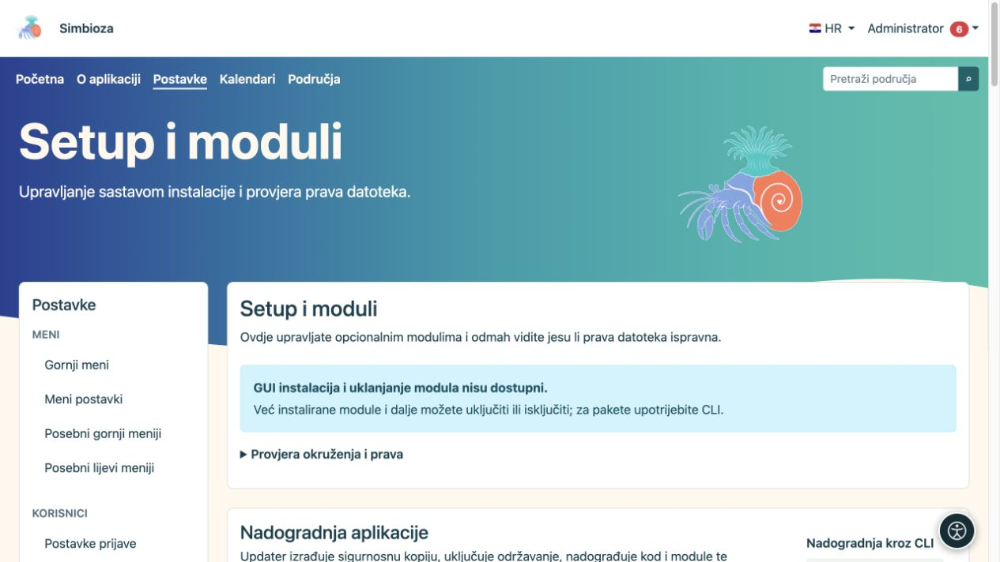
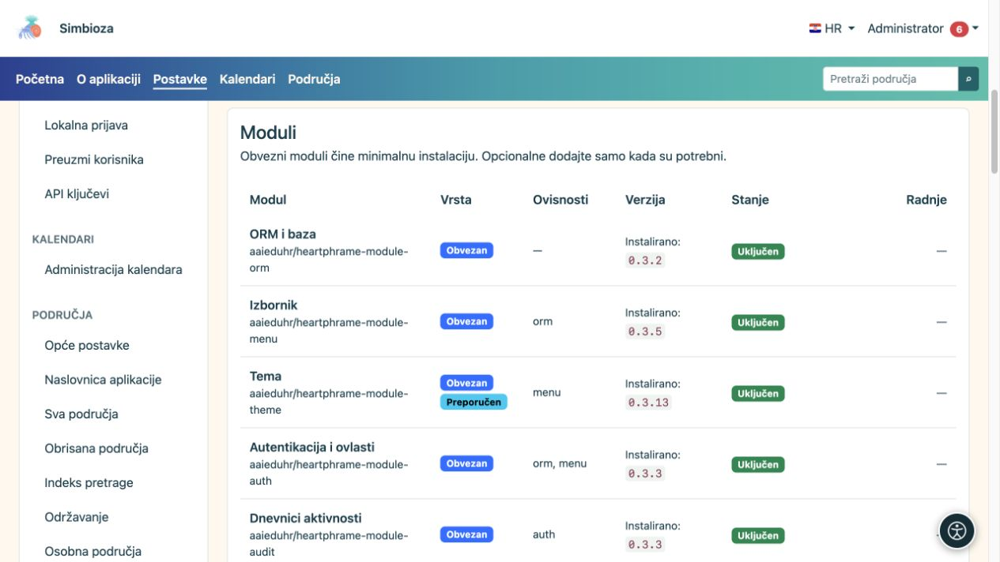

# Podešavanje, moduli i nadogradnja

**Za koga:** administrator cijele instalacije. Otvorite **Postavke → Podešavanje → Moduli i provjere** (naslov ekrana: **Setup i moduli**). Ovdje vidite od čega je instalacija sastavljena, koja su izdanja dostupna i koje promjene poslužitelj može sigurno provesti.

## Pročitajte stanje prije radnje

*Ekran razlikuje provjere okruženja i nadogradnju; dostupnost radnji ovisi o načinu instalacije.*

| Prikaz | Što znači |
|---|---|
| Instalirana verzija | Izdanje koje trenutačno koristite. |
| Dostupna nadogradnja | Pronađeno je novije kompatibilno izdanje. Sama provjera ga ne instalira. |
| Uključen | Modul je instaliran i njegova funkcionalnost radi. |
| Isključen | Modul je instaliran, ali se ne koristi. Njegovi podaci ostaju sačuvani. |
| Nije instaliran | Funkcionalnost još nije dodana u instalaciju. |
| Uklonjen, kopija podataka postoji | Modul je deinstaliran, a sustav ima njegovu kopiju za ponuđeni povrat. |

Simbioza je cjelovita aplikacija, a modularnost omogućuje i uži izbor funkcionalnosti. **Auth, ORM, Menu, Theme, Backup i Audit** zajednički su obavezni temelji. Ostali moduli mogu se dodavati prema potrebi; sustav provjerava njihove nužne ovisnosti.

## Dodajte ili uključite modul

*Popis razlikuje obavezne i opcionalne module te njihovo stanje i ovisnosti.*

1. Pronađite modul na popisu i pročitajte njegovo stanje i ovisnosti.
2. Ako nije instaliran, odaberite ponuđenu instalaciju. Ako postoji ranija kopija, pažljivo odaberite povrat podataka ili novu praznu instalaciju.
3. Pričekajte završnu poruku. Ako se modul nakon instalacije još vodi kao isključen, odaberite **Uključi**.
4. Otvorite njegovu stavku i podesite ovlasti. Instalacija funkcionalnosti sama po sebi ne daje svim korisnicima pravo na njezine privatne podatke.

**Rezultat:** modul je dostupan u istoj Simbiozi. Postojeći sadržaj ostaje u instalaciji. Primjerice, nakon dodavanja Područja postojeće samostalne HTML stranice ostaju samostalne dok ih administrator namjerno ne premjesti u područje kroz [HTML editor](admin-html-editor_hr.md).

## Isključivanje i deinstalacija nisu isto

**Isključi** koristite kada funkcionalnost privremeno ne trebate. **Deinstaliraj** uklanja paket i pripadajuće tablice nakon postupka sigurnosnog kopiranja modula. Prije potvrde pročitajte što se uklanja; sustav može odbiti radnju ako bi se prekinule ovisnosti drugog modula. Za cjelovitu zaštitu instalacije dodatno napravite [backup sitea](admin-sigurnosne-kopije_hr.md).

## Provjerite i provedite nadogradnju

1. Provjerite dostupna izdanja i pročitajte prikazane rezultate. Ako neki izvor nije dostupan, rezultat je djelomičan; to nije potvrda da je sve ažurno.
2. Napravite sigurnosnu kopiju podataka i dogovorite termin ako korisnici aktivno rade.
3. Kada ekran nudi sigurnu nadogradnju cijele aplikacije, pokrenite je i potvrdite radnju.
4. Pratite fazu i rezultat. Obrada radi u pozadini; ne pokrećite novi pokušaj dok prethodni traje.
5. Nakon uspjeha osvježite aplikaciju, provjerite novu verziju i otvorite važan sadržaj.

GUI nadogradnja dostupna je kada je sigurna FPM instalacija pravilno podešena i sve potrebne provjere prolaze. U drugim klasičnim instalacijama ekran prikazuje CLI postupak za osobu koja održava poslužitelj. Docker koristi zamjenu imagea i migraciju prema uputama za taj način instalacije.

Automatska kopija aplikacijskog koda tijekom nadogradnje ne zamjenjuje zaseban backup poslovnih podataka. Ako postupak prijavi grešku, sačuvajte poruku i vrijeme te pročitajte [tehnički log](admin-dnevnici_hr.md) prije ponovnog pokušaja. Nemojte zaobilaziti crvenu provjeru proizvoljnim mijenjanjem prava datoteka.

[Jezici](admin-jezici_hr.md) uređuju se u posebnom dijelu istog ekrana. [Pristupačnost](admin-pristupacnost_hr.md) ima i vlastitu administratorsku stavku.
