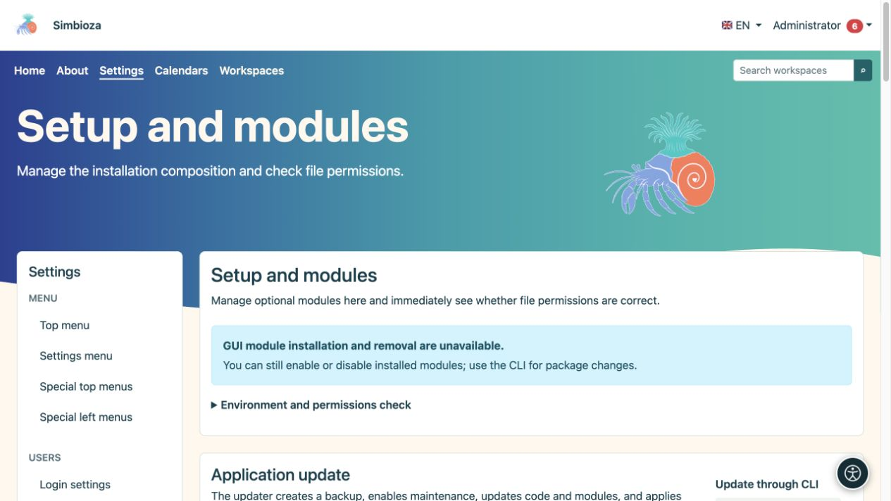
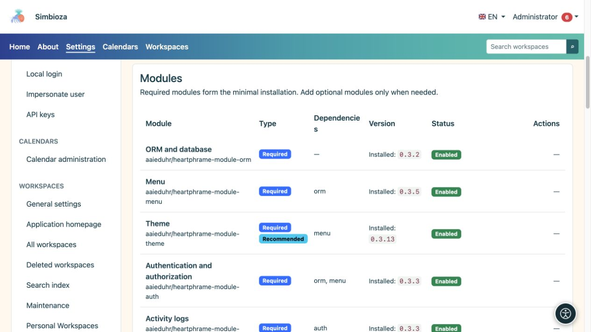

# Configurazione, moduli e aggiornamenti

> Le schermate mostrano l’interfaccia in inglese.

**Pubblico:** l'amministratore dell'intera installazione. Aprire **Impostazioni → Setup → Moduli e controlli** (titolo della pagina: **Setup e moduli**). Questa schermata mostra i componenti dell'installazione, le versioni disponibili e le modifiche che il server può eseguire in sicurezza.

## Leggi lo stato prima di agire

*La schermata separa i controlli ambientali dagli aggiornamenti; le azioni disponibili dipendono dal tipo di installazione.*

| Stato | Significato |
|---|---|
| Versione installata | La versione attualmente in uso. |
| Aggiornamento disponibile | È stata trovata una versione compatibile più recente. Il controllo non lo installa. |
| Abilitato | Il modulo è installato e la sua funzionalità è attiva. |
| Disabilitato | Il modulo rimane installato ma è inattivo. I suoi dati vengono conservati. |
| Non installato | La funzionalità non è stata aggiunta a questa installazione. |
| Rimosso, esiste il backup dei dati | Il modulo è stato disinstallato e il sistema dispone del backup per il ripristino offerto. |

Simbioza è un'applicazione completa; la modularità permette anche una selezione più limitata di funzionalità. **Auth, ORM, Menu, Theme, Backup e Audit** sono le basi condivise obbligatorie. Gli altri moduli possono essere aggiunti secondo necessità, con verifica delle dipendenze richieste da parte del sistema.

## Aggiungi o abilita un modulo

*L'elenco distingue i moduli obbligatori e facoltativi, il loro stato e le dipendenze.*

1. Trova il modulo e leggine lo stato e le dipendenze.
2. Se non è installato, scegli l'azione di installazione offerta. Laddove esiste un backup precedente, scegliere attentamente tra il ripristino dei dati e l'avvio di una nuova installazione vuota.
3. Attendi il messaggio finale. Se il modulo installato è ancora disabilitato, scegli **Abilita**.
4. Apri la sua voce e configura le autorizzazioni. L'installazione di una funzionalità non fornisce a tutti gli utenti l'accesso ai propri dati privati.

**Risultato:** il modulo è disponibile nella stessa installazione Simbioza. I contenuti esistenti rimangono in vigore. Ad esempio, dopo aver aggiunto le aree di lavoro, le pagine HTML autonome esistenti rimangono autonome finché un amministratore non le sposta deliberatamente in un'area di lavoro tramite l'[HTML editor](admin-html-editor_it.md).

## La disabilitazione e la disinstallazione sono diverse

Utilizza **Disabilita** quando temporaneamente non hai bisogno di una funzionalità. **Disinstalla** rimuove il pacchetto e le tabelle dopo la procedura di backup del modulo. Leggere cosa verrà rimosso prima di confermare; il sistema potrebbe rifiutare un'operazione che interromperebbe le dipendenze di un altro modulo. Crea anche un [backup del sito](admin-sigurnosne-kopije_it.md) per una protezione completa dell'installazione.

## Controlla e applica un aggiornamento

1. Controlla le versioni disponibili e leggi i risultati. Una fonte non disponibile significa un controllo parziale; non stabilisce che tutto sia attuale.
2. Eseguire il backup dei dati e organizzare un orario adeguato se le persone lavorano attivamente.
3. Quando lo schermo offre un aggiornamento sicuro dell'intera applicazione, avvialo e conferma.
4. Segui la fase e il risultato. L'elaborazione continua in background; non avviare un altro tentativo mentre è in corso uno.
5. Al termine, aggiorna l'applicazione, controlla la nuova versione e apri il contenuto importante.

Gli aggiornamenti della GUI sono disponibili quando un'installazione FPM protetta è configurata correttamente e tutti i controlli richiesti vengono superati. Altre installazioni classiche mostrano una procedura CLI per il manutentore del server. Le distribuzioni Docker sostituiscono l'immagine ed eseguono le migrazioni come descritto nelle relative istruzioni di installazione.

Il backup automatico del codice dell'applicazione effettuato durante un aggiornamento non sostituisce un backup separato dei dati aziendali. Se un'operazione non riesce, conserva il messaggio e l'ora, quindi controlla il [registro tecnico](admin-dnevnici_it.md) prima di riprovare. Non ignorare un controllo fallito apportando modifiche arbitrarie ai permessi dei file.

Le [Lingue](admin-jezici_it.md) sono gestite in una sezione separata nella stessa schermata. Anche [Accessibilità](admin-pristupacnost_it.md) ha una propria voce di amministratore.
