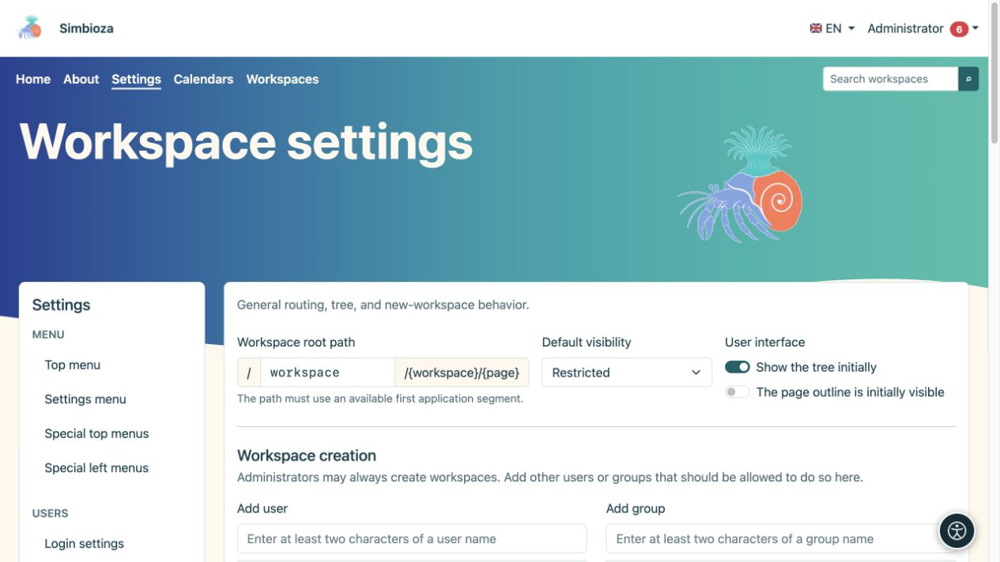
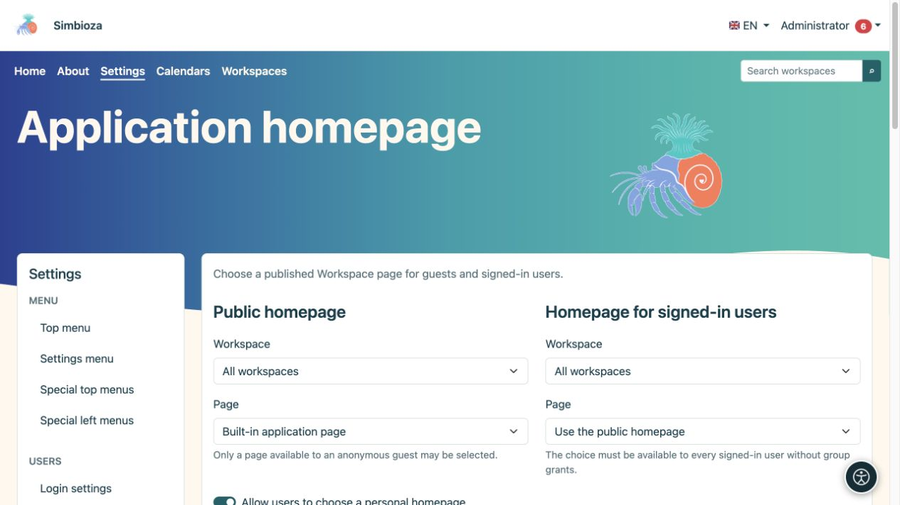
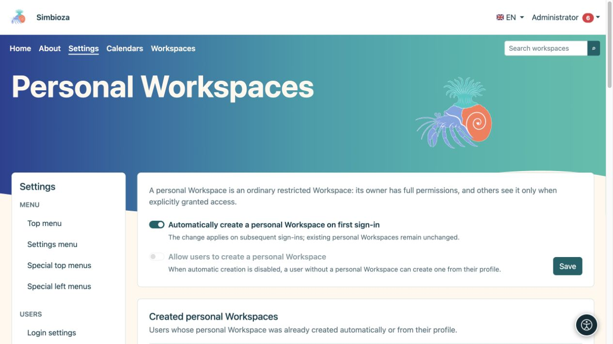
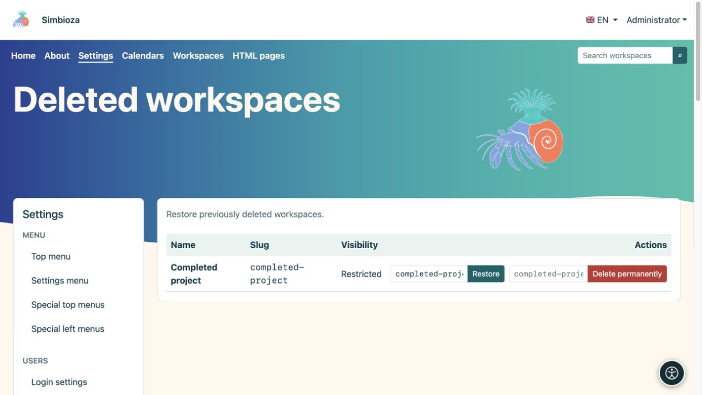
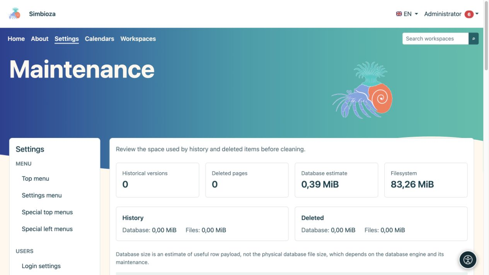

# Administratoreinstellungen für Arbeitsbereiche

> Die Bildschirmaufnahmen zeigen die englische Benutzeroberfläche.

**Für:** den Simbioza-Administrator. Für die tägliche Arbeit verwenden Sie [Verwalten eines Arbeitsbereichs](podrucja-upravljanje_de.md) und [Mitglieder und Berechtigungen](podrucja-clanovi-prava_de.md). Redakteure benötigen keinen Zugriff auf globale Einstellungen.

## Legen Sie das Anfangsverhalten fest

Öffnen Sie **Einstellungen → Arbeitsbereichseinstellungen**. Dieses Formular steuert allgemeine Standardeinstellungen und wer Arbeitsbereiche erstellen darf.

| Einstellung | Zweck |
| --- | --- |
| Stammpfad des Arbeitsbereichs | Der erste Teil öffentlicher Arbeitsbereichsadressen, z. B. `workspace` in `/workspace/project/introduction`. Es darf nicht zu Konflikten mit einer anderen Anwendungsroute kommen. |
| Standardsichtbarkeit | Erste Zielgruppe für einen neuen Arbeitsbereich: eingeschränkte, angemeldete Benutzer oder öffentlich. Ein Arbeitsbereichs-Manager kann später seine Zielgruppe auswählen. |
| Baum zunächst sichtbar | Erste Navigationsanzeige. Durch das Ausblenden des Baums werden weder Berechtigungen entfernt noch die Seite selbst ausgeblendet. |
| Seiteninhalt zunächst sichtbar | Erste Anzeige der Überschriftengliederung der Seite. |
| Erstellen von Arbeitsbereichen | Neben Administratoren dürfen auch Benutzer und Gruppen Arbeitsbereiche erstellen. Dadurch wird nicht auf jeden vorhandenen Arbeitsbereich Zugriff gewährt. |
| Seitenzusammenfassungen | Standardebenen, Artikelanzahl, Reihenfolge und Sichtbarkeit der Anzeigeoptionen für Sammlungen veröffentlichter Seitenauszüge. |

1. Ändern Sie nur die Werte, die Sie benötigen.
2. Suchen Sie unter **Arbeitsbereichserstellung** nach einem Benutzer oder einer Gruppe, wählen Sie das Ergebnis aus und überprüfen Sie die hinzugefügte Liste.
3. Wählen Sie **Einstellungen speichern**.
4. Öffnen Sie die Arbeitsbereichsliste als normaler Benutzer und überprüfen Sie die erwartete Erstellungsaktion.

**Ergebnis:** Neue Auswahlmöglichkeiten folgen den gespeicherten Standardeinstellungen. Durch das Ändern der Standardzielgruppe wird nicht die Zielgruppe jedes vorhandenen Arbeitsbereichs geändert. Das Ändern des Root-Pfads wirkt sich auf öffentliche Adressen aus; überprüfen Sie zunächst die Menüs und vorhandenen Links.

<figure class="my-4">

<figcaption>Standardeinstellungen und Berechtigung zum Erstellen von Arbeitsbereichen.</figcaption>
</figure>

## Wählen Sie Anwendungs-Homepages

Öffnen Sie die **Anwendungshomepage** in den Arbeitsbereichseinstellungen.

1. Wählen Sie für die **Öffentliche Startseite** die integrierte Startseite oder eine veröffentlichte, für Gäste lesbare Seite aus.
2. Verwenden Sie für die **Startseite für angemeldete Benutzer** die öffentliche Startseite wieder oder wählen Sie eine veröffentlichte Seite aus, die für jeden angemeldeten Benutzer ohne gruppenspezifische Rechte lesbar ist.
3. Legen Sie die Sichtbarkeit der Baumstruktur und der Anzeigeoptionen für jede Startseite separat fest.
4. Aktivieren Sie optional **Benutzern erlauben, eine persönliche Homepage auszuwählen**. Ihr Profil bietet nur veröffentlichte Seiten, auf die sie zugreifen können.
5. Wählen Sie **Homepage-Einstellungen speichern**. Überprüfen Sie die Startseite sowohl abgemeldet als auch angemeldet.

**Ergebnis:** Jede Zielgruppe öffnet ihre ausgewählte Startseite. Wenn die Seite verschwindet oder nicht mehr zugänglich ist, wird die nächste verfügbare Standardstartseite verwendet. Durch die Auswahl einer Homepage wird noch kein Zugriff gewährt.

<figure class="my-4">

<figcaption>Wählen Sie separate Homepages für Gäste und alle angemeldeten Benutzer.</figcaption>
</figure>

## Ermöglichen Sie persönliche Arbeitsbereiche

Für diese Funktion sind Simbioza Benutzer und Arbeitsbereiche erforderlich. Öffnen Sie **Einstellungen → Persönliche Arbeitsbereiche**.

| Du willst… | Aktivieren… |
| --- | --- |
| Ein fehlender persönlicher Arbeitsbereich, der bei der nächsten erfolgreichen Anmeldung des Benutzers erstellt werden soll | **Bei der ersten Anmeldung automatisch einen persönlichen Arbeitsbereich erstellen** |
| Benutzer können entscheiden, wann sie ihren eigenen Arbeitsbereich benötigen | Deaktivieren Sie die automatische Erstellung und aktivieren Sie **Benutzern erlauben, einen persönlichen Arbeitsbereich zu erstellen** |
| Derzeit gibt es über diese Wege keine neuen persönlichen Arbeitsbereiche | Schalten Sie beide Optionen aus |

Wählen Sie **Speichern**. Die automatische Erstellung ist nach der Installation aktiviert; die Selbsterstellung ist zunächst deaktiviert und nicht verfügbar, während die automatische Erstellung aktiviert ist. Wenn Sie die Automatisierung aktivieren, wird **nicht sofort der Arbeitsbereich aller erstellt**: Sie wird bei nachfolgenden Anmeldungen wirksam. Durch das Deaktivieren werden vorhandene persönliche Arbeitsbereiche nicht gelöscht.

Zur Selbsterstellung öffnet der Benutzer **Mein Profil → Folgen und Benachrichtigungen → Meinen persönlichen Arbeitsbereich erstellen**. Ein vorhandener Arbeitsbereich ist unter **Mein persönlicher Arbeitsbereich** verfügbar. Der Benutzer erhält zunächst alle sechs Berechtigungen für seinen eigenen eingeschränkten Arbeitsbereich und kann später anderen Personen Zugriff gewähren.

**Erstellte persönliche Arbeitsbereiche** sind eine schreibgeschützte Liste von Benutzern und Links. Es gibt keine Massenerstellung, keine benutzerspezifische Richtlinie oder eine Schaltfläche zur manuellen Erstellung für einen anderen Benutzer. Ein gelöschter persönlicher Arbeitsbereich bleibt seinem Benutzer zugeordnet; Stellen Sie es unter **Gelöschte Arbeitsbereiche** wieder her. Durch eine erneute Anmeldung entsteht kein Ersatz.

<figure class="my-4">

<figcaption>Die automatische Erstellung und die vom Benutzer initiierte Erstellung sind separate Optionen. Die vorhandenen persönlichen Arbeitsbereiche sind unten aufgeführt.</figcaption>
</figure>

## Überprüfen Sie einen gelöschten Arbeitsbereich und stellen Sie ihn wieder her

**Alle Arbeitsbereiche** bietet Inhalt, HTML Export und Verwaltung für den ausgewählten Arbeitsbereich. Befolgen Sie für normale Aktionen den [Manager-Leitfaden](podrucja-upravljanje_de.md).

Um einen wiederherzustellen, öffnen Sie **Gelöschte Arbeitsbereiche**:

1. Finden Sie den richtigen Arbeitsbereich.
2. Überprüfen Sie den vorgeschlagenen **Restore-Slug**; Wählen Sie einen kostenlosen Slug, wenn dessen Adresse bereits verwendet wird.
3. Wählen Sie **Wiederherstellen**.
4. Öffnen Sie den Arbeitsbereich und überprüfen Sie Berechtigungen, Seiten, Anhänge und wichtige Links.

**Ergebnis:** Der vorläufig gelöschte Arbeitsbereich ist mit seinen Berechtigungen wieder verfügbar. **Endgültiges Löschen** ist eine separate Aktion und für die Wiederherstellung nicht erforderlich.

<figure class="my-4">

<figcaption>Aktive, archivierte und eingeschränkte Arbeitsbereiche mit Links zu ihren Einstellungen.</figcaption>
</figure>

<figure class="my-4">

<figcaption>Das abgeschlossene Projekt wird unter den gelöschten Arbeitsbereichen aufgeführt. Wiederherstellen und dauerhaftes Löschen sind unterschiedliche Aktionen. Überprüfen Sie vor der Bestätigung den Namen und den Slug.</figcaption>
</figure>

## Wartung: Zuerst überprüfen und dann eine eingeschränkte Aktion auswählen

**Wartung** zeigt historische Versionen, gelöschte Seiten, eine Schätzung des nützlichen Datenbankinhalts und der Dateinutzung mit einem Vergleich pro Arbeitsbereich. Bei der Datenbankschätzung handelt es sich nicht um die Größe der physischen Datenbankdatei.

- **Suchindex:** Wenn das Suchmodul verfügbar ist, überprüfen Sie seinen Status nach einem großen Import oder einer Wiederherstellung und erstellen Sie es bei Bedarf neu. Originaldokumente werden dadurch nicht verändert. Die Suche erzwingt weiterhin Zugriffsberechtigungen.
- **Vorhandene Bilder optimieren:** erstellt kleinere Webkopien; Originale bleiben erhalten. Der Fortschritt zeigt verarbeitete und übersprungene Elemente an.
- **Seitenverlauf:** Lassen Sie ihn intakt, behalten Sie die neuesten Versionen bei oder entfernen Sie ausreichend alte Versionen. Aktuelle und veröffentlichte Versionen bleiben gemäß der gewählten Richtlinie geschützt.
- **Gelöschte Elemente dauerhaft entfernen:** Wählen Sie das Alter separat aus. Anhänge bleiben erhalten, während eine beibehaltene Version auf sie verweist.

Erstellen Sie vor der irreversiblen Bereinigung ein wiederherstellbares [Backup](admin-sigurnosne-kopije_de.md). Wählen Sie den **Umfang**, die Verlaufsrichtlinie und das Alter der gelöschten Elemente, lesen Sie die Bestätigung und wählen Sie dann **Wartung ausführen**. Wählen Sie für eine begrenzte Aufgabe einen Arbeitsbereich anstelle der gesamten Site aus.

<figure class="my-4">

<figcaption>Bildoptimierung, Bereinigungsumfang, Verlaufsrichtlinie, Alter gelöschter Elemente, unwiderrufliche Bestätigung und dauerhafte Löschung des Arbeitsbereichs sind sichtbar.</figcaption>
</figure>

<figure class="my-4">

<figcaption>Verlaufs-/Gelöscht-Zählungen und Speicherplatzschätzungen helfen Ihnen bei der Auswahl des kleinsten notwendigen Vorgangs.</figcaption>
</figure>

### Einen kompletten Arbeitsbereich dauerhaft löschen

Dies ist nur für einen Arbeitsbereich verfügbar, der bereits vorläufig gelöscht wurde. Geben Sie den genauen Slug ein und bestätigen Sie die Aktion. Es entfernt Inhalte, Verlauf, Anhänge, Berechtigungen, das private Design, spezielle Menüs und zugehörige Moduldaten. Es unterscheidet sich vom Archivieren oder Entfernen einer alten Version. Für die Wiederherstellung ist ein gültiges Backup erforderlich.

Überprüfen Sie nach der Wartung öffentliche und private Inhalte mit den entsprechenden Konten. Für Erscheinungsbild und Navigation gibt es separate Anleitungen: [Designs](teme_de.md) und [Menüs](izbornici_de.md).
