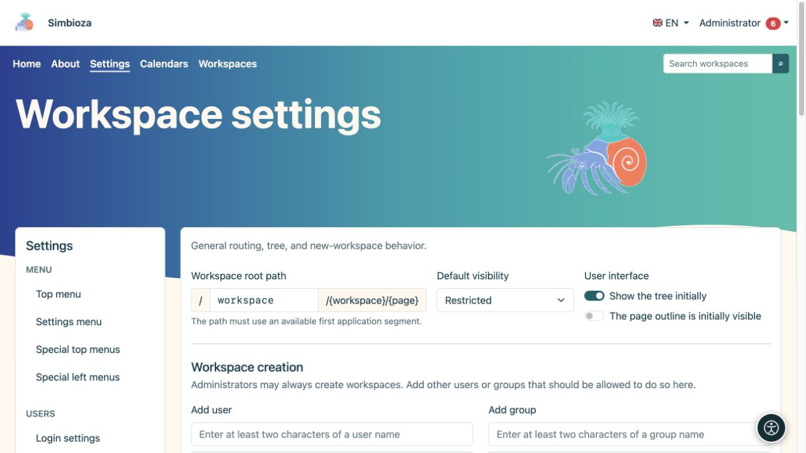
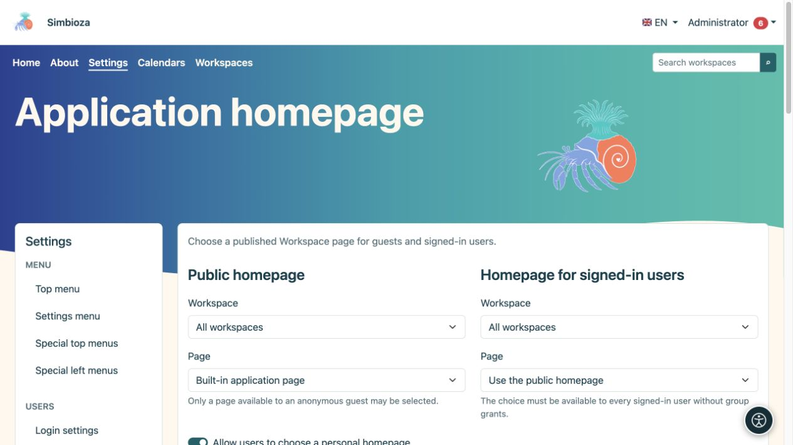
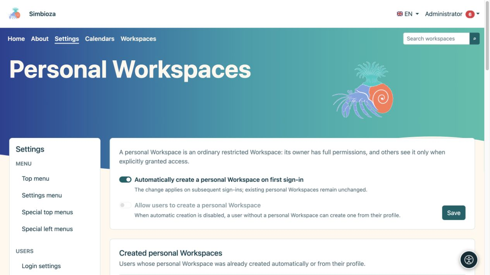
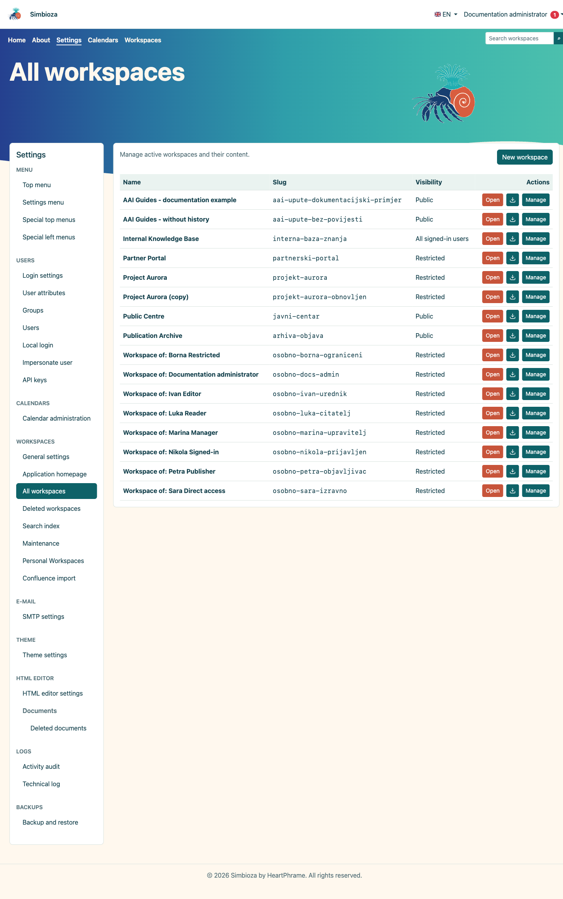
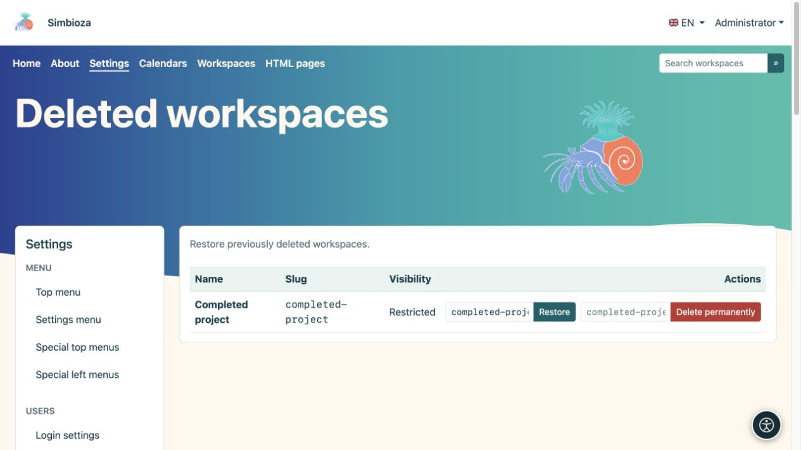
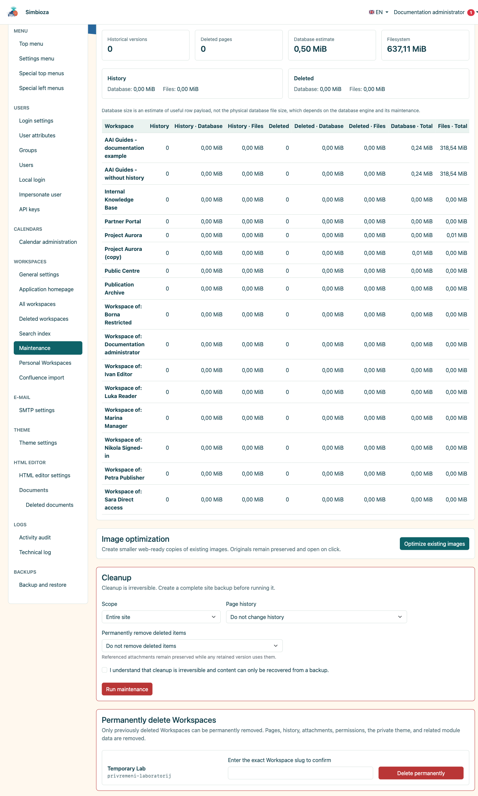
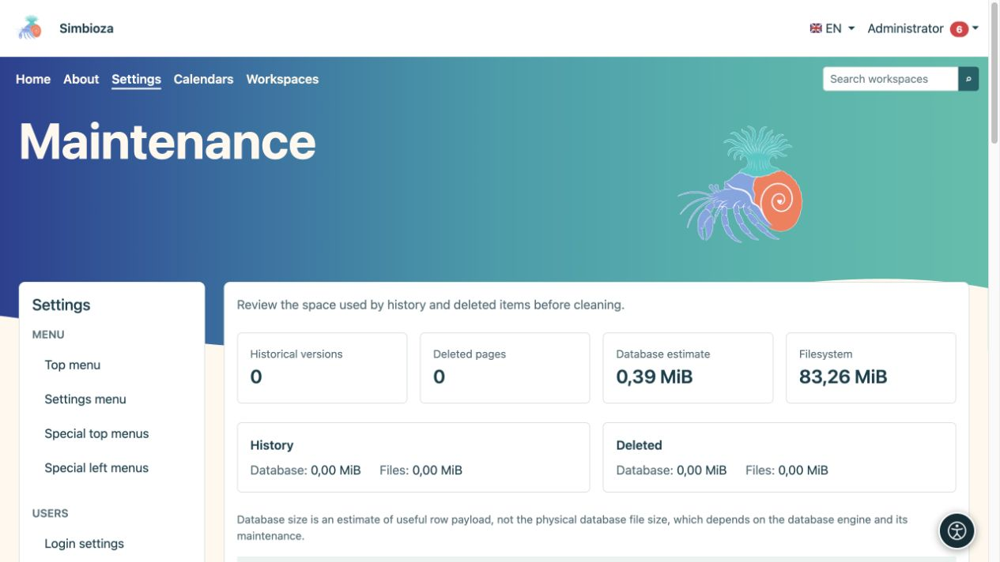

# Administrator settings for workspaces

**For:** the Simbioza administrator. For day-to-day work use [managing a workspace](podrucja-upravljanje_en.md) and [members and permissions](podrucja-clanovi-prava_en.md). Editors do not need access to global Settings.

## Set initial behaviour

Open **Settings → Workspace settings**. This form controls common defaults and who may create workspaces.

| Setting | Purpose |
| --- | --- |
| Workspace root path | The first part of public workspace addresses, such as `workspace` in `/workspace/project/introduction`. It must not conflict with another application route. |
| Default visibility | Initial audience for a new workspace: restricted, signed-in users or public. A workspace manager can later choose its audience. |
| Tree initially visible | Initial navigation display. Hiding the tree does not remove permissions or conceal the page itself. |
| Page contents initially visible | Initial display of the page's heading outline. |
| Workspace creation | Users and groups allowed, in addition to administrators, to create workspaces. This does not grant access to every existing workspace. |
| Page summaries | Default levels, article count, order and display-options visibility for collections of published page excerpts. |

1. Change only the values you need.
2. Under **Workspace creation**, search for a user or group, choose the result and review the added list.
3. Select **Save settings**.
4. Open the workspace list as an ordinary user and check the expected creation action.

**Result:** new choices follow the saved defaults. Changing the default audience does not change every existing workspace's audience. Changing the root path affects public addresses; review menus and existing links first.

<figure class="my-4">

<figcaption>Defaults and permission to create workspaces.</figcaption>
</figure>

## Choose application home pages

Open **Application homepage** within workspace settings.

1. For the **Public homepage**, select the built-in home page or a published page readable by guests.
2. For the **Homepage for signed-in users**, reuse the public home page or select a published page readable by every signed-in user without group-specific rights.
3. Set tree and display-options visibility separately for each home page.
4. Optionally enable **Allow users to choose a personal homepage**. Their profile offers only published pages they can access.
5. Select **Save homepage settings**. Check the start page both signed out and signed in.

**Result:** each audience opens its selected starting page. If the page disappears or becomes inaccessible, the next available default home page is used. Choosing a home page does not itself grant access.

<figure class="my-4">

<figcaption>Choose separate homepages for guests and all signed-in users.</figcaption>
</figure>

## Enable personal workspaces

This feature requires Simbioza User and Workspaces. Open **Settings → Personal Workspaces**.

| You want… | Enable… |
| --- | --- |
| A missing personal workspace to be created at the user's next successful sign-in | **Automatically create a personal Workspace on first sign-in** |
| Users to decide when they need their own workspace | Turn automatic creation off and enable **Allow users to create a personal Workspace** |
| No new personal workspaces through these paths for now | Turn both options off |

Select **Save**. Automatic creation is enabled after installation; self-creation is disabled initially and is unavailable while automatic creation is enabled. Turning automation on **does not immediately create everyone's workspace**: it acts at subsequent sign-ins. Turning it off does not delete existing personal workspaces.

For self-creation, the user opens **My profile → Following and notifications → Create my personal Workspace**. An existing workspace is available under **My personal Workspace**. The user initially receives all six permissions on their own restricted workspace and may later grant access to other people.

**Created personal Workspaces** is a read-only list of users and links. There is no bulk creation, per-user policy or manual creation button for another user. A deleted personal workspace remains mapped to its user; restore it under **Deleted workspaces**. Another sign-in does not create a replacement.

<figure class="my-4">

<figcaption>Automatic creation and user-initiated creation are separate options; existing personal workspaces are listed below.</figcaption>
</figure>

## Review and restore a deleted workspace

**All workspaces** offers content, HTML export and management for the selected workspace. Follow the [manager's guide](podrucja-upravljanje_en.md) for ordinary actions.

To restore one, open **Deleted workspaces**:

1. Find the correct workspace.
2. Check its proposed **Restore slug**; choose a free slug if its address is already in use.
3. Select **Restore**.
4. Open the workspace and check permissions, pages, attachments and important links.

**Result:** the soft-deleted workspace is available again under its permissions. **Permanently delete** is a separate action and is not needed for restoration.

<figure class="my-4">

<figcaption>Active, archived and restricted Workspaces with links to their settings.</figcaption>
</figure>

<figure class="my-4">

<figcaption>Completed project is listed among deleted workspaces. Restore and Delete permanently are different actions; check its name and slug before confirming.</figcaption>
</figure>

## Maintenance: review first, then choose a limited action

**Maintenance** shows historical versions, deleted pages, an estimate of useful database content and file usage, with a per-workspace comparison. The database estimate is not the physical database file size.

- **Search index:** if the search module is available, inspect its status after a large import or restore and rebuild it when necessary. This does not change original documents. Search still enforces access permissions.
- **Optimise existing images:** creates smaller web copies; originals are retained. Progress shows processed and skipped items.
- **Page history:** leave it intact, keep the latest few versions or remove sufficiently old versions. Current and published versions remain protected according to the chosen policy.
- **Permanently remove deleted items:** choose the age separately. Attachments remain while a retained version references them.

Before irreversible cleanup, create a restorable [backup](admin-sigurnosne-kopije_en.md). Choose the **Scope**, history policy and age of deleted items, read the confirmation and then select **Run maintenance**. Choose one workspace rather than the whole site for a limited task.

<figure class="my-4">

<figcaption>Image optimisation, cleanup scope, history policy, deleted-item age, irreversible confirmation and permanent Workspace deletion are visible.</figcaption>
</figure>

<figure class="my-4">

<figcaption>History/deleted counts and space estimates help you choose the smallest necessary operation.</figcaption>
</figure>

### Permanently delete a complete workspace

This is available only for a workspace that has already been soft-deleted. Enter its exact slug and confirm the action. It removes content, history, attachments, permissions, the private theme, special menus and associated module data. It is different from archiving or removing one old version; recovery requires a valid backup.

After maintenance, check public and private content with the appropriate accounts. Appearance and navigation have separate guides: [Themes](teme_en.md) and [Menus](izbornici_en.md).
