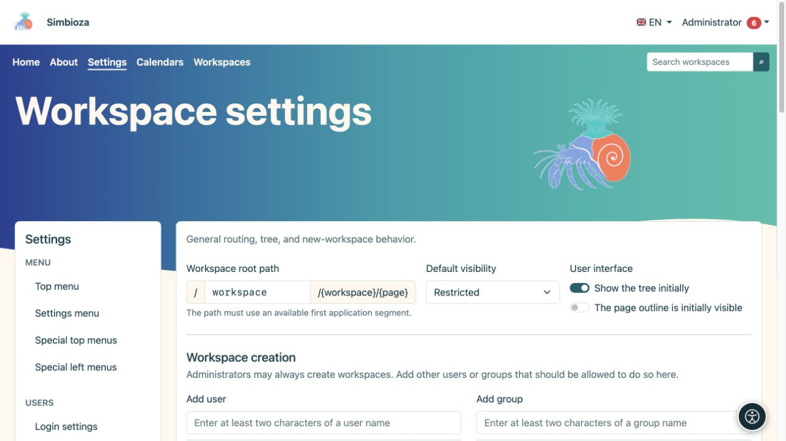
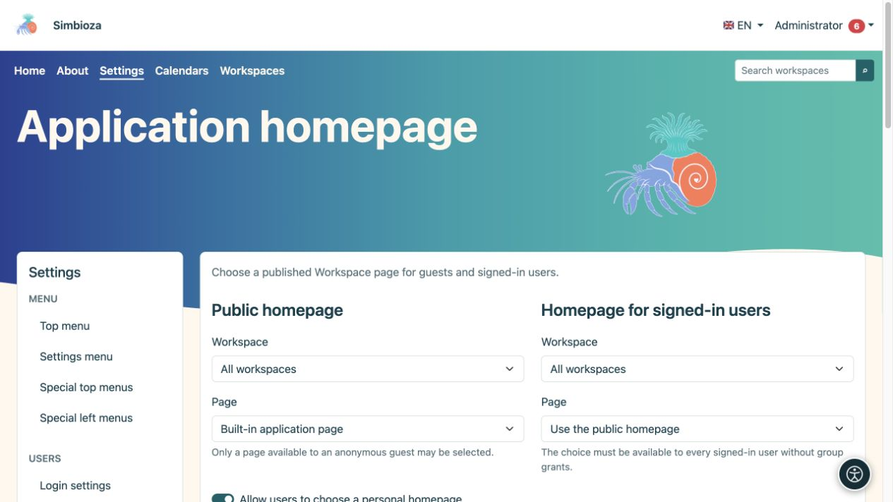
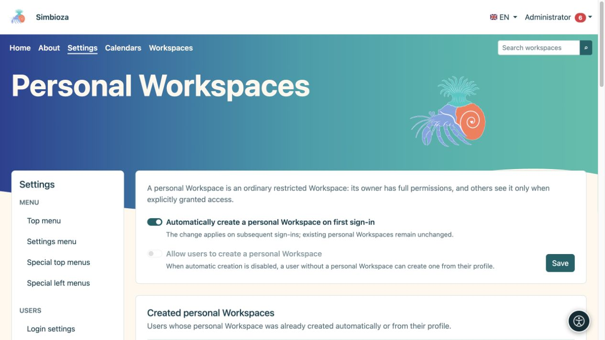
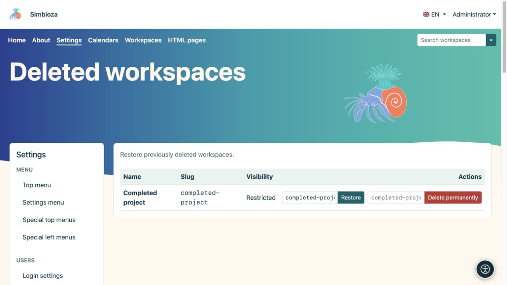
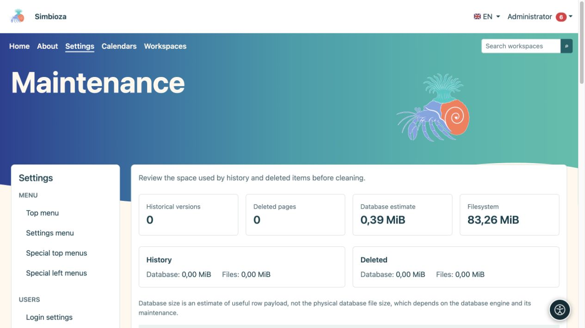

# Configuración administrativa de los espacios de trabajo

> Las capturas de pantalla muestran la interfaz en inglés.

**Para:** el administrador Simbioza. Para el uso diario del trabajo [administrar un espacio de trabajo](podrucja-upravljanje_es.md) y [miembros y permisos](podrucja-clanovi-prava_es.md). Los editores no necesitan acceso a la configuración global.

## Establecer comportamiento inicial

Abra **Configuración → Configuración del espacio de trabajo**. Este formulario controla los valores predeterminados comunes y quién puede crear espacios de trabajo.

| Configuración | Finalidad |
| --- | --- |
| Ruta raíz del espacio de trabajo | La primera parte de las direcciones del espacio de trabajo público, como `workspace` en `/workspace/project/introduction`. No debe entrar en conflicto con otra vía de aplicación. |
| Visibilidad predeterminada | Público inicial para un nuevo espacio de trabajo: restringido, usuarios registrados o público. Posteriormente, un gestor del espacio de trabajo puede elegir su audiencia. |
| Árbol inicialmente visible | Pantalla de navegación inicial. Ocultar el árbol no elimina permisos ni oculta la página en sí. |
| Contenido de la página inicialmente visible | Visualización inicial del esquema del encabezado de la página. |
| Creación de espacio de trabajo | Los usuarios y grupos permitieron, además de los administradores, crear espacios de trabajo. Esto no otorga acceso a todos los espacios de trabajo existentes. |
| Resúmenes de páginas | Niveles predeterminados, recuento de artículos, orden y visibilidad de opciones de visualización para colecciones de extractos de páginas publicadas. |

1. Cambie sólo los valores que necesite.
2. En **Creación de espacio de trabajo**, busque un usuario o grupo, elija el resultado y revise la lista agregada.
3. Seleccione **Guardar configuración**.
4. Abra la lista de espacios de trabajo como un usuario normal y verifique la acción de creación esperada.

**Resultado:** las nuevas opciones siguen los valores predeterminados guardados. Cambiar la audiencia predeterminada no cambia la audiencia de cada espacio de trabajo existente. Cambiar la ruta raíz afecta las direcciones públicas; revise primero los menús y los enlaces existentes.

<figure class="my-4">

<figcaption>Valores predeterminados y permisos para crear espacios de trabajo.</figcaption>
</figure>

## Elija las páginas de inicio de la aplicación

Abra la **Página de inicio de la aplicación** dentro de la configuración del espacio de trabajo.

1. Para la **Página de inicio pública**, seleccione la página de inicio integrada o una página publicada que puedan leer los invitados.
2. Para la **Página de inicio para usuarios que han iniciado sesión**, reutilice la página de inicio pública o seleccione una página publicada que pueda leer cada usuario que haya iniciado sesión sin derechos específicos de grupo.
3. Configure la visibilidad del árbol y de las opciones de visualización por separado para cada página de inicio.
4. Opcionalmente, habilite **Permitir a los usuarios elegir una página de inicio personal**. Su perfil ofrece sólo páginas publicadas a las que pueden acceder.
5. Seleccione **Guardar configuración de la página de inicio**. Consulte la página de inicio tanto cuando haya iniciado sesión como cuando haya iniciado sesión.

**Resultado:** cada audiencia abre su página de inicio seleccionada. Si la página desaparece o se vuelve inaccesible, se utiliza la siguiente página de inicio predeterminada disponible. La elección de una página de inicio no otorga acceso en sí misma.

<figure class="my-4">

<figcaption>Elija páginas de inicio independientes para los invitados y todos los usuarios que hayan iniciado sesión.</figcaption>
</figure>

## Habilitar espacios de trabajo personales

Esta función requiere Simbioza Usuario y espacios de trabajo. Abra **Configuración → Espacios de trabajo personales**.

| Quieres… | Permitir… |
| --- | --- |
| Falta un espacio de trabajo personal que se creará en el próximo inicio de sesión exitoso del usuario | **Crea automáticamente un espacio de trabajo personal al iniciar sesión por primera vez** |
| Los usuarios deciden cuándo necesitan su propio espacio de trabajo. | Desactive la creación automática y habilite **Permitir a los usuarios crear un espacio de trabajo personal** |
| No hay nuevos espacios de trabajo personales a través de estas rutas por ahora | Desactiva ambas opciones |

Seleccione **Guardar**. La creación automática se habilita después de la instalación; la creación automática está deshabilitada inicialmente y no está disponible mientras la creación automática está habilitada. Activar la automatización **no crea inmediatamente el espacio de trabajo de todos**: actúa en inicios de sesión posteriores. Desactivarlo no elimina los espacios de trabajo personales existentes.

Para la creación propia, el usuario abre **Mi perfil → Siguiendo y notificaciones → Crear mi espacio de trabajo personal**. Un espacio de trabajo existente está disponible en **Mi espacio de trabajo personal**. Inicialmente, el usuario recibe los seis permisos en su propio espacio de trabajo restringido y luego puede otorgar acceso a otras personas.

**Espacios de trabajo personales creados** es una lista de usuarios y enlaces de solo lectura. No hay creación masiva, política por usuario o botón de creación manual para otro usuario. Un espacio de trabajo personal eliminado permanece asignado a su usuario; restáurelo en **Espacios de trabajo eliminados**. Otro inicio de sesión no crea un reemplazo.

<figure class="my-4">

<figcaption>La creación automática y la creación iniciada por el usuario son opciones independientes; Los espacios de trabajo personales existentes se enumeran a continuación.</figcaption>
</figure>

## Revisar y restaurar un espacio de trabajo eliminado

**Todos los espacios de trabajo** ofrece contenido, HTML exportación y administración para el espacio de trabajo seleccionado. Siga la [guía del gestor](podrucja-upravljanje_es.md) para acciones ordinarias.

Para restaurar uno, abra **Espacios de trabajo eliminados**:

1. Encuentre el espacio de trabajo correcto.
2. Consulte su propuesta **Restore slug**; elija un slug disponible si su dirección ya está en uso.
3. Seleccione **Restaurar**.
4. Abra el espacio de trabajo y verifique permisos, páginas, archivos adjuntos y enlaces importantes.

**Resultado:** el espacio de trabajo eliminado temporalmente vuelve a estar disponible según sus permisos. **Eliminar permanentemente** es una acción independiente y no es necesaria para la restauración.

<figure class="my-4">

<figcaption>Espacios de trabajo activos, archivados y restringidos con enlaces a sus configuraciones.</figcaption>
</figure>

<figure class="my-4">

<figcaption>El proyecto completado aparece entre los espacios de trabajo eliminados. Restaurar y Eliminar permanentemente son acciones diferentes; verifique su nombre y slug antes de confirmar.</figcaption>
</figure>

## Mantenimiento: revise primero, luego elija una acción limitada

**Mantenimiento** muestra versiones históricas, páginas eliminadas, una estimación del contenido útil de la base de datos y el uso de archivos, con una comparación por espacio de trabajo. La estimación de la base de datos no es el tamaño del archivo físico de la base de datos.

- **Índice de búsqueda:** si el módulo de búsqueda está disponible, inspeccione su estado después de una importación grande o restáurelo y reconstrúyalo cuando sea necesario. Esto no cambia los documentos originales. La búsqueda todavía exige permisos de acceso.
- **Optimiza imágenes existentes:** crea copias web más pequeñas; Se conservan los originales. El progreso muestra los elementos procesados ​​y omitidos.
- **Historial de la página:** déjelo intacto, conserve las últimas versiones o elimine las versiones suficientemente antiguas. Las versiones actuales y publicadas permanecen protegidas según la política elegida.
- **Eliminar permanentemente elementos eliminados:** elige la edad por separado. Los archivos adjuntos permanecen mientras una versión retenida hace referencia a ellos.

Antes de una limpieza irreversible, cree una [copia de seguridad restaurable](admin-sigurnosne-kopije_es.md). Elija el **Ámbito**, la política del historial y la antigüedad de los elementos eliminados, lea la confirmación y seleccione **Ejecutar mantenimiento**. Para una tarea limitada, elija un solo espacio de trabajo en lugar de todo el sitio.

<figure class="my-4">

<figcaption>Son visibles la optimización de la imagen, el alcance de la limpieza, la política del historial, la antigüedad de los elementos eliminados, la confirmación irreversible y la eliminación permanente del espacio de trabajo.</figcaption>
</figure>

<figure class="my-4">

<figcaption>El historial/recuentos eliminados y las estimaciones de espacio le ayudan a elegir la operación más pequeña necesaria.</figcaption>
</figure>

### Eliminar permanentemente un espacio de trabajo completo

Esto está disponible solo para un espacio de trabajo que ya ha sido eliminado temporalmente. Ingrese su slug exacto y confirme la acción. Elimina contenido, historial, archivos adjuntos, permisos, el tema privado, menús especiales y datos del módulo asociado. Es diferente a archivar o eliminar una versión anterior; la recuperación requiere una copia de seguridad válida.

Después del mantenimiento, verifique el contenido público y privado con las cuentas apropiadas. La apariencia y la navegación tienen guías independientes: [Temas](teme_es.md) y [Menús](izbornici_es.md).
