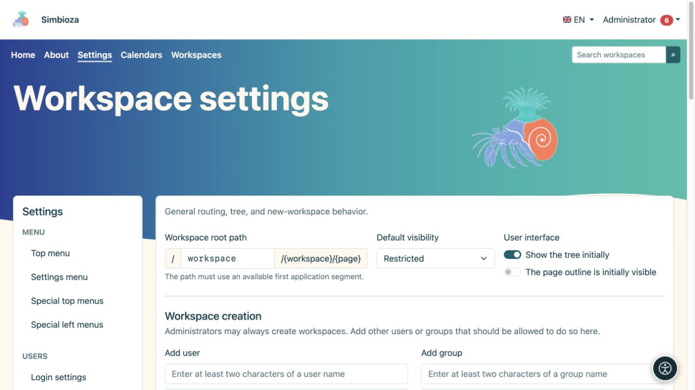
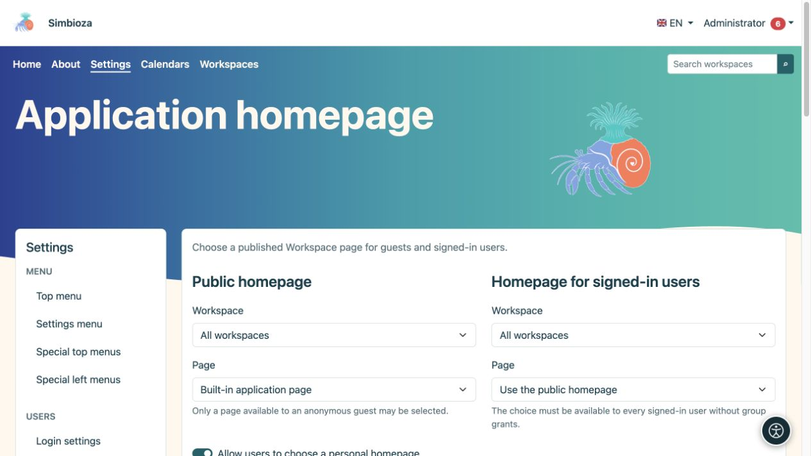
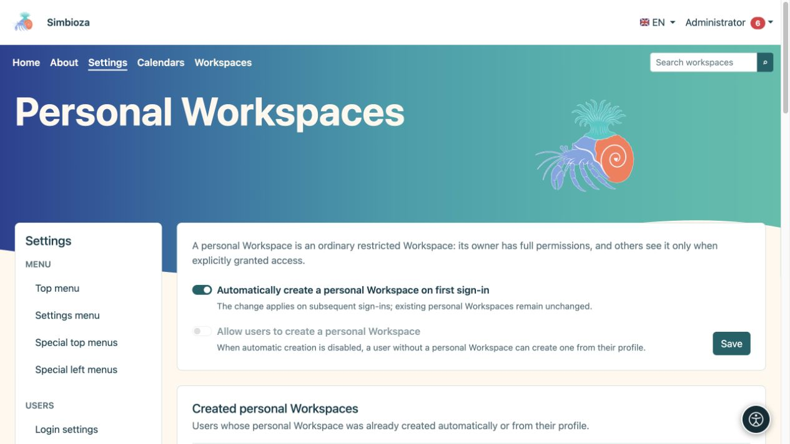
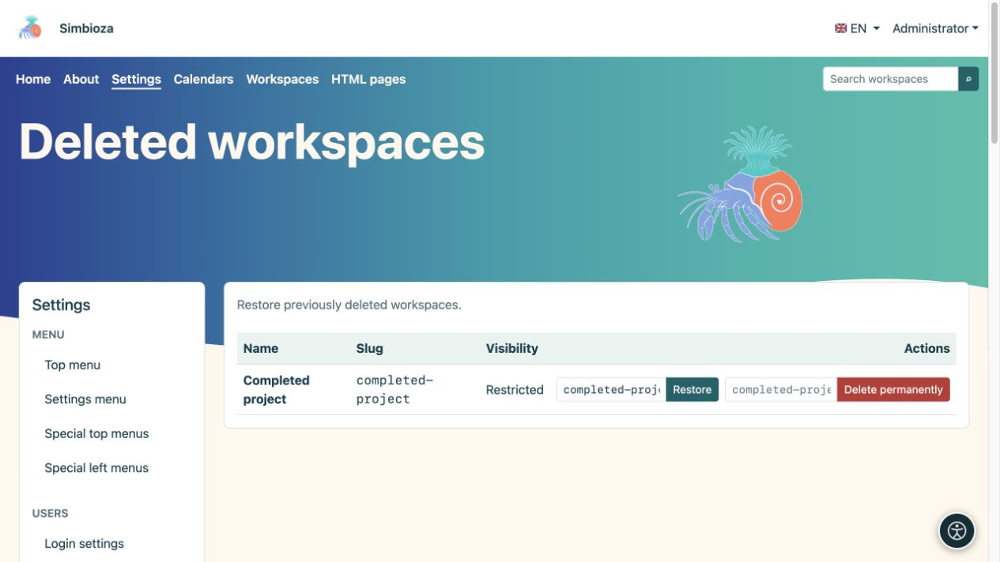
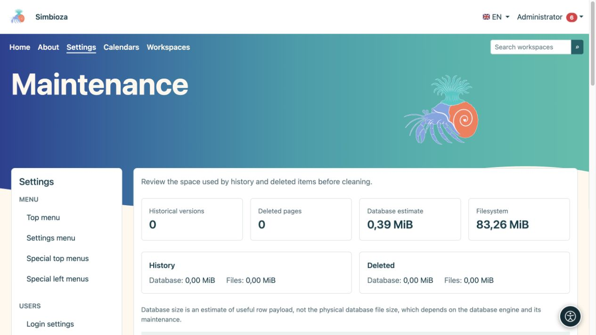

# Paramètres d’administration des espaces de travail

> Les captures d’écran présentent l’interface en anglais.

**Pour :** l'administrateur Simbioza. Pour le travail quotidien, utilisez [gestion d'un espace de travail](podrucja-upravljanje_fr.md) et [membres et autorisations](podrucja-clanovi-prava_fr.md). Les éditeurs n'ont pas besoin d'accéder aux paramètres globaux.

## Définir le comportement initial

Ouvrez **Paramètres → Paramètres de l'espace de travail**. Ce formulaire contrôle les valeurs par défaut courantes et détermine qui peut créer des espaces de travail.

| Paramètre | But |
| --- | --- |
| Chemin racine de l'espace de travail | La première partie des adresses de l'espace de travail public, telles que `workspace` dans `/workspace/project/introduction`. Il ne doit pas entrer en conflit avec une autre voie d'application. |
| Visibilité par défaut | Audience initiale d'un nouvel espace de travail : utilisateurs restreints, connectés ou public. Un gestionnaire d’espace de travail peut ultérieurement choisir son audience. |
| Arbre initialement visible | Affichage initial de la navigation. Masquer l’arborescence ne supprime pas les autorisations et ne masque pas la page elle-même. |
| Contenu de la page initialement visible | Affichage initial du plan du titre de la page. |
| Création d'espace de travail | Utilisateurs et groupes autorisés, en plus des administrateurs, à créer des espaces de travail. Cela n'accorde pas l'accès à tous les espaces de travail existants. |
| Résumés des pages | Niveaux par défaut, nombre d'articles, visibilité des options d'ordre et d'affichage pour les collections d'extraits de pages publiées. |

1. Modifiez uniquement les valeurs dont vous avez besoin.
2. Sous **Création d'espace de travail**, recherchez un utilisateur ou un groupe, choisissez le résultat et examinez la liste ajoutée.
3. Sélectionnez **Enregistrer les paramètres**.
4. Ouvrez la liste des espaces de travail en tant qu'utilisateur ordinaire et vérifiez l'action de création attendue.

**Résultat :** les nouveaux choix suivent les valeurs par défaut enregistrées. La modification de l'audience par défaut ne modifie pas l'audience de chaque espace de travail existant. La modification du chemin racine affecte les adresses publiques ; examinez d’abord les menus et les liens existants.

<figure class="my-4">

<figcaption>Valeurs par défaut et autorisation de créer des espaces de travail.</figcaption>
</figure>

## Choisir les pages d'accueil de l'application

Ouvrez la **page d'accueil de l'application** dans les paramètres de l'espace de travail.

1. Pour la **page d'accueil publique**, sélectionnez la page d'accueil intégrée ou une page publiée lisible par les invités.
2. Pour la **Page d'accueil pour les utilisateurs connectés**, réutilisez la page d'accueil publique ou sélectionnez une page publiée lisible par chaque utilisateur connecté sans droits spécifiques au groupe.
3. Définissez la visibilité de l’arborescence et des options d’affichage séparément pour chaque page d’accueil.
4. Activez éventuellement **Autoriser les utilisateurs à choisir une page d'accueil personnelle**. Leur profil propose uniquement les pages publiées auxquelles ils peuvent accéder.
5. Sélectionnez **Enregistrer les paramètres de la page d'accueil**. Vérifiez la page de démarrage à la fois déconnecté et connecté.

**Résultat :** chaque audience ouvre la page de démarrage sélectionnée. Si la page disparaît ou devient inaccessible, la prochaine page d'accueil par défaut disponible est utilisée. Le choix d'une page d'accueil ne donne pas en soi l'accès.

<figure class="my-4">

<figcaption>Choisissez des pages d'accueil distinctes pour les invités et tous les utilisateurs connectés.</figcaption>
</figure>

## Activer les espaces de travail personnels

Cette fonctionnalité nécessite Simbioza utilisateur et espaces de travail. Ouvrez **Paramètres → Espaces de travail personnels**.

| Tu veux… | Activer… |
| --- | --- |
| Un espace de travail personnel manquant à créer lors de la prochaine connexion réussie de l'utilisateur | **Créez automatiquement un espace de travail personnel lors de la première connexion** |
| Les utilisateurs décident quand ils ont besoin de leur propre espace de travail | Désactivez la création automatique et activez **Autoriser les utilisateurs à créer un espace de travail personnel** |
| Aucun nouvel espace de travail personnel via ces chemins pour l'instant | Désactivez les deux options |

Sélectionnez **Enregistrer**. La création automatique est activée après l'installation ; l'auto-création est initialement désactivée et n'est pas disponible lorsque la création automatique est activée. L'activation de l'automatisation **ne crée pas immédiatement l'espace de travail de tout le monde** : elle agit lors des connexions ultérieures. Le désactiver ne supprime pas les espaces de travail personnels existants.

Pour l'auto-création, l'utilisateur ouvre **Mon profil → Suivis et notifications → Créer mon espace de travail personnel**. Un espace de travail existant est disponible sous **Mon espace de travail personnel**. L'utilisateur reçoit initialement les six autorisations sur son propre espace de travail restreint et peut ensuite accorder l'accès à d'autres personnes.

**Espaces de travail personnels créés** est une liste en lecture seule d'utilisateurs et de liens. Il n'y a pas de création groupée, de politique par utilisateur ou de bouton de création manuelle pour un autre utilisateur. Un espace de travail personnel supprimé reste mappé à son utilisateur ; restaurez-le sous **Espaces de travail supprimés**. Une autre connexion ne crée pas de remplacement.

<figure class="my-4">

<figcaption>La création automatique et la création initiée par l'utilisateur sont des options distinctes ; les espaces de travail personnels existants sont répertoriés ci-dessous.</figcaption>
</figure>

## Examiner et restaurer un espace de travail supprimé

**Tous les espaces de travail** propose du contenu, l'exportation HTML et la gestion pour l'espace de travail sélectionné. Suivez le [guide du gestionnaire](podrucja-upravljanje_fr.md) pour les actions ordinaires.

Pour en restaurer un, ouvrez **Espaces de travail supprimés** :

1. Trouvez le bon espace de travail.
2. Vérifiez son **Slug de restauration** proposé ; choisissez un slug gratuit si son adresse est déjà utilisée.
3. Sélectionnez **Restaurer**.
4. Ouvrez l'espace de travail et vérifiez les autorisations, les pages, les pièces jointes et les liens importants.

**Résultat :** l'espace de travail supprimé de manière réversible est à nouveau disponible sous ses autorisations. **Supprimer définitivement** est une action distincte et n'est pas nécessaire pour la restauration.

<figure class="my-4">

<figcaption>Espaces de travail actifs, archivés et restreints avec des liens vers leurs paramètres.</figcaption>
</figure>

<figure class="my-4">

<figcaption>Le projet terminé est répertorié parmi les espaces de travail supprimés. Restaurer et Supprimer définitivement sont des actions différentes ; vérifiez son nom et son slug avant de confirmer.</figcaption>
</figure>

## Maintenance : examinez d'abord, puis choisissez une action limitée

**Maintenance** affiche les versions historiques, les pages supprimées, une estimation du contenu utile de la base de données et de l'utilisation des fichiers, avec une comparaison par espace de travail. L'estimation de la base de données ne correspond pas à la taille physique du fichier de base de données.

- **Index de recherche :** si le module de recherche est disponible, inspectez son état après une importation importante ou restaurez-le et reconstruisez-le si nécessaire. Cela ne modifie pas les documents originaux. La recherche applique toujours les autorisations d'accès.
- **Optimisez les images existantes :** crée des copies Web plus petites ; les originaux sont conservés. La progression montre les éléments traités et ignorés.
- **Historique de la page :** laissez-le intact, conservez les dernières versions ou supprimez les versions suffisamment anciennes. Les versions actuelles et publiées restent protégées selon la politique choisie.
- **Supprimez définitivement les éléments supprimés :** choisissez l'âge séparément. Les pièces jointes restent tandis qu'une version conservée les référence.

Avant un nettoyage irréversible, créez une [sauvegarde restaurable](admin-sigurnosne-kopije_fr.md). Choisissez la **Portée**, la politique de l’historique et l’ancienneté des éléments supprimés, lisez la confirmation, puis sélectionnez **Exécuter la maintenance**. Pour une tâche limitée, choisissez un seul espace de travail plutôt que l’ensemble du site.

<figure class="my-4">

<figcaption>L'optimisation de l'image, la portée du nettoyage, la politique d'historique, l'âge des éléments supprimés, la confirmation irréversible et la suppression permanente de l'espace de travail sont visibles.</figcaption>
</figure>

<figure class="my-4">

<figcaption>L'historique/comptes supprimés et les estimations d'espace vous aident à choisir la plus petite opération nécessaire.</figcaption>
</figure>

### Supprimer définitivement un espace de travail complet

Ceci est disponible uniquement pour un espace de travail qui a déjà été supprimé de manière logicielle. Entrez son slug exact et confirmez l'action. Il supprime le contenu, l'historique, les pièces jointes, les autorisations, le thème privé, les menus spéciaux et les données du module associé. Cela diffère de l'archivage ou de la suppression d'une ancienne version ; la récupération nécessite une sauvegarde valide.

Après la maintenance, vérifiez le contenu public et privé avec les comptes appropriés. L'apparence et la navigation ont des guides distincts : [Thèmes](teme_fr.md) et [Menus](izbornici_fr.md).
