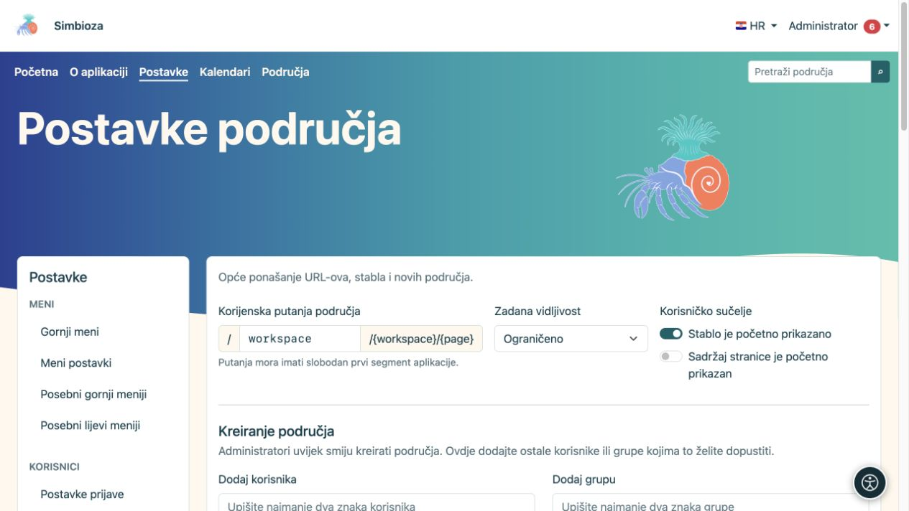
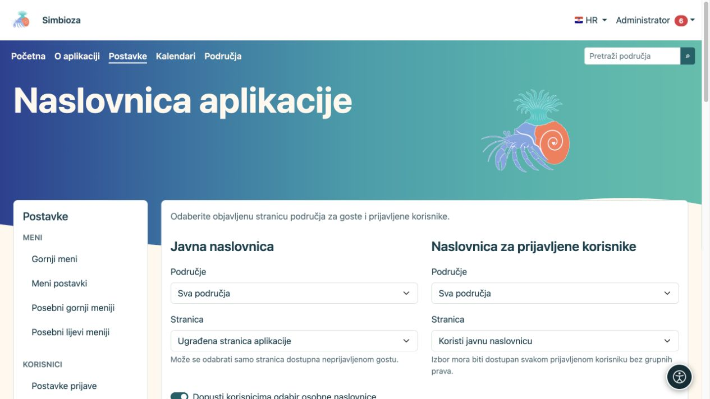
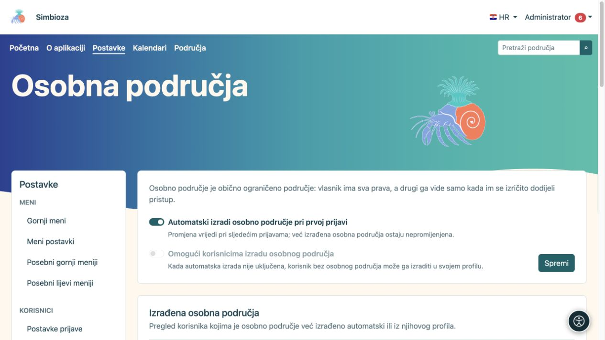
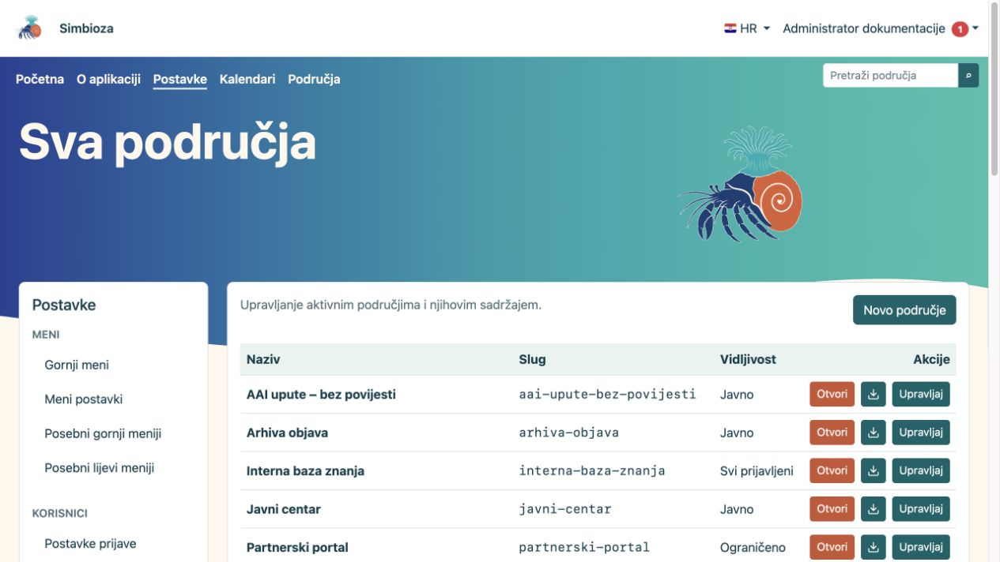
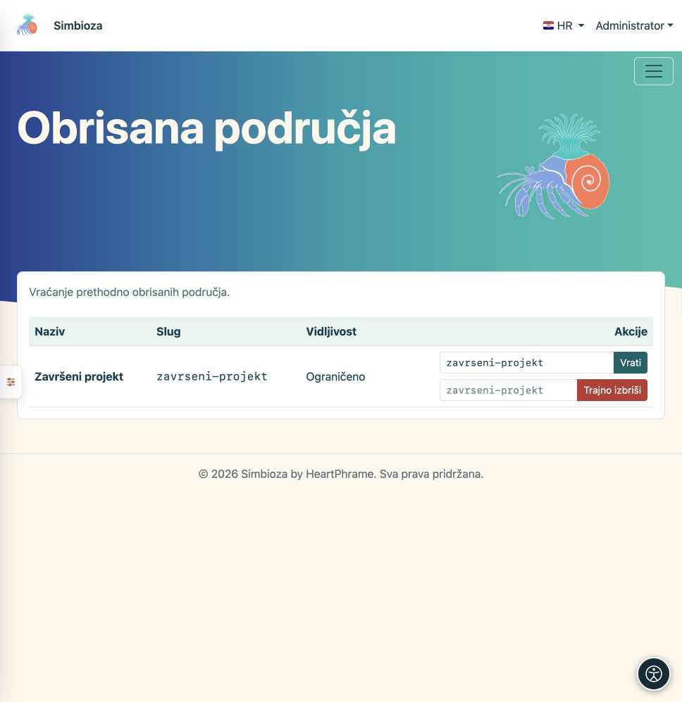
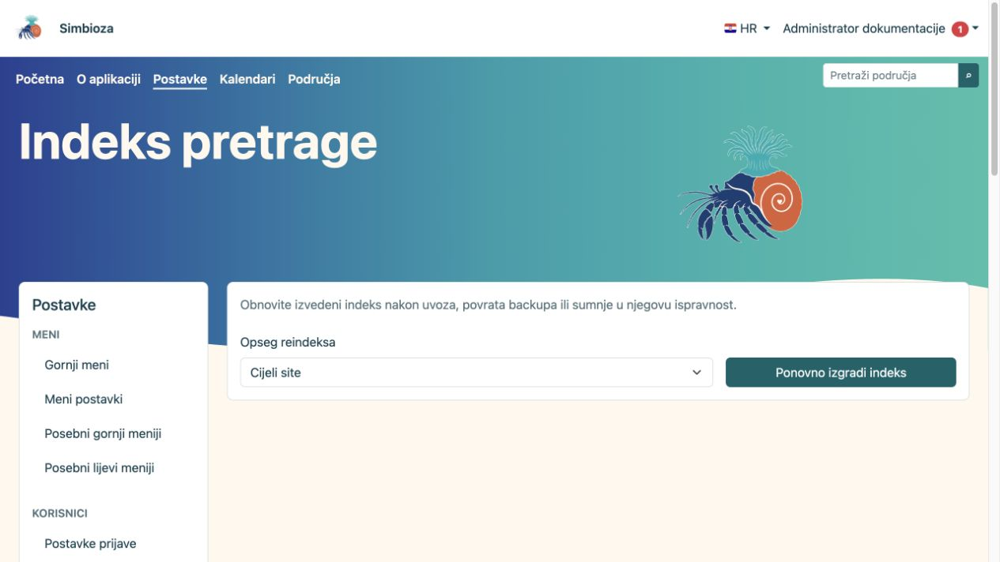
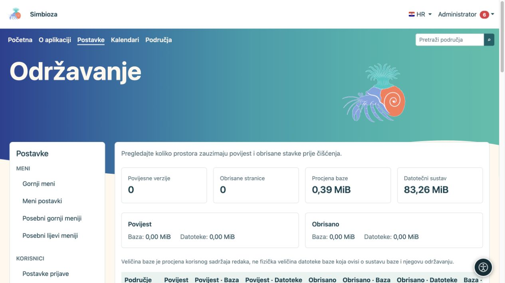
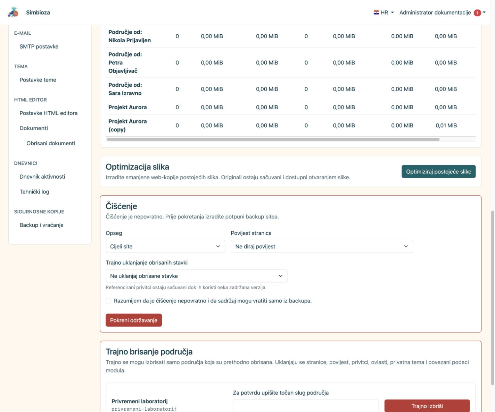
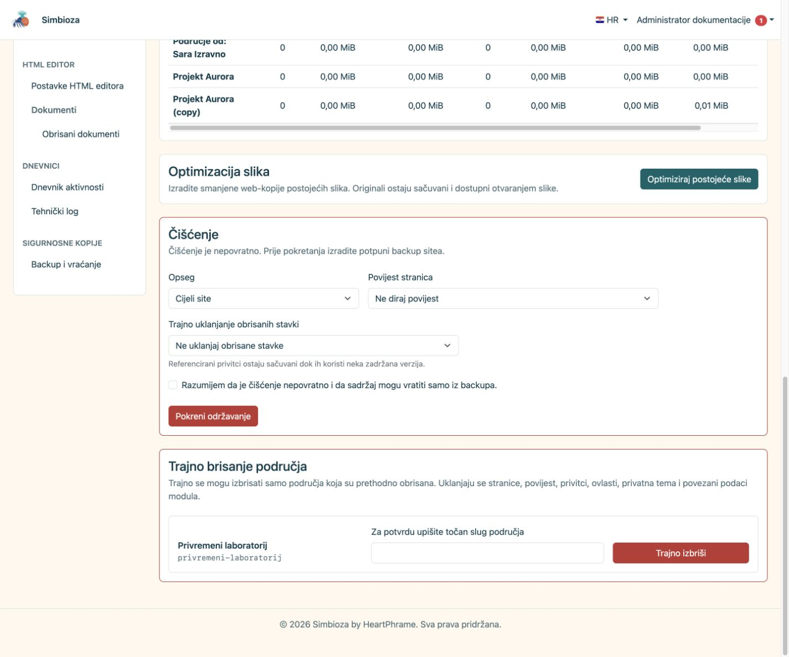

# Administratorske postavke područja

**Za koga:** za administratora Simbioze. Za uređivanje vlastitog prostora koristite [upravljanje područjem](podrucja-upravljanje_hr.md); za dodjeljivanje pristupa [članove i prava](podrucja-clanovi-prava_hr.md). Globalne Postavke nisu potrebne svakom uredniku.

## Podesite početno ponašanje

Otvorite **Postavke → Postavke područja**. Ovaj obrazac određuje zajedničke zadane vrijednosti i tko smije stvarati nova područja.

| Postavka | Što određuje |
| --- | --- |
| Korijenska putanja područja | Prvi dio javnih adresa područja; primjerice `workspace` u `/workspace/projekt/uvod`. Mora biti slobodan dio adrese aplikacije. |
| Zadana vidljivost | Početni izbor za novo područje: ograničeno, svim prijavljenima ili javno. Upravitelj pojedinog područja poslije bira njegovu publiku. |
| Stablo je početno prikazano | Početni prikaz navigacije. Skrivanje stabla ne ukida prava niti skriva samu stranicu. |
| Sadržaj stranice je početno prikazan | Početni prikaz popisa naslova na stranici. |
| Kreiranje područja | Korisnici i grupe kojima se, uz administratora, dopušta stvaranje novih područja. To ne daje pravo nad svim postojećim područjima. |
| Sažetci stranica | Zadane razine, broj članaka, redoslijed i prikaz opcija za zbirku isječaka objavljenih stranica. |

1. Promijenite samo potrebne vrijednosti.
2. U odjeljku **Kreiranje područja** pronađite osobu ili grupu pretragom, odaberite rezultat i pregledajte popis dodanih.
3. Odaberite **Spremi postavke**.
4. Otvorite popis područja kao obični korisnik i provjerite očekivanu radnju stvaranja.

**Rezultat:** novi odabiri slijede spremljena pravila. Promjena zadanog izbora nije masovna promjena vidljivosti postojećih područja. Promjena korijenske putanje utječe na javne adrese; prije nje provjerite izbornike i postojeće poveznice.

<figure class="my-4">

<figcaption>Zadane vrijednosti i ovlasti stvaranja područja.</figcaption>
</figure>

## Odaberite naslovnice aplikacije

Otvorite **Naslovnica aplikacije** unutar postavki područja.

1. Za **Javnu naslovnicu** odaberite ugrađenu naslovnicu ili objavljenu stranicu koju može čitati gost.
2. Za **Naslovnicu za prijavljene korisnike** odaberite korištenje javne naslovnice ili objavljenu stranicu dostupnu svim prijavljenima, bez posebnog članstva u grupi.
3. Zasebno odredite vidljivost stabla i opcija prikaza za svaku naslovnicu.
4. Po želji uključite **Dopusti korisnicima odabir osobne naslovnice**. U profilu korisnik može birati samo objavljene stranice kojima ima pristup.
5. Odaberite **Spremi postavke naslovnice**. Provjerite početnu stranicu odjavljeni i prijavljeni.

**Rezultat:** odgovarajuća publika otvara odabranu početnu stranicu. Ako ona nestane ili joj se opozove pristup, primjenjuje se sljedeća dostupna zadana naslovnica. Postavljanje naslovnice samo po sebi ne dodjeljuje prava.

<figure class="my-4">

<figcaption>Odvojite naslovnicu gosta i svih prijavljenih korisnika.</figcaption>
</figure>

## Omogućite osobna područja

Ova se stavka pojavljuje uz modul Simbioza User i Područja. Otvorite **Postavke → Osobna područja**.

| Želite… | Uključite… |
| --- | --- |
| Da se nedostajuće osobno područje izradi pri sljedećoj uspješnoj prijavi korisnika | **Automatski izradi osobno područje pri prvoj prijavi** |
| Da korisnik sam odluči kada mu treba osobno područje | Isključite automatsku izradu i uključite **Omogući korisnicima izradu osobnog područja** |
| Da se nova osobna područja zasad ne izrađuju tim putovima | Isključite obje mogućnosti |

Odaberite **Spremi**. Automatska izrada je zadano uključena nakon instalacije; samostalna je zadano isključena i nije raspoloživa dok je uključena automatska izrada. Uključivanje automatske izrade **ne izrađuje sva područja odmah**: primjenjuje se pri sljedećim prijavama. Isključivanje ne briše postojeća osobna područja.

Za samostalnu izradu korisnik otvara **Moj profil → Praćenje i obavijesti → Izradi moje osobno područje**. Postojeće otvara preko **Moje osobno područje**. Korisnik početno dobiva svih šest prava nad vlastitim ograničenim područjem i potom sam može dodijeliti pristup drugima.

Tablica **Izrađena osobna područja** služi pregledu korisnika i poveznica. Nema masovne izrade, pravila po pojedinom korisniku niti gumba za ručnu izradu za drugoga. Obrisano osobno područje ostaje povezano s korisnikom; vratite ga kroz **Obrisana područja**. Sljedeća prijava ne stvara zamjensko područje.

<figure class="my-4">

<figcaption>Automatska izrada i korisnička izrada dvije su odvojene mogućnosti; pregled postojećih područja nalazi se ispod.</figcaption>
</figure>

## Pregledajte i vratite obrisano područje

U **Sva područja** možete otvoriti sadržaj, HTML izvoz ili upravljanje odabranim područjem. Za redovne radnje vrijede [upute upravitelju](podrucja-upravljanje_hr.md).

Za povrat otvorite **Obrisana područja**:

1. Pronađite točno područje.
2. Provjerite predloženi **Slug za vraćanje**; ako je adresa zauzeta, odaberite slobodan slug.
3. Odaberite **Vrati**.
4. Otvorite područje, provjerite prava, stranice, privitke i važne poveznice.

**Rezultat:** meko obrisano područje ponovno je dostupno prema svojim pravima. **Trajno izbriši** je druga radnja i nije potrebna za vraćanje.

<figure class="my-4">

<figcaption>Administrator vidi aktivna, arhivirana i ograničena područja te može otvoriti njihove postavke.</figcaption>
</figure>

<figure class="my-4">

<figcaption>Završeni projekt nalazi se među obrisanim područjima. Vraćanje i trajno brisanje odvojene su radnje; prije potvrde provjerite naziv i slug.</figcaption>
</figure>

## Održavanje: prvo pregled, zatim najmanja potrebna radnja

**Održavanje** prikazuje broj povijesnih verzija, obrisanih stranica, procjenu korisnog sadržaja baze i zauzeće datoteka, uz usporedbu po području. Procjena baze nije fizička veličina datoteke baze podataka.

- **Indeks pretrage:** ako je modul pretrage dostupan, nakon većeg uvoza ili vraćanja pregledajte stanje pa po potrebi obnovite indeks. To ne mijenja izvorne dokumente. Prava pristupa i dalje se provjeravaju pri pretrazi.
- **Optimiziraj postojeće slike:** stvara manje web-kopije; izvornici ostaju sačuvani. Prikaz napretka pokazuje obrađene i preskočene stavke.
- **Povijest stranica:** možete je ostaviti, sačuvati zadnjih nekoliko verzija ili ukloniti dovoljno stare verzije. Aktualne i objavljene verzije zadržavaju se prema odabranoj politici.
- **Trajno uklanjanje obrisanih stavki:** zaseban izbor starosti. Privitci ostaju dok ih koristi zadržana verzija.

Prije nepovratnog čišćenja napravite provjerljivu [sigurnosnu kopiju](admin-sigurnosne-kopije_hr.md). Odaberite **Opseg**, politiku povijesti i starost obrisanih stavki, pročitajte potvrdu i tek tada odaberite **Pokreni održavanje**. Za manji zahvat odaberite jedno područje umjesto cijelog sitea.

<figure class="my-4">

<figcaption>Stanje indeksa i administratorske akcije za ponovnu izgradnju pretraživih zapisa.</figcaption>
</figure>

<figure class="my-4">

<figcaption>Broj povijesnih i obrisanih zapisa te procjena prostora pomažu odabrati najmanji potreban zahvat.</figcaption>
</figure>

<figure class="my-4">

<figcaption>Vidljivi su opseg, politika povijesti, starost obrisanih stavki, potvrda nepovratnosti i gumb Pokreni održavanje.</figcaption>
</figure>

### Trajno brisanje cijelog područja

Dostupno je samo za već meko obrisano područje. Unesite njegov točan slug i potvrdite radnju. Uklanjaju se sadržaj, povijest, privitci, prava, privatna tema, posebni izbornici i povezani podatci modula. To nije arhiviranje ni čišćenje jedne inačice; povrat je moguć samo iz valjane sigurnosne kopije.

<figure class="my-4">

<figcaption>Za potvrdu se mora upisati točan slug; uklanjanje obuhvaća stranice, povijest, privitke, ovlasti, privatnu temu i podatke povezanih modula.</figcaption>
</figure>

Nakon održavanja provjerite javni sadržaj i privatni sadržaj odgovarajućim računima. Za promjenu izgleda i navigacije koristite zasebne upute za [Teme](teme_hr.md) i [Izbornike](izbornici_hr.md).
