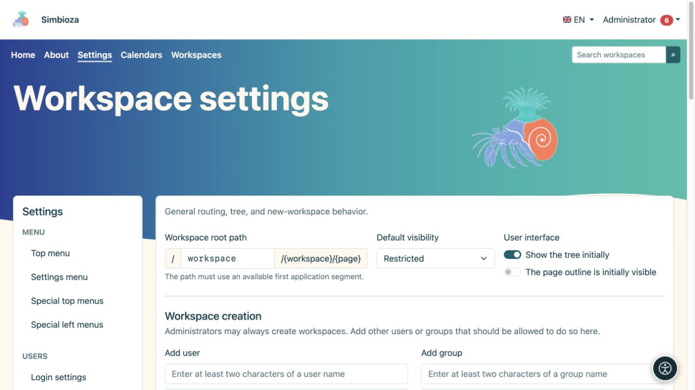
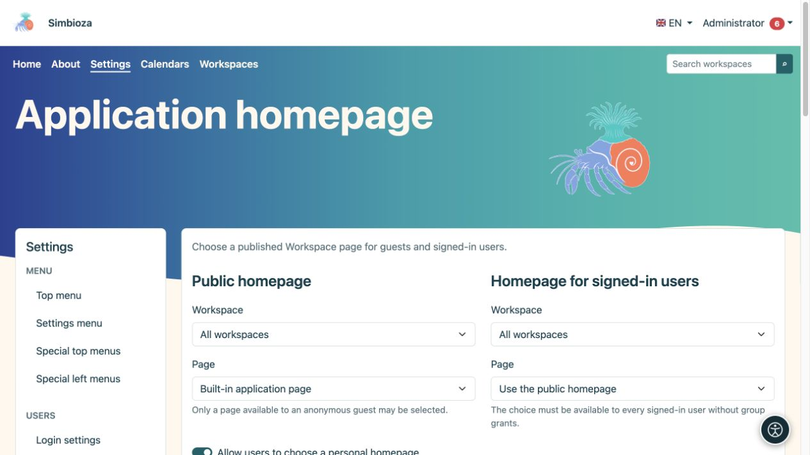
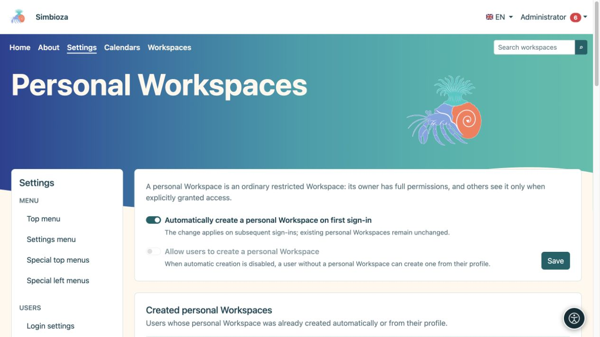
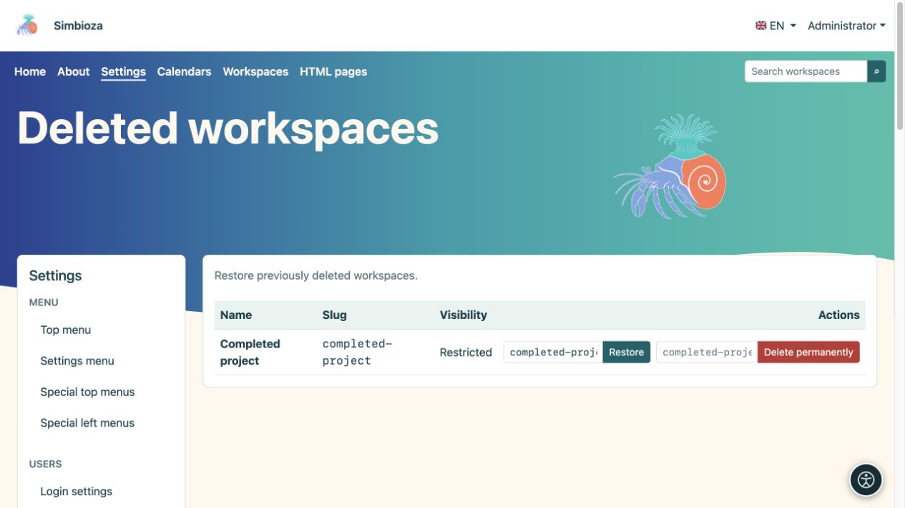
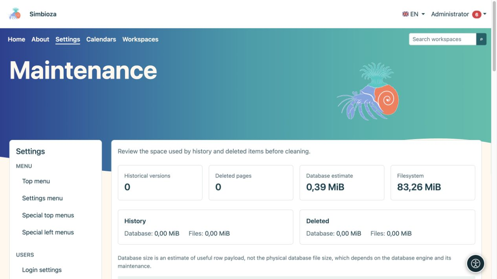

# Impostazioni dell'amministratore per le aree di lavoro

> Le schermate mostrano l’interfaccia in inglese.

**Per:** l'amministratore Simbioza. Per il lavoro quotidiano utilizzare [gestione di un'area di lavoro](podrucja-upravljanje_it.md) e [membri e autorizzazioni](podrucja-clanovi-prava_it.md). Gli editor non hanno bisogno di accedere alle Impostazioni globali.

## Imposta il comportamento iniziale

Apri **Impostazioni → Impostazioni area di lavoro**. Questo modulo controlla le impostazioni predefinite comuni e chi può creare aree di lavoro.

| Impostazione | Scopo |
| --- | --- |
| Percorso principale dell'area di lavoro | La prima parte degli indirizzi dell'area di lavoro pubblica, ad esempio `workspace` in `/workspace/project/introduction`. Non deve entrare in conflitto con un altro percorso applicativo. |
| Visibilità predefinita | Destinatario iniziale per una nuova area di lavoro: utenti limitati, che hanno effettuato l'accesso o pubblico. Un gestore dell'area di lavoro può successivamente scegliere il proprio pubblico. |
| Albero inizialmente visibile | Visualizzazione iniziale della navigazione. Nascondere l'albero non rimuove i permessi né nasconde la pagina stessa. |
| Indice della pagina inizialmente visibile | Visualizzazione iniziale dell'elenco dei titoli della pagina. |
| Creazione dell'area di lavoro | Utenti e gruppi sono autorizzati, oltre agli amministratori, a creare aree di lavoro. Ciò non garantisce l'accesso a ogni area di lavoro esistente. |
| Riepiloghi delle pagine | Livelli predefiniti, conteggio articoli, ordine e visibilità delle opzioni di visualizzazione per raccolte di estratti di pagine pubblicate. |

1. Modifica solo i valori che ti servono.
2. In **Creazione di area di lavoro**, cerca un utente o un gruppo, scegli il risultato ed esamina l'elenco aggiunto.
3. Seleziona **Salva impostazioni**.
4. Apri l'elenco delle aree di lavoro come utente normale e controlla l'azione di creazione prevista.

**Risultato:** le nuove scelte seguono le impostazioni predefinite salvate. La modifica del pubblico predefinito non modifica il pubblico di ogni area di lavoro esistente. La modifica del percorso root influisce sugli indirizzi pubblici; rivedere prima i menu e i collegamenti esistenti.

<figure class="my-4">

<figcaption>Impostazioni predefinite e autorizzazione per creare aree di lavoro.</figcaption>
</figure>

## Scegli le home page delle applicazioni

Apri la **home page dell'applicazione** nelle impostazioni dell'area di lavoro.

1. Per la **Home page pubblica**, seleziona la home page integrata o una pagina pubblicata leggibile dagli ospiti.
2. Per la **Home page per gli utenti che hanno effettuato l'accesso**, riutilizza la home page pubblica o seleziona una pagina pubblicata leggibile da ogni utente che ha effettuato l'accesso senza diritti specifici del gruppo.
3. Imposta la visibilità della struttura e delle opzioni di visualizzazione separatamente per ciascuna home page.
4. Facoltativamente, abilita **Consenti agli utenti di scegliere una home page personale**. Il loro profilo offre solo le pagine pubblicate a cui possono accedere.
5. Seleziona **Salva impostazioni home page**. Controlla la pagina iniziale sia quando sei disconnesso che dopo aver effettuato l'accesso.

**Risultato:** ogni pubblico apre la pagina iniziale selezionata. Se la pagina scompare o diventa inaccessibile, viene utilizzata la successiva home page predefinita disponibile. La scelta di una home page non garantisce di per sé l'accesso.

<figure class="my-4">

<figcaption>Scegli home page separate per gli ospiti e tutti gli utenti che hanno effettuato l'accesso.</figcaption>
</figure>

## Abilita aree di lavoro personali

Questa funzionalità richiede Simbioza User e Workspaces. Apri **Impostazioni → Aree di lavoro personali**.

| Vuoi… | Abilitare… |
| --- | --- |
| Un'area di lavoro personale mancante da creare al successivo accesso riuscito dell'utente | **Crea automaticamente un'area di lavoro personale al primo accesso** |
| Gli utenti possono decidere quando hanno bisogno del propria area di lavoro | Disattiva la creazione automatica e attiva **Consenti agli utenti di creare un'area di lavoro personale** |
| Per ora non ci sono nuove aree di lavoro personali attraverso questi percorsi | Disattiva entrambe le opzioni |

Seleziona **Salva**. Dopo l'installazione è abilitata la creazione automatica; la creazione su iniziativa dell'utente è inizialmente disabilitata e non è disponibile mentre è attiva quella automatica. Abilitare l'automazione **non crea immediatamente l'area di lavoro di tutti**: agisce agli accessi successivi. Disabilitarla non elimina le aree personali esistenti.

Per l'autocreazione, l'utente apre **Il mio profilo → Seguiti e notifiche → Crea la mia area di lavoro personale**. Un'area di lavoro esistente è disponibile in **La mia area di lavoro personale**. L'utente inizialmente riceve tutte e sei le autorizzazioni per la propria area di lavoro riservata e successivamente può concedere l'accesso ad altre persone.

**Le aree di lavoro personali create** sono un elenco di utenti e collegamenti di sola lettura. Non sono previsti creazione in blocco, policy per utente o pulsante di creazione manuale per un altro utente. Un'area di lavoro personale eliminata rimane mappata al relativo utente; ripristinarlo in **Aree di lavoro eliminate**. Un altro accesso non crea una sostituzione.

<figure class="my-4">

<figcaption>La creazione automatica e la creazione avviata dall'utente sono opzioni separate; le aree di lavoro personali esistenti sono elencati di seguito.</figcaption>
</figure>

## Esaminare e ripristinare un'area di lavoro eliminata

**Tutte le aree di lavoro** offre contenuti, HTML esportazione e gestione per l'area di lavoro selezionata. Segui la [guida del gestore](podrucja-upravljanje_it.md) per le azioni ordinarie.

Per ripristinarne uno, apri **Aree di lavoro eliminate**:

1. Trova l'area di lavoro corretta.
2. Controlla lo **Slug di ripristino** proposto; scegli uno slug disponibile se l'indirizzo è già in uso.
3. Seleziona **Ripristina**.
4. Apri l'area di lavoro e controlla autorizzazioni, pagine, allegati e collegamenti importanti.

**Risultato:** l'area di lavoro eliminata temporaneamente è nuovamente disponibile con le sue autorizzazioni. **Elimina definitivamente** è un'azione separata e non è necessaria per il ripristino.

<figure class="my-4">

<figcaption>Aree di lavoro attive, archiviate e limitate con collegamenti alle relative impostazioni.</figcaption>
</figure>

<figure class="my-4">

<figcaption>Il progetto completato è elencato tra le aree di lavoro eliminate. Ripristina ed Elimina permanentemente sono azioni diverse; controllane il nome e lo slug prima di confermare.</figcaption>
</figure>

## Manutenzione: prima controlla, poi scegli un'azione limitata

**Manutenzione** mostra le versioni cronologiche, le pagine eliminate, una stima del contenuto utile del database e dell'utilizzo dei file, con un confronto per area di lavoro. La stima del database non corrisponde alla dimensione fisica del file del database.

- **Indice di ricerca:** se il modulo di ricerca è disponibile, controllane lo stato dopo una grande importazione o un ripristino e ricostruiscilo quando necessario. Questo non modifica i documenti originali. La ricerca continua a rispettare le autorizzazioni di accesso.
- **Ottimizza le immagini esistenti:** crea copie web più piccole; gli originali vengono conservati. Lo stato di avanzamento mostra gli elementi elaborati e saltati.
- **Cronologia della pagina:** lasciala intatta, mantieni le versioni più recenti o rimuovi versioni sufficientemente vecchie. Le versioni attuali e pubblicate rimangono protette secondo la politica scelta.
- **Rimuovi definitivamente gli elementi eliminati:** scegli l'età separatamente. Gli allegati rimangono finché una versione conservata fa riferimento ad essi.

Prima della pulizia irreversibile, creare un [backup](admin-sigurnosne-kopije_it.md) ripristinabile. Scegli l'**Ambito**, i criteri relativi alla cronologia e l'età degli elementi eliminati, leggi la conferma e quindi seleziona **Esegui manutenzione**. Scegli un'area di lavoro anziché l'intero sito per un'attività limitata.

<figure class="my-4">

<figcaption>Sono visibili l'ottimizzazione delle immagini, l'ambito della pulizia, i criteri relativi alla cronologia, l'età degli elementi eliminati, la conferma irreversibile e l'eliminazione permanente dell'area di lavoro.</figcaption>
</figure>

<figure class="my-4">

<figcaption>I conteggi della cronologia/eliminazione e le stime dello spazio ti aiutano a scegliere l'operazione più piccola necessaria.</figcaption>
</figure>

### Elimina definitivamente un'area di lavoro completa

Questa opzione è disponibile solo per un'area di lavoro che è già stata eliminata temporaneamente. Inserisci lo slug esatto e conferma l'azione. Rimuove contenuto, cronologia, allegati, permessi, tema privato, menu speciali e dati dei moduli associati. È diverso dall'archiviare o rimuovere una vecchia versione; il ripristino richiede un backup valido.

Dopo la manutenzione, controlla i contenuti pubblici e privati con gli account appropriati. L'aspetto e la navigazione hanno guide separate: [Temi](teme_it.md) e [Menu](izbornici_it.md).
