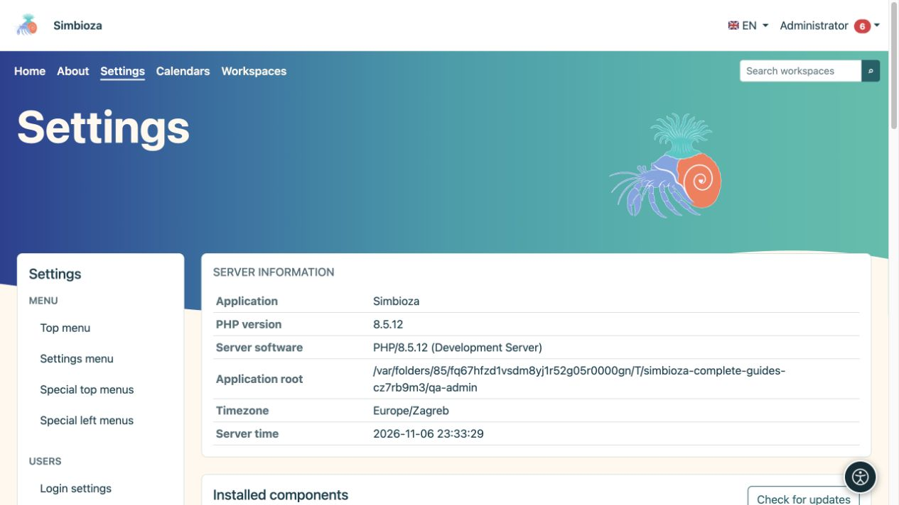

# Simbioza verwalten

> Die Bildschirmaufnahmen zeigen die englische Benutzeroberfläche.

Diese Anweisungen richten sich an den **Administrator der gesamten Simbioza-Installation**. Ein Administrator konfiguriert die Anwendung, Benutzer und Module. Ein Arbeitsbereichs-Manager verwaltet Inhalte und Berechtigungen innerhalb seines Arbeitsbereich; Diese Rolle gewährt nicht Zugriff auf alle Anwendungseinstellungen.

*Die Einstellungsübersicht zeigt Installationsinformationen und Zugang zur Administration.*

## Bevor Sie eine Einstellung ändern

1. Melden Sie sich mit Ihrem Administratorkonto an. Wenn das Konto über einen separaten Administratorzugriffsschalter verfügt, aktivieren Sie ihn zunächst in Ihrem persönlichen Menü.
2. Öffnen Sie **Einstellungen**. Das linke Menü gruppiert Einstellungen nach Funktion. Installierte Module stellen die verfügbaren Einträge bereit.
3. Lesen Sie die aktuellen Werte und die Erklärung unter jedem Feld. Ihre Installation weist möglicherweise andere Werte als die hier beschriebenen Standardwerte auf.
4. Ändern Sie die entsprechenden Einstellungen, wählen Sie die Schaltfläche **Speichern** und lesen Sie die Ergebnismeldung. Durch das Speichern einer Gruppe wird nicht automatisch das Formular einer anderen Gruppe gespeichert.
5. Öffnen Sie den Bildschirm erneut und überprüfen Sie die Werte. Überprüfen Sie den Inhaltszugriff auch mit einem anderen Konto, das über keine Administratorrechte verfügt.

**Ergebnis:** Die Änderung wird gespeichert und aus Sicht des vorgesehenen Benutzers überprüft.

## Wählen Sie ein Verfahren

| Sie wollen… | Lesen |
|---|---|
| Erscheinungsbild oder Navigation ändern | Die Design- und Menükapitel in diesem Handbuch |
| Fügen Sie ein Modul hinzu oder aktualisieren Sie die Anwendung | [Setup und Module](admin-podesavanje_de.md) |
| Fügen Sie eine Sprache hinzu oder aktualisieren Sie sie | [Sprachen](admin-jezici_de.md) |
| Lesehilfen aktivieren | [Barrierefreiheit](admin-pristupacnost_de.md) |
| Gewähren Sie Personen und Gruppen Zugriff | [Benutzer und Berechtigungen](admin-korisnici-i-pristup_de.md) |
| Verwalten Sie einen freigegebenen oder persönlichen Kalender | [Kalenderverwaltung](admin-kalendari_de.md) |
| Aktivieren Sie die Nachrichtenzustellung | [E-Mail](admin-e-posta_de.md) |
| Konfigurieren Sie Speicher, Anhänge und eigenständige HTML-Seiten | [HTML-Editor](admin-html-editor_de.md) |
| Genehmigen Sie zusätzliches JavaScript oder CSS für Inhalte | [Externe Skripte](admin-skripte_de.md) |
| Finden Sie ein Ereignis oder untersuchen Sie einen Fehler | [Protokolle](admin-dnevnici_de.md) |
| Aktivieren Sie Umfrageautoren und die Anmeldung bei externen Umfragen | [Umfrageverwaltung](admin-ankete_de.md) |
| Daten bewahren oder wiederherstellen | [Sicherungen](admin-sigurnosne-kopije_de.md) |
| Geben Sie einen Schlüssel für ein angeschlossenes System aus | [API Schlüssel](admin-api_de.md) |
| Aufgaben-, Kommentar- und Benachrichtigungseinstellungen verstehen | [Zusammenarbeit](admin-suradnja_de.md) |

## Wenn Sie die Einstellungen nicht öffnen oder speichern können

- **Ein Anmeldebildschirm wird angezeigt:** Melden Sie sich an und öffnen Sie den Eintrag erneut.
- **Zugriff verweigert:** Editor- oder Managerrechte unterscheiden sich von Administratorrechten. Bitten Sie einen Administrator, die Aktion auszuführen.
- **Der Eintrag fehlt:** Überprüfen Sie, ob das erforderliche Modul in [Setup](admin-podesavanje_de.md) installiert und aktiviert ist. Ein ausgeblendeter Eintrag bedeutet nicht, dass seine Daten gelöscht wurden.
- **Einstellungen sind schreibgeschützt:** Der Serververantwortliche muss den Schreibzugriff auf die Konfiguration prüfen. Das Ändern des Dateieigentums oder der Berechtigungen ist in diesem Handbuch kein Endbenutzerverfahren.
- **Das Formular ist veraltet oder eine andere Person hat die Daten geändert:** Aktualisieren Sie den Bildschirm, lesen Sie die aktuellen Werte und übernehmen Sie Ihre Änderung erneut.

Erstellen Sie ein geeignetes Backup, bevor Sie ein Upgrade durchführen, den Speicher ändern oder Daten wiederherstellen. Durch alleiniges Öffnen eines Bildschirms werden keine dieser Vorgänge gestartet.
