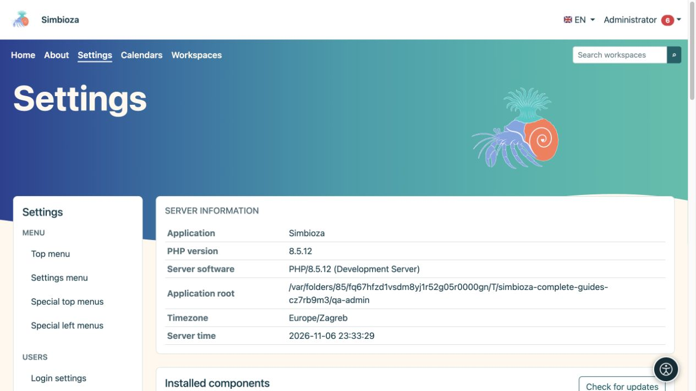

# Administering Simbioza

These instructions are for the **administrator of the whole Simbioza installation**. An administrator configures the application, users, and modules. A workspace manager manages content and permissions within their workspace; that role does not grant access to every application setting.

*The settings overview shows installation information and access to administration.*

## Before changing a setting

1. Sign in with your administrator account. If the account offers a separate administrator-access switch, enable it from your personal menu first.
2. Open **Settings**. The left menu groups settings by function. Installed modules provide the available entries.
3. Read the current values and the explanation below each field. Your installation may have different values from the defaults described here.
4. Change related settings, choose their **Save** button, and read the result message. Saving one group does not automatically save another group's form.
5. Reopen the screen and check the values. Also verify content access with another account that has no administrator privileges.

**Result:** the change is saved and checked from the intended user's perspective.

## Choose a procedure

| You want to… | Read |
|---|---|
| Change appearance or navigation | The theme and menu chapters in this manual |
| Add a module or upgrade the application | [Setup and modules](admin-podesavanje_en.md) |
| Add or refresh a language | [Languages](admin-jezici_en.md) |
| Enable reading aids | [Accessibility](admin-pristupacnost_en.md) |
| Grant access to people and groups | [Users and permissions](admin-korisnici-i-pristup_en.md) |
| Manage a shared or personal calendar | [Calendar administration](admin-kalendari_en.md) |
| Enable message delivery | [Email](admin-e-posta_en.md) |
| Configure storage, attachments, and standalone HTML pages | [HTML editor](admin-html-editor_en.md) |
| Approve additional JavaScript or CSS for content | [External scripts](admin-skripte_en.md) |
| Find an event or investigate an error | [Logs](admin-dnevnici_en.md) |
| Enable survey authors and external survey sign-in | [Survey administration](admin-ankete_en.md) |
| Preserve or restore data | [Backups](admin-sigurnosne-kopije_en.md) |
| Issue a key for a connected system | [API keys](admin-api_en.md) |
| Understand task, comment, and notification settings | [Collaboration](admin-suradnja_en.md) |

## If you cannot open or save settings

- **A sign-in screen appears:** sign in, then reopen the entry.
- **Access is denied:** editor or manager privileges are different from administrator privileges. Ask an administrator to perform the action.
- **The entry is missing:** check whether the required module is installed and enabled in [Setup](admin-podesavanje_en.md). A hidden entry does not mean its data has been deleted.
- **Settings are read-only:** the person responsible for the server must check configuration write access. Changing file ownership or permissions is not an end-user procedure in this guide.
- **The form is stale or another person changed the data:** refresh the screen, read the current values, and apply your change again.

Create an appropriate backup before upgrading, changing storage, or restoring data. Opening a screen alone does not start any of those operations.
