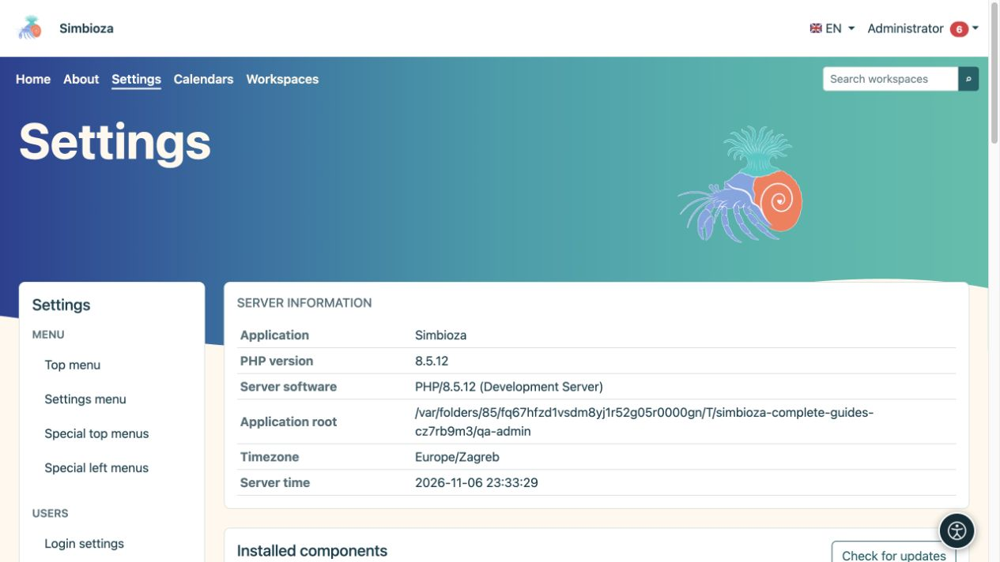

# Administrar Simbioza

> Las capturas de pantalla muestran la interfaz en inglés.

Estas instrucciones son para el **administrador de toda la instalación Simbioza**. Un administrador configura la aplicación, los usuarios y los módulos. Un gestor del espacio de trabajo gestiona el contenido y los permisos dentro de su espacio de trabajo; ese rol no otorga acceso a todas las configuraciones de la aplicación.

*La descripción general de la configuración muestra información de instalación y acceso a la administración.*

## Antes de cambiar una configuración

1. Inicie sesión con su cuenta de administrador. Si la cuenta ofrece un interruptor de acceso de administrador independiente, habilítelo primero desde su menú personal.
2. Abra **Configuración**. El menú de la izquierda agrupa las configuraciones por función. Los módulos instalados proporcionan las entradas disponibles.
3. Lea los valores actuales y la explicación debajo de cada campo. Su instalación puede tener valores diferentes a los predeterminados descritos aquí.
4. Cambie la configuración relacionada, elija el botón **Guardar** y lea el mensaje de resultado. Guardar un grupo no guarda automáticamente el formulario de otro grupo.
5. Vuelva a abrir la pantalla y verifique los valores. Verifique también el acceso al contenido con otra cuenta que no tenga privilegios de administrador.

**Resultado:** el cambio se guarda y se verifica desde la perspectiva del usuario previsto.

## Elija un procedimiento

| Tú quieres… | Leer |
|---|---|
| Cambiar apariencia o navegación | Los capítulos temáticos y de menú de este manual. |
| Agregue un módulo o actualice la aplicación | [Configuración y módulos](admin-podesavanje_es.md) |
| Agregar o actualizar un idioma | [Idiomas](admin-jezici_es.md) |
| Habilitar ayudas de lectura | [Accesibilidad](admin-pristupacnost_es.md) |
| Conceder acceso a personas y grupos | [Usuarios y permisos](admin-korisnici-i-pristup_es.md) |
| Administrar un calendario compartido o personal | [Administración del calendario](admin-kalendari_es.md) |
| Habilitar la entrega de mensajes | [Correo electrónico](admin-e-posta_es.md) |
| Configurar almacenamiento, archivos adjuntos y páginas HTML independientes | [HTML editor](admin-html-editor_es.md) |
| Aprobar JavaScript o CSS adicional para el contenido | [Scripts externos](admin-skripte_es.md) |
| Encontrar un evento o investigar un error | [Registros](admin-dnevnici_es.md) |
| Habilitar autores de encuestas e inicio de sesión de encuestas externas | [Administración de la encuesta](admin-ankete_es.md) |
| Conservar o restaurar datos | [Copias de seguridad](admin-sigurnosne-kopije_es.md) |
| Emitir una clave para un sistema conectado | [clave de APIs](admin-api_es.md) |
| Comprender la configuración de tareas, comentarios y notificaciones | [Colaboración](admin-suradnja_es.md) |

## Si no puede abrir o guardar la configuración

- **Aparece una pantalla de inicio de sesión:** inicie sesión y luego vuelva a abrir la entrada.
- **Acceso denegado:** los privilegios de editor o administrador son diferentes de los privilegios de administrador. Pídale a un administrador que realice la acción.
- **Falta la entrada:** verifique si el módulo requerido está instalado y habilitado en [Configuración](admin-podesavanje_es.md). Una entrada oculta no significa que sus datos hayan sido eliminados.
- **Las configuraciones son de solo lectura:** el responsable del servidor debe verificar la configuración del acceso de escritura. Cambiar la propiedad o los permisos de los archivos no es un procedimiento del usuario final en esta guía.
- **El formulario está obsoleto o otra persona cambió los datos:** actualice la pantalla, lea los valores actuales y aplique el cambio nuevamente.

Cree una copia de seguridad adecuada antes de actualizar, cambiar el almacenamiento o restaurar datos. Abrir una pantalla por sí solo no inicia ninguna de esas operaciones.
