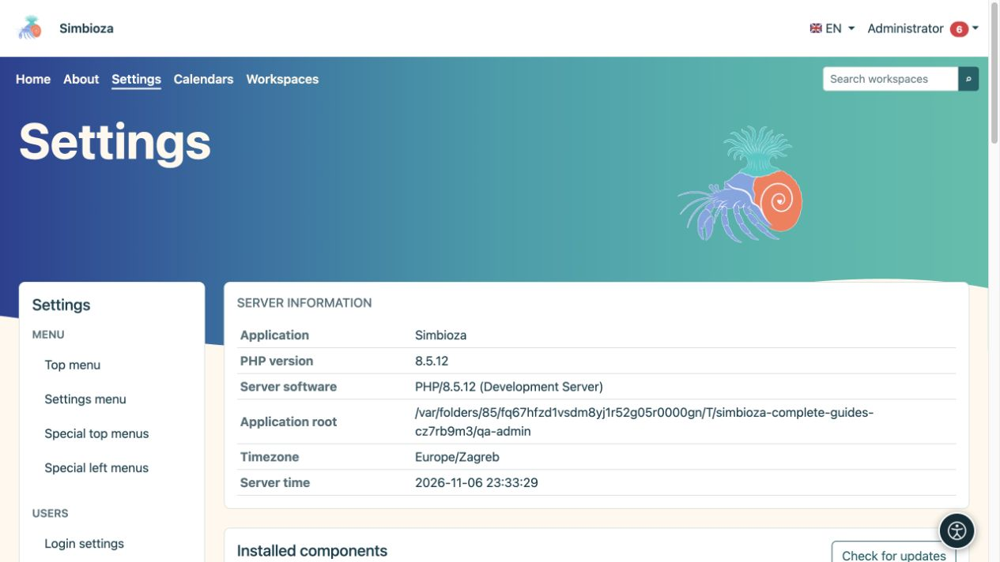

# Administrer Simbioza

> Les captures d’écran présentent l’interface en anglais.

Ces instructions sont destinées à l'**administrateur de l'ensemble de l'installation Simbioza**. Un administrateur configure l'application, les utilisateurs et les modules. Un gestionnaire d'espace de travail gère le contenu et les autorisations au sein de son espace de travail ; ce rôle n'accorde pas l'accès à tous les paramètres de l'application.

*L'aperçu des paramètres affiche les informations d'installation et l'accès à l'administration.*

## Avant de modifier un paramètre

1. Connectez-vous avec votre compte administrateur. Si le compte propose un commutateur d'accès administrateur distinct, activez-le d'abord à partir de votre menu personnel.
2. Ouvrez **Paramètres**. Le menu de gauche regroupe les paramètres par fonction. Les modules installés fournissent les entrées disponibles.
3. Lisez les valeurs actuelles et l'explication sous chaque champ. Votre installation peut avoir des valeurs différentes des valeurs par défaut décrites ici.
4. Modifiez les paramètres associés, choisissez leur bouton **Enregistrer** et lisez le message de résultat. L'enregistrement d'un groupe n'enregistre pas automatiquement le formulaire d'un autre groupe.
5. Rouvrez l'écran et vérifiez les valeurs. Vérifiez également l'accès au contenu avec un autre compte qui ne dispose d'aucun privilège d'administrateur.

**Résultat :** la modification est enregistrée et vérifiée du point de vue de l'utilisateur prévu.

## Choisissez une procédure

| Tu veux… | Lire |
|---|---|
| Modifier l'apparence ou la navigation | Les chapitres de thème et de menu de ce manuel |
| Ajouter un module ou mettre à niveau l'application | [Configuration et modules](admin-podesavanje_fr.md) |
| Ajouter ou actualiser une langue | [Langues](admin-jezici_fr.md) |
| Activer les aides à la lecture | [Accessibilité](admin-pristupacnost_fr.md) |
| Accorder l'accès à des personnes et à des groupes | [Utilisateurs et autorisations](admin-korisnici-i-pristup_fr.md) |
| Gérer un calendrier partagé ou personnel | [Administration du calendrier](admin-kalendari_fr.md) |
| Activer la livraison des messages | [E-mail](admin-e-posta_fr.md) |
| Configurer le stockage, les pièces jointes et les pages HTML autonomes | [Éditeur HTML](admin-html-editor_fr.md) |
| Approuver du JavaScript ou du CSS supplémentaire pour le contenu | [Scripts externes](admin-skripte_fr.md) |
| Rechercher un événement ou sondager sur une erreur | [Journaux](admin-dnevnici_fr.md) |
| Activer les auteurs de sondages et la connexion aux sondages externes | [Administration du sondage](admin-ankete_fr.md) |
| Conserver ou restaurer des données | [Sauvegardes](admin-sigurnosne-kopije_fr.md) |
| Émettre une clé pour un système connecté | [Touches API](admin-api_fr.md) |
| Comprendre les paramètres des tâches, des commentaires et des notifications | [Collaboration](admin-suradnja_fr.md) |

## Si vous ne pouvez pas ouvrir ou enregistrer les paramètres

- **Un écran de connexion apparaît :** connectez-vous, puis rouvrez l'entrée.
- **L'accès est refusé :** les privilèges d'éditeur ou de gestionnaire sont différents des privilèges d'administrateur. Demandez à un administrateur d'effectuer l'action.
- **L'entrée est manquante :** vérifiez si le module requis est installé et activé dans [Setup](admin-podesavanje_fr.md). Une entrée masquée ne signifie pas que ses données ont été supprimées.
- **Les paramètres sont en lecture seule :** la personne responsable du serveur doit vérifier l'accès en écriture à la configuration. La modification de la propriété ou des autorisations d'un fichier n'est pas une procédure destinée à l'utilisateur final dans ce guide.
- **Le formulaire est obsolète ou une autre personne a modifié les données :** actualisez l'écran, lisez les valeurs actuelles et appliquez à nouveau votre modification.

Créez une sauvegarde appropriée avant de mettre à niveau, de modifier le stockage ou de restaurer des données. L’ouverture d’un écran seule ne démarre aucune de ces opérations.
