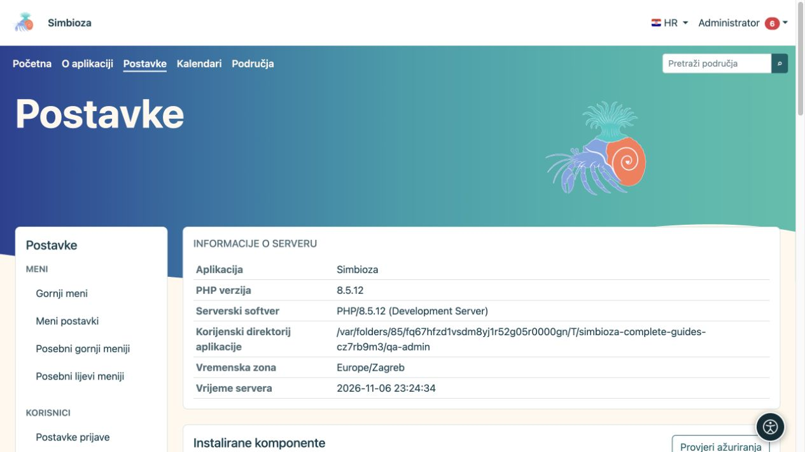

# Administriranje Simbioze

Ove su upute za **administratora cijele Simbioze**. Administrator podešava aplikaciju, korisnike i module. Upravitelj područja uređuje sadržaj i prava svojeg područja; time ne dobiva pristup svim postavkama aplikacije.

*Početni pregled postavki pokazuje podatke o instalaciji i ulaz u administratorske mogućnosti.*

## Prije prve promjene

1. Prijavite se svojim administratorskim računom. Ako račun nudi zasebno uključivanje administratorskog pristupa, najprije ga uključite u osobnom izborniku.
2. Otvorite **Postavke**. Lijevi izbornik grupira postavke prema funkcionalnosti. Dostupne su stavke instaliranih modula.
3. Pročitajte trenutačne vrijednosti i opis ispod polja. Postojeća instalacija može imati drukčije vrijednosti od zadanih u ovim uputama.
4. Promijenite povezane postavke, odaberite pripadajući gumb **Spremi** i pročitajte poruku rezultata. Obrazac jedne skupine ne sprema automatski ostale skupine.
5. Ponovno otvorite ekran i provjerite vrijednosti. Pristup sadržaju provjerite i drugim računom koji nema administratorska prava.

**Rezultat:** promjena je spremljena i provjerena iz perspektive osobe kojoj je namijenjena.

## Odaberite postupak

| Želite… | Otvorite upute |
|---|---|
| Promijeniti izgled ili navigaciju | [Teme](teme_hr.md) i [Izbornici](izbornici_hr.md) |
| Dodati modul ili nadograditi aplikaciju | [Podešavanje i moduli](admin-podesavanje_hr.md) |
| Dodati ili osvježiti jezik | [Jezici](admin-jezici_hr.md) |
| Uključiti alate za lakše čitanje | [Pristupačnost](admin-pristupacnost_hr.md) |
| Dodijeliti pristup osobama i grupama | [Korisnici i ovlasti](admin-korisnici-i-pristup_hr.md) |
| Urediti zajednički ili osobni kalendar | [Administracija kalendara](admin-kalendari_hr.md) |
| Omogućiti slanje poruka | [E-pošta](admin-e-posta_hr.md) |
| Podesiti pohranu, privitke i samostalne HTML stranice | [HTML editor](admin-html-editor_hr.md) |
| Odobriti dodatni JavaScript ili CSS za sadržaj | [Vanjske skripte](admin-skripte_hr.md) |
| Pronaći događaj ili uzrok pogreške | [Dnevnici](admin-dnevnici_hr.md) |
| Omogućiti sastavljanje i vanjsku prijavu na ankete | [Administracija anketa](admin-ankete_hr.md) |
| Sačuvati ili vratiti podatke | [Sigurnosne kopije](admin-sigurnosne-kopije_hr.md) |
| Izdati ključ za povezani sustav | [API ključevi](admin-api_hr.md) |
| Razumjeti postavke zadataka, komentara i obavijesti | [Suradnja](admin-suradnja_hr.md) |

## Ako ne možete otvoriti ili spremiti postavke

- **Prikazuje se prijava:** prijavite se pa ponovno otvorite željenu stavku.
- **Nemate pristup:** urednička ili upraviteljska ovlast nije isto što i administratorska. Zatražite da radnju obavi administrator.
- **Stavke nema:** provjerite je li potreban modul instaliran i uključen u [Podešavanju](admin-podesavanje_hr.md). Nemojte zaključiti da skrivena stavka znači da je podatak obrisan.
- **Postavke su samo za čitanje:** ovlaštena osoba za poslužitelj treba provjeriti mogućnost spremanja konfiguracije. Promjena vlasništva ili prava datoteka nije korisnička radnja u ovim uputama.
- **Obrazac je zastario ili se podaci istodobno promijenili:** osvježite ekran, pročitajte aktualne vrijednosti i ponovite svoju izmjenu.

Za nadogradnje, promjenu pohrane i vraćanje podataka prvo izradite primjerenu sigurnosnu kopiju. Samo otvaranje pregleda ne pokreće takvu promjenu.
