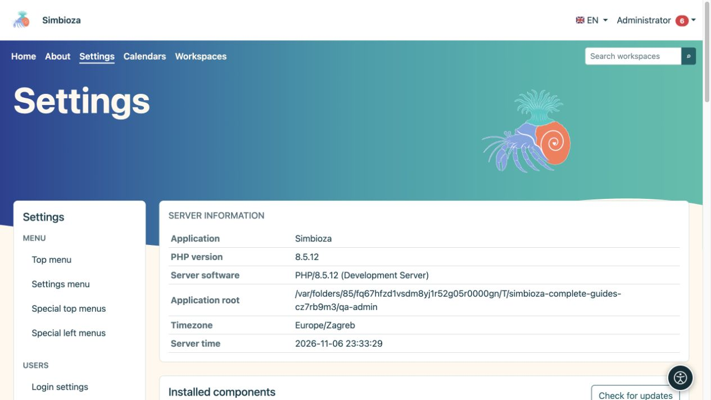

# Amministrazione di Simbioza

> Le schermate mostrano l’interfaccia in inglese.

Queste istruzioni sono rivolte all'**amministratore dell'intera installazione Simbioza**. Un amministratore configura l'applicazione, gli utenti e i moduli. Un responsabile di un'area di lavoro gestisce contenuti e autorizzazioni all'interno della propria area; questo ruolo non concede accesso a tutte le impostazioni dell'applicazione.

*La panoramica delle impostazioni mostra le informazioni di installazione e l'accesso all'amministrazione.*

## Prima di modificare un'impostazione

1. Accedi con il tuo account amministratore. Se l'account offre un interruttore di accesso amministratore separato, abilitalo prima dal tuo menu personale.
2. Apri **Impostazioni**. Il menu di sinistra raggruppa le impostazioni per funzione. I moduli installati forniscono le voci disponibili.
3. Leggere i valori correnti e la spiegazione sotto ogni campo. La tua installazione potrebbe avere valori diversi da quelli predefiniti descritti qui.
4. Modifica le impostazioni correlate, scegli il pulsante **Salva** e leggi il messaggio del risultato. Il salvataggio di un gruppo non salva automaticamente il modulo di un altro gruppo.
5. Riaprire la schermata e verificare i valori. Verifica anche l'accesso ai contenuti con un altro account che non dispone di privilegi di amministratore.

**Risultato:** la modifica viene salvata e verificata dal punto di vista dell'utente previsto.

## Scegli una procedura

| Vuoi… | Leggere |
|---|---|
| Modifica l'aspetto o la navigazione | I capitoli del tema e del menu in questo manuale |
| Aggiungi un modulo o aggiorna l'applicazione | [Configurazione e moduli](admin-podesavanje_it.md) |
| Aggiungi o aggiorna una lingua | [Lingue](admin-jezici_it.md) |
| Abilita gli aiuti alla lettura | [Accessibilità](admin-pristupacnost_it.md) |
| Concedere l'accesso a persone e gruppi | [Utenti e autorizzazioni](admin-korisnici-i-pristup_it.md) |
| Gestisci un calendario condiviso o personale | [Amministrazione calendario](admin-kalendari_it.md) |
| Abilita la consegna dei messaggi | [E-mail](admin-e-posta_it.md) |
| Configura archiviazione, allegati e pagine HTML autonome | [HTMLeditor](admin-html-editor_it.md) |
| Approvare JavaScript o CSS aggiuntivi per i contenuti | [Script esterni](admin-skripte_it.md) |
| Trova un evento o indaga su un errore | [Registri](admin-dnevnici_it.md) |
| Abilita gli autori del sondaggio e l'accesso al sondaggio esterno | [Amministrazione del sondaggio](admin-ankete_it.md) |
| Conservare o ripristinare i dati | [Backup](admin-sigurnosne-kopije_it.md) |
| Emettere una chiave per un sistema connesso | [API chiavi](admin-api_it.md) |
| Comprendere le impostazioni di attività, commenti e notifiche | [Collaborazione](admin-suradnja_it.md) |

## Se non riesci ad aprire o salvare le impostazioni

- **Viene visualizzata una schermata di accesso:** accedi, quindi riapri la voce.
- **Accesso negato:** i privilegi di editor o manager sono diversi dai privilegi di amministratore. Chiedi a un amministratore di eseguire l'azione.
- **La voce manca:** verificare se il modulo richiesto è installato e abilitato in [Setup](admin-podesavanje_it.md). Una voce nascosta non significa che i suoi dati sono stati cancellati.
- **Le impostazioni sono di sola lettura:** la persona responsabile del server deve verificare l'accesso in scrittura alla configurazione. La modifica della proprietà o delle autorizzazioni dei file non è una procedura dell'utente finale in questa guida.
- **Il modulo è obsoleto o un'altra persona ha modificato i dati:** aggiorna lo schermo, leggi i valori correnti e applica nuovamente la modifica.

Crea un backup appropriato prima di aggiornare, modificare lo spazio di archiviazione o ripristinare i dati. La sola apertura di una schermata non avvia nessuna di queste operazioni.
