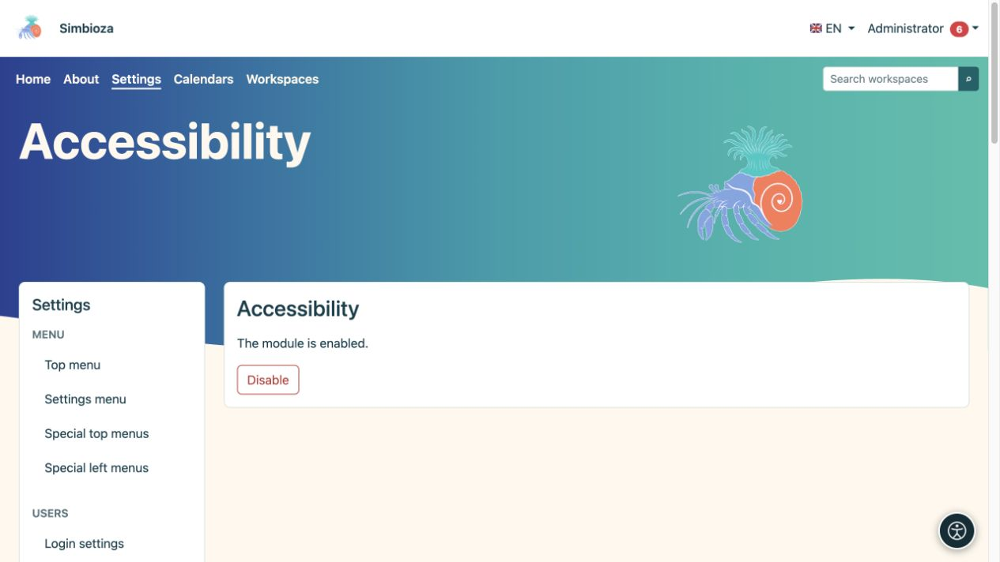

# Barrierefreiheit

> Die Bildschirmaufnahmen zeigen die englische Benutzeroberfläche.

**Zielgruppe:** Ein Administrator aktiviert das Tool für die Site. Jeder Leser wählt seine eigenen Anpassungen. Öffnen Sie **Einstellungen → Barrierefreiheit**.

## Aktivieren Sie das Tool

*Der Administrator aktiviert oder deaktiviert das Modul hier; Leser wählen ihre eigenen Anpassungen über die runde Barrierefreiheitstaste.*

1. Lesen Sie den aktuellen Status des Moduls.
2. Wenn es installiert, aber deaktiviert ist, wählen Sie **Aktivieren**.
3. Öffnen Sie eine normale Seite und prüfen Sie, ob die Schaltfläche für Barrierefreiheit angezeigt wird.
4. Öffnen Sie das Bedienfeld, versuchen Sie eine Einstellung und setzen Sie sie dann zurück.

Wenn das Modul nicht installiert ist, fügen Sie es über [Setup und Module](admin-podesavanje_de.md) hinzu. Wenn der Bildschirm schreibgeschützt ist, muss der Installationsbetreuer den vorgeschriebenen Modulstatus-Schreibzugriff gewähren.

**Ergebnis:** Besucher können die Darstellung in ihrem eigenen Browser anpassen, ohne das Design für andere Personen zu ändern.

## Was Leser anpassen können

Das Panel gruppiert Lese-, Seh-, Farb- und Navigationsoptionen. Je nach ausgewählter Sprache und Browserunterstützung bietet es Schriftarten, Textgröße und -abstände, Hervorhebung von Überschriften und Links, Kontrast, Farbpaletten und -sättigung, sichtbaren Fokus, eine Lesehilfe, einen größeren Zeiger und reduzierte Animationen. Die verfügbaren Schriftarten hängen vom Schriftsystem der Sprache ab.

Die Einstellungen werden für diese Installation lokal in diesem Browser gespeichert; sie sind weder eine gemeinsame Einstellung für alle Benutzer noch Teil des Seiteninhalts. Benutzer wählen sie auf einem anderen Gerät erneut aus. Durch Zurücksetzen wird die Standardanzeige wiederhergestellt.

## Verantwortlichkeiten des Autors und Administrators

Das Tool ersetzt keine barrierefreien Inhalte. Überschriften brauchen eine sinnvolle Reihenfolge, Bilder brauchen Beschreibungen, Links brauchen klare Namen und Tabellen brauchen Überschriften. Überprüfen Sie auch die Tastatur: Steuerelemente müssen erreichbar, der Fokus sichtbar und geöffnete Dialoge schließbar sein.

Überprüfen Sie echte Seiten in der Standardanzeige, mit vergrößertem Text, auf mobilen Bildschirmen und über eine Tastatur. Wenn Inhalte weiterhin unlesbar bleiben, reparieren Sie den Inhalt oder das Design, anstatt von den Lesern eine Entschädigung für eine fehlerhafte Form zu erwarten.

**Deaktivieren** verbirgt die Funktionalität der Erweiterung für die Site. Gespeicherte Inhalte, Rollen oder Berechtigungen werden dadurch nicht verändert.
