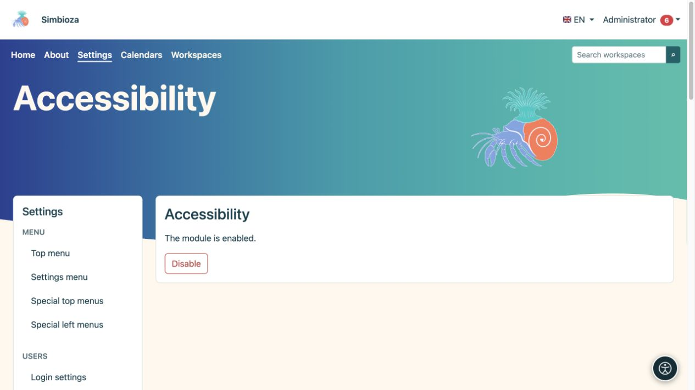

# Accessibility

**Audience:** an administrator enables the tool for the site; each reader selects their own adjustments. Open **Settings → Accessibility**.

## Enable the tool

*The administrator enables or disables the module here; readers choose their own adjustments through the round accessibility button.*

1. Read the module's current state.
2. If it is installed but disabled, choose **Enable**.
3. Open an ordinary page and check that the accessibility button appears.
4. Open the panel, try one adjustment, then reset it.

If the module is not installed, add it through [Setup and modules](admin-podesavanje_en.md). If the screen is read-only, the installation maintainer must provide the prescribed module-state write access.

**Result:** visitors can adapt the display in their own browser without changing the theme for other people.

## What readers can adjust

The panel groups reading, vision, colour, and navigation options. Depending on the selected language and browser support, it offers fonts, text size and spacing, heading and link emphasis, contrast, colour palettes and saturation, visible focus, a reading guide, a larger pointer, and reduced animation. Available fonts depend on the language's writing system.

Preferences are stored locally in that browser for that installation; they are neither a shared setting for all users nor part of page content. Users choose them again on another device. Reset restores their default display.

## Author and administrator responsibilities

The tool does not replace accessible content. Headings need a meaningful order, images need descriptions, links need clear names, and tables need headers. Also check the keyboard: controls must be reachable, focus visible, and open dialogs closable.

Check real pages in the default display, with enlarged text, on mobile screens, and using a keyboard. If content remains unreadable, repair the content or theme instead of expecting readers to compensate for a broken form.

**Disable** hides the extension's functionality for the site. It does not change stored content, roles, or permissions.
