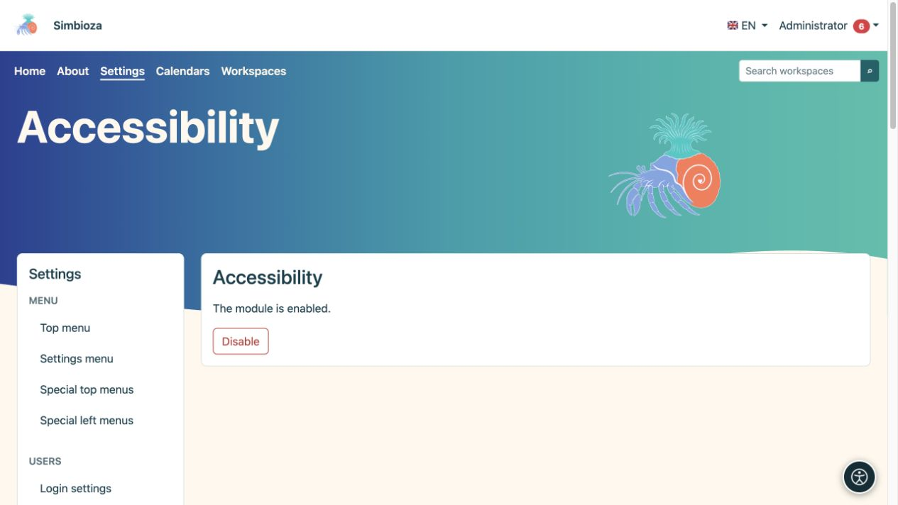

# Accesibilidad

> Las capturas de pantalla muestran la interfaz en inglés.

**Audiencia:** un administrador habilita la herramienta para el sitio; cada lector selecciona sus propios ajustes. Abra **Configuración → Accesibilidad**.

## Habilitar la herramienta

*Aquí el administrador habilita o deshabilita el módulo; los lectores eligen sus propios ajustes a través del botón redondo de accesibilidad.*

1. Lea el estado actual del módulo.
2. Si está instalado pero deshabilitado, elija **Habilitar**.
3. Abra una página normal y compruebe que aparece el botón de accesibilidad.
4. Abra el panel, pruebe un ajuste y luego reinícielo.

Si el módulo no está instalado, agréguelo a través de [Configuración y módulos](admin-podesavanje_es.md). Si la pantalla es de solo lectura, el encargado de la instalación debe proporcionar el acceso de escritura prescrito en el estado del módulo.

**Resultado:** los visitantes pueden adaptar la visualización en su propio navegador sin cambiar el tema para otras personas.

## Qué pueden ajustar los lectores

El panel agrupa opciones de lectura, visión, color y navegación. Dependiendo del idioma seleccionado y la compatibilidad del navegador, ofrece fuentes, tamaño y espaciado del texto, énfasis en encabezados y enlaces, contraste, paletas de colores y saturación, enfoque visible, una guía visual de lectura, un puntero más grande y animación reducida. Las fuentes disponibles dependen del sistema de escritura del idioma.

Las preferencias se almacenan localmente en ese navegador para esa instalación; no son una configuración compartida para todos los usuarios ni parte del contenido de la página. Los usuarios los vuelven a elegir en otro dispositivo. Restablecer restaura su visualización predeterminada.

## Responsabilidades del autor y administrador

La herramienta no reemplaza el contenido accesible. Los títulos necesitan un orden significativo, las imágenes necesitan descripciones, los enlaces necesitan nombres claros y las tablas necesitan encabezados. Compruebe también el teclado: los controles deben ser accesibles, el foco visible y los cuadros de diálogo abiertos deben poder cerrarse.

Consulte páginas reales en la visualización predeterminada, con texto ampliado, en pantallas de dispositivos móviles y usando un teclado. Si el contenido sigue siendo ilegible, repare el contenido o el tema en lugar de esperar que los lectores compensen un formulario roto.

**Desactivar** oculta la funcionalidad de la extensión para el sitio. No cambia el contenido, las funciones ni los permisos almacenados.
