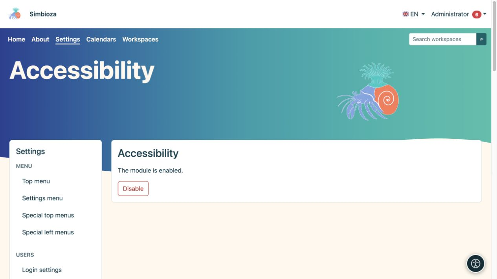

# Accessibilité

> Les captures d’écran présentent l’interface en anglais.

**Public :** un administrateur active l'outil pour le site ; chaque lecteur sélectionne ses propres ajustements. Ouvrez **Paramètres → Accessibilité**.

## Activer l'outil

*L'administrateur active ou désactive le module ici ; les lecteurs choisissent leurs propres ajustements via le bouton rond d'accessibilité.*

1. Lisez l'état actuel du module.
2. S'il est installé mais désactivé, choisissez **Activer**.
3. Ouvrez une page ordinaire et vérifiez que le bouton d'accessibilité apparaît.
4. Ouvrez le panneau, essayez un réglage, puis réinitialisez-le.

Si le module n'est pas installé, ajoutez-le via [Configuration et modules](admin-podesavanje_fr.md). Si l'écran est en lecture seule, le responsable de l'installation doit fournir l'accès en écriture à l'état du module prescrit.

**Résultat :** les visiteurs peuvent adapter l'affichage dans leur propre navigateur sans changer le thème pour les autres personnes.

## Ce que les lecteurs peuvent ajuster

Le panneau regroupe les options de lecture, de vision, de couleur et de navigation. En fonction de la langue sélectionnée et de la prise en charge du navigateur, il propose des polices, la taille et l'espacement du texte, l'accentuation des titres et des liens, le contraste, les palettes de couleurs et la saturation, la mise au point visible, un guide de lecture, un pointeur plus grand et une animation réduite. Les polices disponibles dépendent du système d'écriture de la langue.

Les préférences sont stockées localement dans ce navigateur pour cette installation ; ils ne constituent ni un paramètre partagé pour tous les utilisateurs ni une partie du contenu de la page. Les utilisateurs les choisissent à nouveau sur un autre appareil. La réinitialisation rétablit leur affichage par défaut.

## Responsabilités de l'auteur et de l'administrateur

L'outil ne remplace pas le contenu accessible. Les titres ont besoin d'un ordre significatif, les images ont besoin de descriptions, les liens ont besoin de noms clairs et les tableaux ont besoin d'en-têtes. Vérifiez également le clavier : les commandes doivent être accessibles, le focus visible et les boîtes de dialogue ouvertes doivent être fermées.

Vérifiez les vraies pages dans l'affichage par défaut, avec du texte agrandi, sur les écrans mobiles et à l'aide d'un clavier. Si le contenu reste illisible, réparez le contenu ou le thème au lieu d'attendre des lecteurs qu'ils compensent pour un formulaire cassé.

**Désactiver** masque les fonctionnalités de l'extension pour le site. Cela ne modifie pas le contenu, les rôles ou les autorisations stockés.
