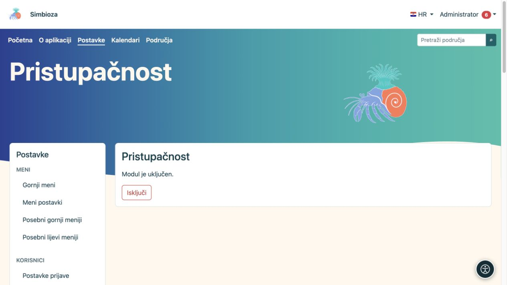

# Pristupačnost

**Za koga:** administrator uključuje alat za cijeli site; svaki čitatelj zasebno bira svoje prilagodbe. Otvorite **Postavke → Pristupačnost**.

## Uključite alat

*Administrator ovdje uključuje ili isključuje modul; čitatelj svoje prilagodbe bira iz kružnog gumba pristupačnosti.*

1. Provjerite prikazano stanje modula.
2. Ako je instaliran, a isključen, odaberite **Uključi**.
3. Otvorite običnu stranicu i provjerite pojavljuje li se gumb pristupačnosti.
4. Otvorite panel i isprobajte jednu prilagodbu, zatim je poništite.

Ako modul nije instaliran, dodajte ga kroz [Setup i module](admin-podesavanje_hr.md). Ako je ekran samo za čitanje, osoba koja održava instalaciju treba omogućiti propisano spremanje stanja modula.

**Rezultat:** posjetitelj može prilagoditi prikaz u svojem pregledniku bez promjene teme za druge osobe.

## Što čitatelj može prilagoditi

Panel grupira mogućnosti za čitanje, vid, boje i navigaciju. Ovisno o odabranom jeziku i podršci preglednika, nudi font, veličinu i razmake teksta, naglašavanje naslova i poveznica, kontrast, palete i zasićenost boja, isticanje fokusa, vodilicu za čitanje, veći pokazivač i smanjenje animacija. Dostupni fontovi ovise o pismu jezika.

Postavke se pamte lokalno u tom pregledniku za tu instalaciju; nisu zajednička postavka svih korisnika ni sadržaj stranice. Na drugom uređaju korisnik ih bira ponovno. Gumb za vraćanje zadanog prikaza poništava njegove prilagodbe.

## Odgovornost autora i administratora

Alat ne zamjenjuje pravilno uređen sadržaj. Naslovi trebaju imati smislen redoslijed, slike opis, poveznice jasan naziv, a tablice zaglavlja. Provjerite i tipkovnicu: do kontrole se mora moći doći, fokus se mora vidjeti, a otvoreni dijalog moći zatvoriti.

Za provjeru stvarne stranice kombinirajte zadani prikaz, povećani tekst, mobilni ekran i tipkovnicu. Ako sadržaj ostane nečitljiv, popravite sadržaj ili temu; nemojte od čitatelja tražiti da alatima nadoknađuje neispravan obrazac.

**Isključi** skriva funkcionalnost dodatka za site. Ne mijenja spremljeni sadržaj, uloge ni ovlasti.
