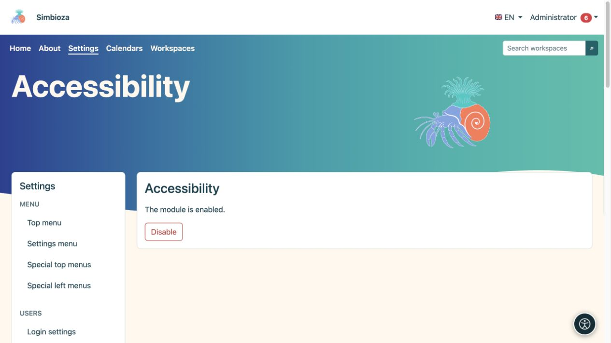

# Accessibilità

> Le schermate mostrano l’interfaccia in inglese.

**Pubblico:** un amministratore abilita lo strumento per il sito; ogni lettore seleziona le proprie regolazioni. Apri **Impostazioni → Accessibilità**.

## Abilita lo strumento

*L'amministratore abilita o disabilita il modulo qui; i lettori scelgono le proprie regolazioni tramite il pulsante rotondo di accessibilità.*

1. Leggi lo stato attuale del modulo.
2. Se è installato ma disabilitato, scegli **Abilita**.
3. Apri una pagina normale e controlla che appaia il pulsante di accessibilità.
4. Apri il pannello, prova una regolazione, quindi ripristinala.

Se il modulo non è installato, aggiungerlo tramite [Configurazione e moduli](admin-podesavanje_it.md). Se la schermata è di sola lettura, il manutentore dell'installazione deve fornire l'accesso in scrittura nello stato del modulo prescritto.

**Risultato:** i visitatori possono adattare la visualizzazione nel proprio browser senza modificare il tema per altre persone.

## Ciò che i lettori possono modificare

Il pannello raggruppa le opzioni di lettura, visione, colore e navigazione. A seconda della lingua selezionata e del supporto del browser, offre caratteri, dimensione e spaziatura del testo, enfasi su intestazioni e collegamenti, contrasto, tavolozze di colori e saturazione, messa a fuoco visibile, una guida alla lettura, un puntatore più grande e un'animazione ridotta. I caratteri disponibili dipendono dal sistema di scrittura della lingua.

Le preferenze vengono archiviate localmente in quel browser per quell'installazione; non sono né un'impostazione condivisa per tutti gli utenti né parte del contenuto della pagina. Gli utenti li scelgono nuovamente su un altro dispositivo. Reset ripristina la visualizzazione predefinita.

## Responsabilità di autore e amministratore

Lo strumento non sostituisce i contenuti accessibili. I titoli necessitano di un ordine significativo, le immagini necessitano di descrizioni, i collegamenti necessitano di nomi chiari e le tabelle necessitano di intestazioni. Controlla anche la tastiera: i controlli devono essere raggiungibili, il focus visibile e le finestre di dialogo aperte chiudibili.

Controlla le pagine reali nella visualizzazione predefinita, con testo ingrandito, sugli schermi dei dispositivi mobili e utilizzando una tastiera. Se il contenuto rimane illeggibile, ripara il contenuto o il tema invece di aspettarti che i lettori compensino un modulo danneggiato.

**Disabilita** nasconde la funzionalità dell'estensione per il sito. Non modifica il contenuto, i ruoli o le autorizzazioni archiviati.
