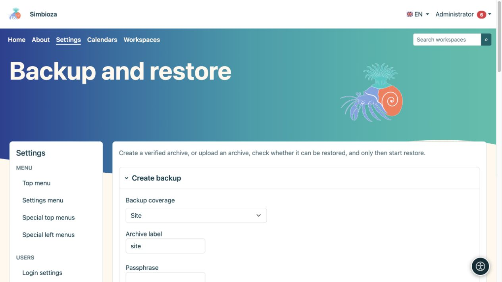
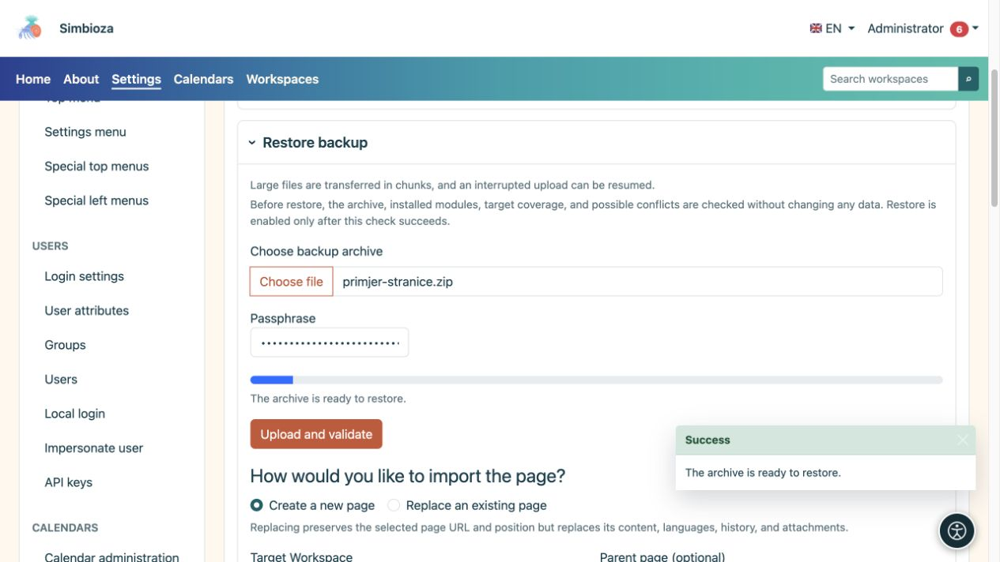

# Sicherungen erstellen und wiederherstellen

> Die Bildschirmaufnahmen zeigen die englische Benutzeroberfläche.

**Zielgruppe:** der Administrator der gesamten Installation. Öffnen Sie **Einstellungen → Sichern und Wiederherstellen**. Archive bewahren Daten für eine spätere Wiederherstellung auf; HTML-Exporte zum Lesen von Seiten dienen einem anderen Zweck.

## Wählen Sie einen Bereich aus

| Umfang | Wann sollte man es verwenden? |
|---|---|
| Website | Eine vollständige Kopie der unterstützten Daten und Einstellungen der installierten Module, einschließlich Anwendungseinstellungen. Es handelt sich nicht um eine Kopie des Programms PHP, des Server-Betriebssystems oder technischer Protokolle. |
| Geschäftskomponente | Eine oder mehrere angebotene verwandte Funktionen. Beiträge von installierten Modulen, die zur Komponente gehören, sind enthalten; es werden keine beliebigen Datenbanktabellen ausgewählt. |
| Arbeitsbereich | Seiten, Hierarchie, Anhänge und zugehörige Arbeitsbereichsdaten, einschließlich Umfragen, Antworten und Einstellungen. Lesen Sie **Diese Sicherung beinhaltet** für Ihre Installation. |
| Seite | Eine ausgewählte Seite mit Sprachen, Verlauf und Anhängen. Ein separates Kontrollkästchen enthält Berechtigungen und Einschränkungen. |

Confluence-Daten werden einbezogen, wenn sie vorhanden sind und das entsprechende Modul installiert ist; Dabei handelt es sich um zusätzliche Import- und Link-Auflösungsdaten. Ein importierter Confluence-Arbeitsbereich wird nach dem Import als gewöhnlicher Simbioza-Arbeitsbereich verwendet.

## Erstellen Sie ein Backup und laden Sie es herunter

*Wählen Sie vor der Erstellung die Abdeckung, die Archivbezeichnung und die erforderliche Passphrase aus.*

1. Wählen Sie den Umfang und den relevanten Arbeitsbereich, die Seite oder die Geschäftskomponenten aus. Verwenden Sie die Suche und **Mehr laden** in größeren Listen.
2. Überprüfen Sie die enthaltenen Daten und für eine Seite, ob Berechtigungen enthalten sein sollen.
3. Geben Sie einen erkennbaren Archivnamen ein.
4. Geben Sie eine Passphrase ein, wenn das Archiv Geheimnisse enthält, z. B. externe Anmeldeeinstellungen. Bewahren Sie es getrennt auf; die Anwendung speichert es nicht in der Datenbank.
5. Wählen Sie **Backup erstellen** und warten Sie, bis der Vorgang abgeschlossen ist.
6. Speichern Sie die heruntergeladene Datei sicher.

**Ergebnis:** Sie verfügen über ein verifiziertes tragbares Archiv. Ein GUI-Archiv ist für den einmaligen Download vorgesehen; seine Serverkopie wird nach einem erfolgreichen Download gelöscht. Ein Auftragsdatensatz ist kein Ersatz für das heruntergeladene Archiv.

## Vor der Wiederherstellung prüfen

*Wählen Sie nach dem Hochladen einer Seitensicherung eine neue Seite oder den Ersatz einer vorhandenen Seite aus. Durch das alleinige Hochladen werden keine Daten wiederhergestellt.*

1. Wählen Sie unter **Backup wiederherstellen** Ihr Archiv aus. Große Dateien werden in Blöcken hochgeladen.
2. Geben Sie bei Bedarf die Passphrase ein und wählen Sie **Hochladen und prüfen**.
3. Lesen Sie den erkannten Umfang, erforderliche Module, mögliche Konflikte und verfügbare Ziele.
4. Wählen Sie den Wiederherstellungsmodus und das Ziel.
5. Führen Sie **Wiederherstellungskompatibilität prüfen** erneut aus, nachdem Sie eine wichtige Auswahl geändert haben.
6. Wählen Sie erst nach erfolgreicher Prüfung und Überprüfung der Warnungen **Wiederherstellung starten** und bestätigen Sie.

**Bei der Preflight-Prüfung werden vorhandene Daten nicht geändert.** Ein erfolgreicher Upload allein bedeutet nicht, dass die Wiederherstellung abgeschlossen ist. Öffnen Sie anschließend die Seite/Umfrage, einen Anhang und die Ergebnisse und testen Sie den Zugriff mit einem anderen Konto.

## Konfliktoptionen verstehen

- **Gleiche Quelle zusammenführen** verknüpft Daten aus derselben Quelle gemäß den Regeln des ausgewählten Bereichs. Es ist kein Ersatz für eine unabhängige Kopie.
- **Kopie erstellen** erstellt neben dem vorhandenen Inhalt separate Inhalte.
- **Ersetzen** kann vorhandene Daten ersetzen. Ein vollständiger Austausch erfordert außerdem eine ausdrückliche Bestätigung des Wartungsmodus und sollte mit dem Betreuer vereinbart werden.

Wählen Sie für eine Seite **Neue Seite erstellen** oder **Vorhandene Seite überschreiben**. Beim Überschreiben bleiben die Adresse und Position der ausgewählten Seite erhalten, jedoch werden deren Inhalt, Sprachen, Verlauf und Anhänge ersetzt. Überprüfen Sie vor der endgültigen Bestätigung den Zielarbeitsbereich, das übergeordnete Dokument und das genaue vorhandene Dokument.

**Seitenberechtigungen importieren** wendet Erteilungen für bestehende Benutzer und Gruppen an. Gehen Sie nicht davon aus, dass fehlende Konten automatisch erstellt werden oder dass alte Zuschüsse zur neuen Organisation passen. Überprüfen Sie bei wiederhergestellten Umfragen auch Zielgruppe, Datenschutz, Veröffentlichungsstatus und Berichtszeitpläne.

## Aktuelle Jobs

Die Liste zeigt Zeit, Vorgang, Umfang und Status. **Einmal herunterladen** lädt ein verfügbares Archiv herunter; **Auftragsdatensatz löschen** löscht weder die Quellseite noch den Arbeitsbereich. Wenn ein Vorgang fehlschlägt, lesen Sie die Meldung und das [Protokoll](admin-dnevnici_de.md), bevor Sie es erneut versuchen.
