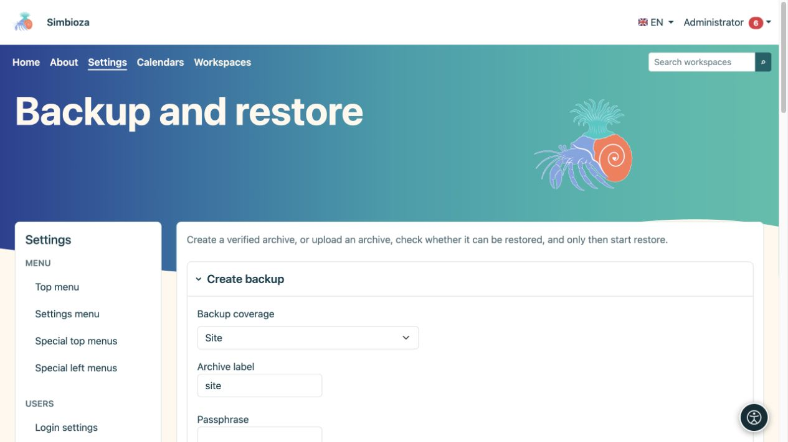
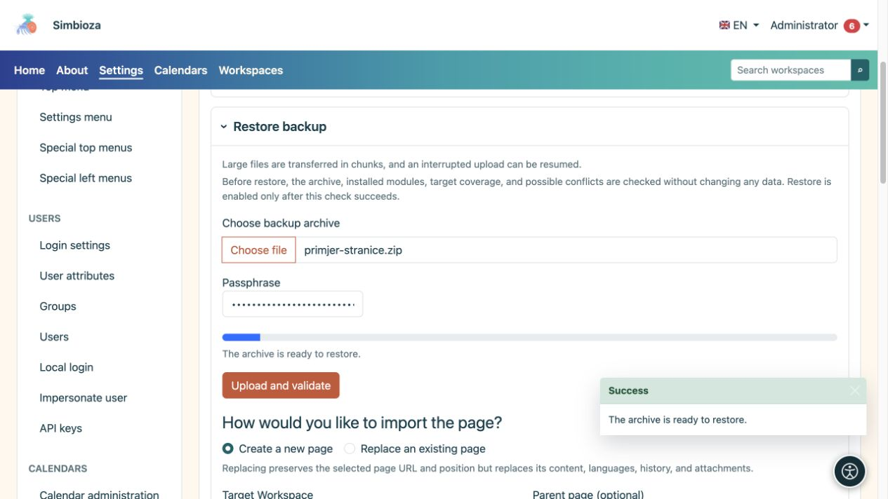

# Backups and restoration

**Audience:** the administrator of the entire installation. Open **Settings → Backup and restore**. Archives preserve data for later restoration; HTML exports for reading pages serve a different purpose.

## Select a scope

| Scope | When to use it |
|---|---|
| Site | A complete copy of supported data and settings from installed modules, including application settings. It is not a copy of the PHP program, server operating system, or technical logs. |
| Business component | One or more offered related functions. Contributions from installed modules belonging to the component are included; arbitrary database tables are not selected. |
| Workspace | Pages, hierarchy, attachments, and related workspace data, including surveys, responses, and settings. Read **This backup includes** for your installation. |
| Page | A selected page with languages, history, and attachments. A separate checkbox includes permissions and restrictions. |

Confluence data is included when it exists and the relevant module is installed; this is additional import and link-resolution data. An imported Confluence workspace is used as an ordinary Simbioza workspace after import.

## Create and download a backup

*Before creation, select the coverage, archive label, and required passphrase.*

1. Select the scope and relevant workspace, page, or business components. Use search and **Load more** in larger lists.
2. Check the included data and, for a page, whether permissions should be included.
3. Enter a recognisable archive name.
4. Enter a passphrase when the archive includes secrets, such as external sign-in settings. Keep it separately; the application does not store it in the database.
5. Choose **Create backup** and wait for completion.
6. Store the downloaded file securely.

**Result:** you have a verified portable archive. A GUI archive is intended for one-time download; its server copy is deleted after a successful download. A job record is not a substitute for the downloaded archive.

## Check before restoring

*After uploading a page backup, choose a new page or replacement of an existing one; uploading alone does not restore data.*

1. Under **Restore backup**, select your archive. Large files are uploaded in chunks.
2. Enter the passphrase if required and choose **Upload and check**.
3. Read the detected scope, required modules, possible conflicts, and available targets.
4. Choose the restore mode and destination.
5. Run **Check restore compatibility** again after changing an important selection.
6. Only after a successful check and reviewing warnings, choose **Start restore** and confirm.

**Preflight checking does not change existing data.** A successful upload alone does not mean restoration is complete. Afterwards, open the page/survey, an attachment, and results, and test access with another account.

## Understand conflict options

- **Merge same source** links data from the same source according to the selected scope's rules. It is not a substitute for an independent copy.
- **Create copy** creates separate content alongside the existing content.
- **Replace** can replace existing data. A full replacement also requires explicit maintenance-mode confirmation and should be arranged with the maintainer.

For a page, choose **Create a new page** or **Overwrite an existing page**. Overwriting preserves the selected page's address and position but replaces its content, languages, history, and attachments. Check the target workspace, parent, and exact existing document before final confirmation.

**Import page permissions** applies grants for existing users and groups. Do not assume missing accounts are automatically created or that old grants suit the new organisation. For restored surveys, also check audience, privacy, publication state, and report schedules.

## Recent jobs

The list shows time, operation, scope, and state. **Download once** downloads an available archive; **Delete job record** does not delete the source page or workspace. If an operation fails, read its message and the [log](admin-dnevnici_en.md) before retrying.
