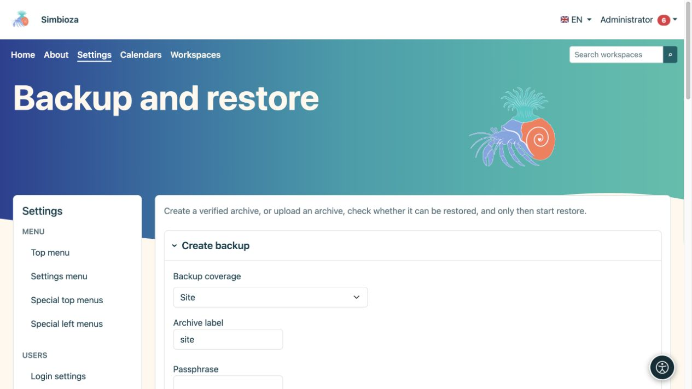
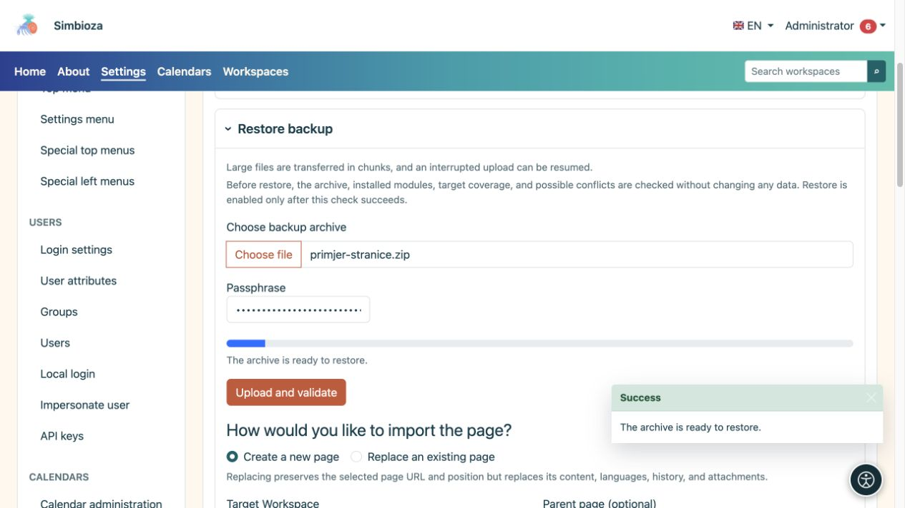

# Copias de seguridad y restauración

> Las capturas de pantalla muestran la interfaz en inglés.

**Audiencia:** el administrador de toda la instalación. Abra **Configuración → Copia de seguridad y restauración**. Los archivos preservan los datos para su posterior restauración; Las exportaciones HTML para leer páginas tienen un propósito diferente.

## Seleccione un alcance

| Alcance | Cuando usarlo |
|---|---|
| Sitio | Una copia completa de los datos y configuraciones admitidos de los módulos instalados, incluida la configuración de la aplicación. No es una copia del programa PHP, del sistema operativo del servidor ni de los registros técnicos. |
| Componente empresarial | Una o más funciones relacionadas ofrecidas. Se incluyen las aportaciones de los módulos instalados pertenecientes al componente; Las tablas de bases de datos arbitrarias no se seleccionan. |
| Espacio de trabajo | Páginas, jerarquía, archivos adjuntos y datos relacionados con el espacio de trabajo, incluidas encuestas, respuestas y configuraciones. Lea **Esta copia de seguridad incluye** para su instalación. |
| Página | Una página seleccionada con idiomas, historia y archivos adjuntos. Una casilla de verificación separada incluye permisos y restricciones. |

Los datos de Confluence se incluyen cuando existen y el módulo correspondiente está instalado; Estos son datos adicionales de importación y resolución de enlaces. Un espacio de trabajo de Confluence importado se utiliza como un espacio de trabajo Simbioza normal después de la importación.

## Crear y descargar una copia de seguridad

*Antes de la creación, seleccione la cobertura, la etiqueta de archivo y la frase de contraseña requerida.*

1. Seleccione el alcance y el espacio de trabajo, la página o los componentes comerciales relevantes. Utilice la búsqueda y **Cargar más** en listas más grandes.
2. Verifique los datos incluidos y, para una página, si se deben incluir permisos.
3. Introduzca un nombre de archivo reconocible.
4. Ingrese una frase de contraseña cuando el archivo incluya secretos, como configuraciones de inicio de sesión externo. Manténgalo por separado; la aplicación no lo almacena en la base de datos.
5. Elija **Crear copia de seguridad** y espere a que finalice.
6. Guarde el archivo descargado de forma segura.

**Resultado:** tiene un archivo portátil verificado. Un archivo GUI está diseñado para una descarga única; su copia del servidor se elimina después de una descarga exitosa. Un registro de trabajo no sustituye al archivo descargado.

## Comprobar antes de restaurar

*Después de cargar una copia de seguridad de la página, elija una página nueva o reemplace una existente; la carga por sí sola no restaura los datos.*

1. En **Restaurar copia de seguridad**, seleccione su archivo. Los archivos grandes se cargan en trozos.
2. Ingrese la frase de contraseña si es necesario y elija **Cargar y verificar**.
3. Lea el alcance detectado, los módulos requeridos, los posibles conflictos y los objetivos disponibles.
4. Elija el modo de restauración y el destino.
5. Ejecute **Verificar compatibilidad de restauración** nuevamente después de cambiar una selección importante.
6. Solo después de una verificación exitosa y de revisar las advertencias, elija **Iniciar restauración** y confirme.

**La verificación previa no cambia los datos existentes.** Una carga exitosa por sí sola no significa que la restauración esté completa. Luego, abra la página/encuesta, un archivo adjunto y los resultados, y pruebe el acceso con otra cuenta.

## Comprender las opciones de conflicto

- **Fusionar la misma fuente** vincula datos de la misma fuente de acuerdo con las reglas del alcance seleccionado. No sustituye a una copia independiente.
- **Crear copia** crea contenido separado junto con el contenido existente.
- **Reemplazar** puede reemplazar datos existentes. Un reemplazo completo también requiere una confirmación explícita del modo de mantenimiento y debe coordinarse con el encargado del mantenimiento.

Para una página, elija **Crear una página nueva** o **Sobrescribir una página existente**. La sobrescritura conserva la dirección y la posición de la página seleccionada, pero reemplaza su contenido, idiomas, historial y archivos adjuntos. Verifique el espacio de trabajo de destino, el documento principal y el documento existente exacto antes de la confirmación final.

**Importar permisos de página** aplica concesiones para usuarios y grupos existentes. No asuma que las cuentas faltantes se crean automáticamente o que las permisos antiguas se adaptan a la nueva organización. Para encuestas restauradas, verifique también la audiencia, la privacidad, el estado de publicación y los cronogramas de informes.

## Empleos recientes

La lista muestra la hora, la operación, el alcance y el estado. **Descargar una vez** descarga un archivo disponible; **Eliminar registro de trabajo** no elimina la página de origen ni el espacio de trabajo. Si una operación falla, lea su mensaje y el [registro](admin-dnevnici_es.md) antes de volver a intentarlo.
