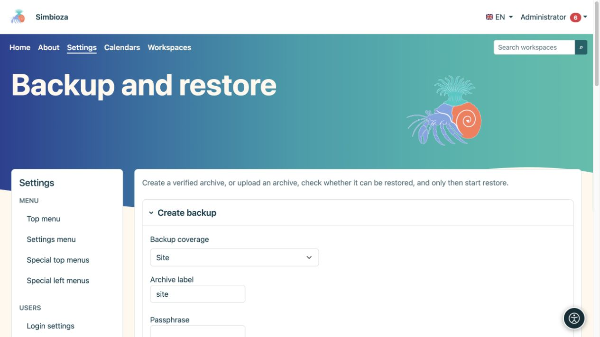
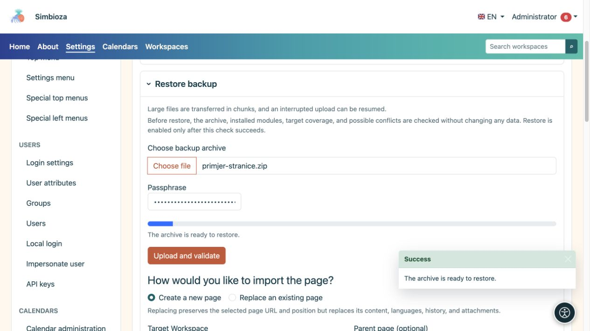

# Sauvegardes et restauration

> Les captures d’écran présentent l’interface en anglais.

**Public :** l'administrateur de l'ensemble de l'installation. Ouvrez **Paramètres → Sauvegarde et restauration**. Les archives conservent les données pour une restauration ultérieure ; Les exportations HTML pour la lecture de pages ont un objectif différent.

## Sélectionnez une portée

| Portée | Quand l'utiliser |
|---|---|
| Site | Une copie complète des données et paramètres pris en charge à partir des modules installés, y compris les paramètres de l'application. Il ne s'agit pas d'une copie du programme PHP, du système d'exploitation du serveur ou des journaux techniques. |
| Volet métier | Une ou plusieurs fonctions associées proposées. Les contributions des modules installés appartenant au composant sont incluses ; les tables de base de données arbitraires ne sont pas sélectionnées. |
| Espace de travail | Pages, hiérarchie, pièces jointes et données d'espace de travail associées, y compris les sondages, les réponses et les paramètres. Lisez **Cette sauvegarde inclut** pour votre installation. |
| Page | Une page sélectionnée avec les langues, l'historique et les pièces jointes. Une case à cocher distincte inclut les autorisations et les restrictions. |

Les données Confluence sont incluses lorsqu'elles existent et que le module correspondant est installé ; il s'agit de données supplémentaires d'importation et de résolution de lien. Un espace de travail Confluence importé est utilisé comme un espace de travail Simbioza ordinaire après l'importation.

## Créer et télécharger une sauvegarde

*Avant la création, sélectionnez la couverture, l'étiquette d'archive et la phrase secrète requise.*

1. Sélectionnez la portée et les composants d’espace de travail, de page ou d’entreprise pertinents. Utilisez la recherche et **Chargez plus** dans des listes plus grandes.
2. Vérifiez les données incluses et, pour une page, si les autorisations doivent être incluses.
3. Entrez un nom d'archive reconnaissable.
4. Saisissez une phrase secrète lorsque l'archive inclut des secrets, tels que des paramètres de connexion externes. Conservez-le séparément ; l'application ne le stocke pas dans la base de données.
5. Choisissez **Créer une sauvegarde** et attendez la fin.
6. Stockez le fichier téléchargé en toute sécurité.

**Résultat :** vous disposez d'une archive portable vérifiée. Une archive GUI est destinée à un téléchargement unique ; sa copie sur le serveur est supprimée après un téléchargement réussi. Un enregistrement de travail ne remplace pas l'archive téléchargée.

## Vérifiez avant de restaurer

*Après avoir téléchargé une sauvegarde de page, choisissez une nouvelle page ou remplacez une page existante ; le téléchargement seul ne restaure pas les données.*

1. Sous **Restaurer la sauvegarde**, sélectionnez votre archive. Les fichiers volumineux sont téléchargés en morceaux.
2. Saisissez la phrase secrète si nécessaire et choisissez **Télécharger et vérifier**.
3. Lisez la portée détectée, les modules requis, les conflits possibles et les cibles disponibles.
4. Choisissez le mode de restauration et la destination.
5. Exécutez à nouveau **Vérifier la compatibilité de la restauration** après avoir modifié une sélection importante.
6. Ce n'est qu'après une vérification réussie et un examen des avertissements que vous choisissez **Démarrer la restauration** et confirmez.

**La vérification en amont ne modifie pas les données existantes.** Un téléchargement réussi ne signifie pas à lui seul que la restauration est terminée. Ensuite, ouvrez la page/le sondage, une pièce jointe et les résultats, et testez l'accès avec un autre compte.

## Comprendre les options de conflit

- **Fusionner la même source** lie les données de la même source selon les règles de la portée sélectionnée. Cela ne remplace pas une copie indépendante.
- **Créer une copie** crée un contenu séparé à côté du contenu existant.
- **Remplacer** peut remplacer les données existantes. Un remplacement complet nécessite également une confirmation explicite du mode maintenance et doit être organisé avec le responsable.

Pour une page, choisissez **Créer une nouvelle page** ou **Écraser une page existante**. L'écrasement préserve l'adresse et la position de la page sélectionnée mais remplace son contenu, ses langues, son historique et ses pièces jointes. Vérifiez l'espace de travail cible, le parent et le document existant exact avant la confirmation finale.

**Importer les droits des pages** applique les droits aux utilisateurs et groupes existants. Ne supposez pas que les comptes manquants sont créés automatiquement ou que les anciens droits conviennent à la nouvelle organisation. Pour les sondages restaurés, vérifiez également le public, la confidentialité, l’état de publication et la planification des rapports.

## Emplois récents

La liste indique l'heure, l'opération, la portée et l'état. **Télécharger une fois** télécharge une archive disponible ; **Supprimer l'enregistrement de tâche** ne supprime pas la page source ou l'espace de travail. Si une opération échoue, lisez son message et le [log](admin-dnevnici_fr.md) avant de réessayer.
