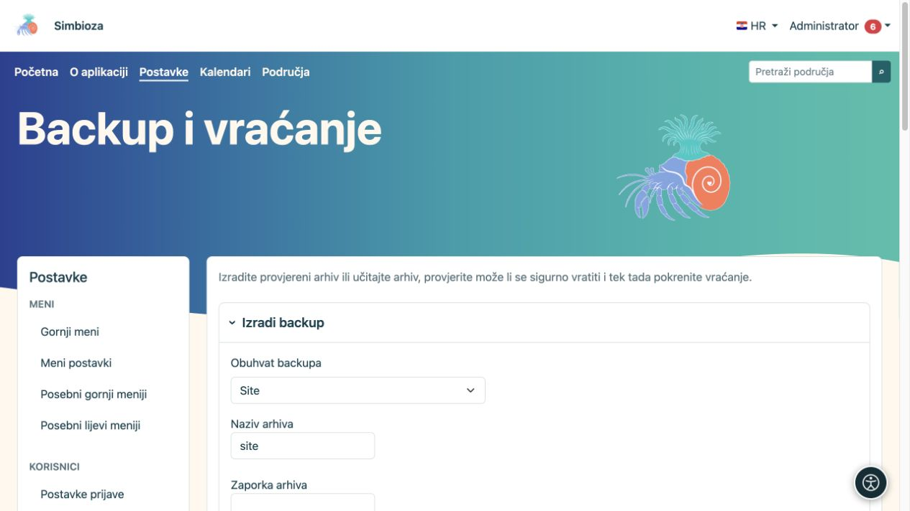
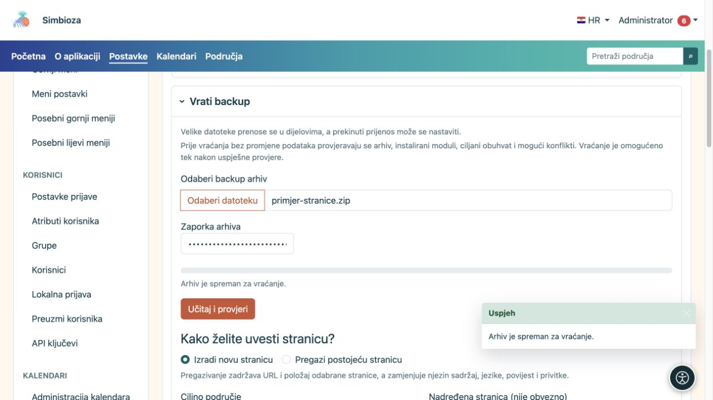

# Sigurnosne kopije i vraćanje

**Za koga:** administrator cijele instalacije. Otvorite **Postavke → Backup i vraćanje**. Arhiv služi očuvanju podataka i njihovu kasnijem vraćanju; HTML izvoz namijenjen čitanju stranica ima drugu svrhu.

## Odaberite opseg

| Opseg | Kada ga odabrati |
|---|---|
| Site | Za potpunu kopiju podržanih podataka i postavki instaliranih modula, uključujući aplikacijske postavke. To nije kopija PHP programa, poslužiteljskog operacijskog sustava ni tehničkih logova. |
| Poslovna cjelina | Za jednu ili više ponuđenih povezanih funkcionalnosti. Uključuju se doprinosi instaliranih modula te cjeline; ne biraju se nasumične tablice baze. |
| Područje | Za stranice, hijerarhiju, privitke i povezane podatke područja, uključujući ankete, njihove odgovore i postavke. Pročitajte popis **U ovaj backup uključeno je** za svoju instalaciju. |
| Stranica | Za odabranu stranicu s jezicima, poviješću i privitcima. Prava i ograničenja uključuju se zasebnom kućicom. |

Confluence podaci uključuju se ako postoje i odgovarajući je modul instaliran; to su dodatni podaci uvoza i razrješavanja poveznica. Područje uvezeno iz Confluencea nakon uvoza koristi se kao obično područje Simbioze.

## Izradite i preuzmite kopiju

*Prije izrade odaberite opseg, naziv arhiva i potrebnu zaporku.*

1. Odaberite opseg i pripadajuće područje, stranicu ili poslovne cjeline. Koristite pretragu i **Učitaj još** u većim popisima.
2. Provjerite uključene podatke i, za stranicu, odluku o uključivanju prava.
3. Unesite naziv arhiva da ga poslije prepoznate.
4. Upišite zaporku kada arhiv uključuje tajne, primjerice postavke vanjske prijave. Sačuvajte je odvojeno; aplikacija je ne sprema u bazu.
5. Odaberite **Izradi backup** i pričekajte završetak.
6. Sačuvajte preuzetu datoteku na sigurnom mjestu.

**Rezultat:** imate provjereni prenosivi arhiv. GUI kopija namijenjena je jednokratnom preuzimanju; nakon uspješnog preuzimanja poslužiteljska kopija se briše. Zapis posla nije zamjena za lokalno spremljeni arhiv.

## Najprije provjerite vraćanje

*Nakon učitavanja kopije stranice birate novu stranicu ili pregazivanje postojeće; samo učitavanje još ne vraća podatke.*

1. U **Vrati backup** odaberite svoj arhiv. Velike datoteke prenose se u dijelovima.
2. Upišite zaporku ako je potrebna i odaberite **Učitaj i provjeri**.
3. Pročitajte pronađeni opseg, potrebne module, moguće konflikte i ponuđene ciljeve.
4. Odaberite način vraćanja i odredište.
5. Ponovno pokrenite **Provjeri mogućnost vraćanja** nakon promjene važnog izbora.
6. Tek nakon uspješne provjere i čitanja upozorenja odaberite **Pokreni vraćanje** te potvrdite.

**Provjera još ne mijenja postojeće podatke.** Samo uspješno učitavanje datoteke ne znači da je sadržaj vraćen. Nakon vraćanja otvorite stranicu/anketu, privitak i rezultat te provjerite pristup drugim računom.

## Razumijte izbor konflikta

- **Spoji isti izvor** povezuje podatke istoga izvora prema pravilima prikazanog opsega. Ne koristite ga kao zamjenu za novu neovisnu kopiju.
- **Kreiraj kopiju** koristite kada želite zaseban sadržaj uz postojeći.
- **Zamijeni** može zamijeniti postojeće podatke. Potpuni replace traži i izričitu potvrdu maintenance načina; postupak treba dogovoriti s održavateljem.

Kod stranice odaberite **Izradi novu stranicu** ili **Pregazi postojeću stranicu**. Pregazivanje čuva adresu i položaj odabrane stranice, ali zamjenjuje sadržaj, jezike, povijest i privitke. Provjerite ciljno područje, nadređenu stranicu i točan postojeći dokument prije završne potvrde.

**Uvezi prava stranice** primjenjuje prava za postojeće korisnike i grupe. Nemojte pretpostaviti da se nepostojeći računi automatski stvaraju ili da prava odgovaraju novoj organizaciji. Za vraćene ankete dodatno provjerite ciljanu skupinu, privatnost, status objave i raspored izvještaja.

## Nedavni poslovi

Popis pokazuje vrijeme, operaciju, opseg i stanje. **Preuzmi jednom** preuzima raspoloživi arhiv, a **Obriši zapis posla** nije brisanje izvorne stranice ili područja. Ako radnja nije uspjela, pročitajte poruku i [dnevnik](admin-dnevnici_hr.md) prije ponavljanja.
