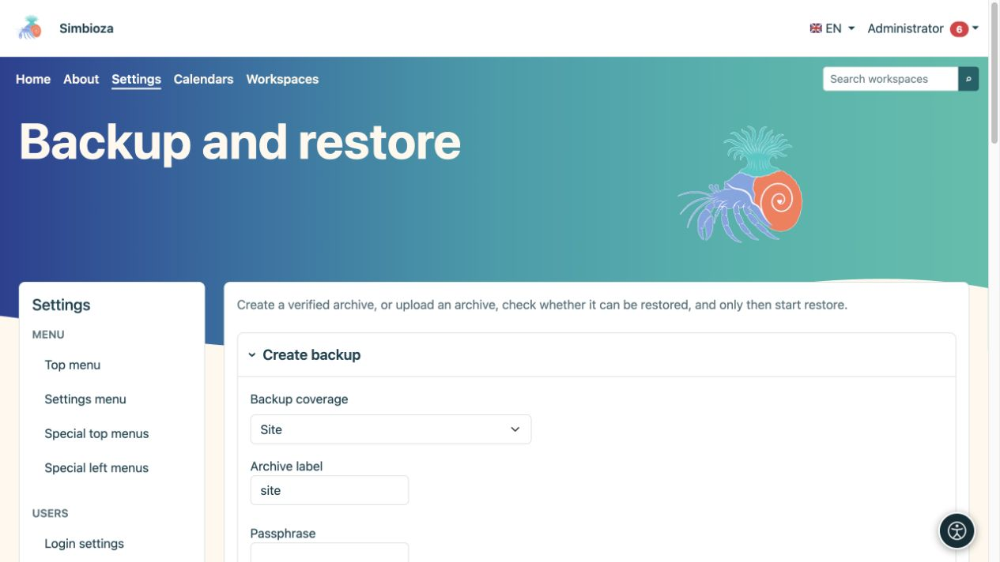
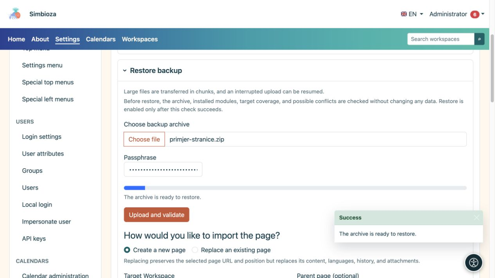

# Backup e ripristino

> Le schermate mostrano l’interfaccia in inglese.

**Destinatari:** l'amministratore dell'intera installazione. Apri **Impostazioni → Backup e ripristino**. Gli archivi conservano i dati per un successivo ripristino; le esportazioni HTML per leggere le pagine hanno uno scopo diverso.

## Seleziona un ambito

| Ambito | Quando usarlo |
|---|---|
| Sito | Una copia completa dei dati e delle impostazioni supportati dai moduli installati, incluse le impostazioni dell'applicazione. Non è una copia del programma PHP, del sistema operativo del server o dei registri tecnici. |
| Componente aziendale | Una o più funzioni correlate offerte. Sono inclusi i contributi dei moduli installati appartenenti al componente; le tabelle del database arbitrarie non sono selezionate. |
| Area di lavoro | Pagine, gerarchia, allegati e dati relativi all'area di lavoro, inclusi sondaggi, risposte e impostazioni. Leggi **Questo backup include** per la tua installazione. |
| Pagina | Una pagina selezionata con lingue, cronologia e allegati. Una casella di controllo separata include autorizzazioni e restrizioni. |

I dati di Confluence sono inclusi quando esistono e il relativo modulo è installato; si tratta di dati aggiuntivi sull'importazione e sulla risoluzione dei collegamenti. Dopo l'importazione, un'area di lavoro proveniente da Confluence viene usata come una normale area di lavoro Simbioza.

## Crea e scarica un backup

*Prima della creazione, seleziona la copertura, l'etichetta di archivio e la passphrase richiesta.*

1. Seleziona l'ambito e l'area di lavoro, la pagina o i componenti aziendali pertinenti. Utilizza la ricerca e **Carica altro** negli elenchi più grandi.
2. Controlla i dati inclusi e, per una pagina, se le autorizzazioni devono essere incluse.
3. Inserisci un nome di archivio riconoscibile.
4. Inserisci una passphrase quando l'archivio include segreti, come le impostazioni di accesso esterno. Conservarlo separatamente; l'applicazione non lo memorizza nel database.
5. Scegli **Crea backup** e attendi il completamento.
6. Archivia il file scaricato in modo sicuro.

**Risultato:** hai un archivio portatile verificato. Un archivio GUI può essere scaricato una sola volta; la sua copia sul server viene eliminata dopo un download riuscito. Un record di lavoro non sostituisce l'archivio scaricato.

## Controllare prima del ripristino

*Dopo aver caricato il backup di una pagina, scegli una nuova pagina o la sostituzione di una esistente; il solo caricamento non ripristina i dati.*

1. In **Ripristina backup**, seleziona il tuo archivio. I file di grandi dimensioni vengono caricati in blocchi.
2. Inserisci la passphrase se richiesta e scegli **Carica e controlla**.
3. Leggere l'ambito rilevato, i moduli richiesti, i possibili conflitti e le destinazioni disponibili.
4. Scegli la modalità di ripristino e la destinazione.
5. Esegui nuovamente **Verifica ripristino compatibilità** dopo aver modificato una selezione importante.
6. Solo dopo aver completato con successo il controllo e aver letto gli avvisi, seleziona **Avvia ripristino** e conferma.

**Il controllo preliminare non modifica i dati esistenti.** Un caricamento riuscito da solo non significa che il ripristino è completo. Successivamente, apri la pagina/il sondaggio, un allegato e i risultati e verifica l'accesso con un altro account.

## Comprendere le opzioni di conflitto

- **Unisci la stessa origine** collega i dati della stessa origine in base alle regole dell'ambito selezionato. Non sostituisce una copia indipendente.
- **Crea copia** crea contenuti separati insieme al contenuto esistente.
- **Sostituisci** può sostituire i dati esistenti. Una sostituzione completa richiede anche la conferma esplicita della modalità di manutenzione e deve essere concordata con il manutentore.

Per una pagina, scegli **Crea una nuova pagina** oppure **Sovrascrivi una pagina esistente**. La sovrascrittura mantiene indirizzo e posizione della pagina selezionata, ma ne sostituisce contenuto, lingue, cronologia e allegati. Controlla l'area di lavoro di destinazione, la pagina superiore e l'esatto documento esistente prima della conferma finale.

**Importa autorizzazioni della pagina** applica le autorizzazioni a utenti e gruppi esistenti. Non dare per scontato che gli account mancanti vengano creati automaticamente o che le vecchie autorizzazioni siano adatte alla nuova organizzazione. Per i sondaggi ripristinati, controlla anche destinatari, privacy, stato di pubblicazione e pianificazioni dei rapporti.

## Lavori recenti

L'elenco mostra l'ora, l'operazione, l'ambito e lo stato. **Scarica una volta** scarica un archivio disponibile; **Elimina record lavoro** non elimina la pagina di origine o l'area di lavoro. Se un'operazione fallisce, leggere il messaggio e il [log](admin-dnevnici_it.md) prima di riprovare.
