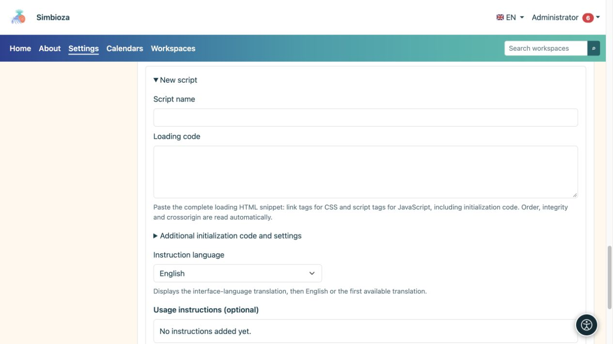
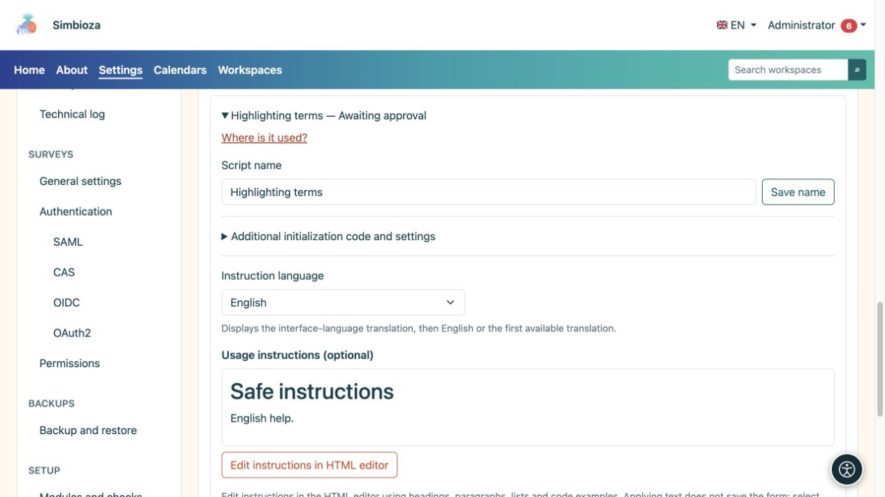

# Externe Skripte und Hinweise für Autoren

> Die Bildschirmaufnahmen zeigen die englische Benutzeroberfläche.

**Zielgruppe:** der Administrator der gesamten Installation. Öffnen Sie **Einstellungen → Editor HTML → Externe Skripte**. Diese Registrierung ist für zusätzlichen Seiteninhaltscode vorgesehen, nicht für die eigenen Skripte von Simbioza.

Ein genehmigtes Skript kann im Browser des Lesers mit Zugriff auf die angezeigte Seite ausgeführt werden. Genehmigen Sie nur Quellen und Code, denen Sie vertrauen. Durch die Genehmigung wird das Skript nicht auf jeder Seite geladen: Autoren wählen separat ein genehmigtes Skript für ihre Seite aus.

## Bereiten Sie ein neues Skript vor

*Ein neues Skript verfügt über separate Felder für seinen Namen, das Laden der Bibliothek, zusätzlichen Code und Anweisungen.*

1. Erweitern Sie **Neues Skript**.
2. Geben Sie einen Klarnamen ein, den die Autoren erkennen.
3. Fügen Sie den Snippet des Lieferanten in **Ladecode** ein: HTML `link`-Tags für CSS und `script`-Tags für JavaScript. Abhängigkeitsreihenfolge beibehalten.
4. Wenn ein separater Startcode erforderlich ist, geben Sie ihn unter **Zusätzlicher Startcode und Einstellungen** ein, ohne die Tags `script` einzuschließen. Es gehört zu diesem Registrierungseintrag, nicht zur CDN-Datei.
5. Bearbeiten Sie **Nutzungsanweisungen** im eingebetteten HTML-Editor. Erklären Sie, was ein Autor auf seiner Seite tun muss, und stellen Sie das kleinste nützliche Codebeispiel bereit.
6. Wählen Sie im Dialogfeld **Text anwenden**, dann im Formular **Anweisungen speichern** oder für einen neuen Eintrag **Als ausstehend hinzufügen**.

**Ergebnis:** Der Eintrag ist vorbereitet, aber für Autoren nicht verfügbar, bis ein Administrator ihn genehmigt. Durch alleinige Eingabe von Text im Dialog wird das Verabreichungsformular nicht gespeichert.

## Integritätsüberprüfung

Das System liest `integrity` und `crossorigin` aus dem Snippet. **Integrität** gibt den erwarteten Datei-Digest an: Der Browser weigert sich, Remote-Code auszuführen, der nicht mehr übereinstimmt. **Crossorigin** wählt den für diese Überprüfung erforderlichen Cross-Origin-Lademodus aus; der Remote-Server muss den entsprechenden Zugriff erlauben.

SRI ist optional. Ohne diese Angabe zeigt das System eine Warnung an, da der Eigentümer der Remote-URL den Code später ändern kann. Treffen Sie diese Entscheidung bewusst für jeden Eintrag. Das Hinzufügen eines beliebigen Digest- oder `crossorigin`-Attributs kann die falsche Datei oder einen Server, der den erforderlichen Zugriff nicht zulässt, nicht beheben.

## Genehmigen, ablehnen oder widerrufen

Öffnen Sie einen Eintrag, überprüfen Sie dessen Ladecode, Startcode und Anweisungen und wählen Sie dann **Genehmigen** oder **Ablehnen**. Wenn ein genehmigter Eintrag nicht mehr verwendet werden darf, wählen Sie **Genehmigung widerrufen**. Das Ändern des ausführbaren Codes oder seiner Adresse erfordert einen neuen Genehmigungsprozess. die frühere Genehmigung sollte nicht als Genehmigung eines anderen Inhalts gewertet werden.

**Wo wird es verwendet?** listet Seiten und Sprachen auf, die auf den ausgewählten Eintrag verweisen. Fügen Sie bei Bedarf historische Versionen hinzu. Eine gefundene Referenz und ein auf einer Seite aktiviertes Skript sind unterschiedliche Zustände; Lesen Sie den Status der Zeile, bevor Sie zu dem Schluss kommen, dass der Code ausgeführt wird.

## Anleitung in mehreren Sprachen

*Anleitungen werden nach Sprache ausgewählt und bearbeitet; Ihre Vorschau ist vom ausführbaren Skriptcode getrennt.*

Wählen Sie eine installierte Unterrichtssprache aus, bearbeiten Sie deren Inhalt und speichern Sie. Autoren erhalten die Übersetzung der Benutzeroberfläche, dann Englisch und dann die erste verfügbare Übersetzung. Ein Fragezeichen neben dem Skriptnamen im Editor wird nur angezeigt, wenn die Anweisungen nicht leer sind. Das Hilfemodal erklärt die Verwendung; es gibt dem Autor keine Rechte zur Drehbuchgenehmigung.

Genehmigte Skripte sind in den Exporten der Seite HTML enthalten: Remote-Adressen bleiben Links und enthaltener lokaler Code wird mit dem Inhalt exportiert. Überprüfen Sie die exportierte Seite und die Verfügbarkeit ihrer Abhängigkeiten. Erwarten Sie nicht, dass Inhaltsskripte im Editor selbst oder in einer historischen Vorschau ausgeführt werden.

Für integrierte interaktive Tabellen verwenden Sie **Tabelleneinstellungen** im [Bearbeitungsleitfaden](uredivanje-stranica_de.md); DataTables ist für diese Funktion nicht erforderlich.
