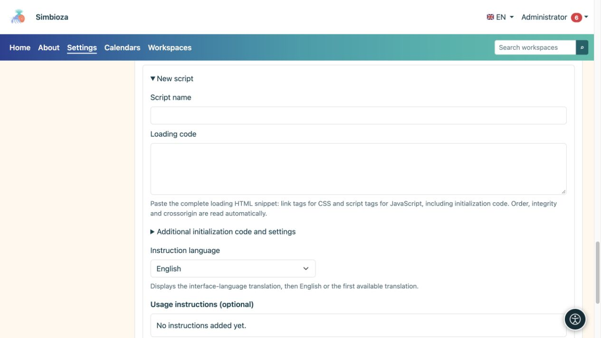
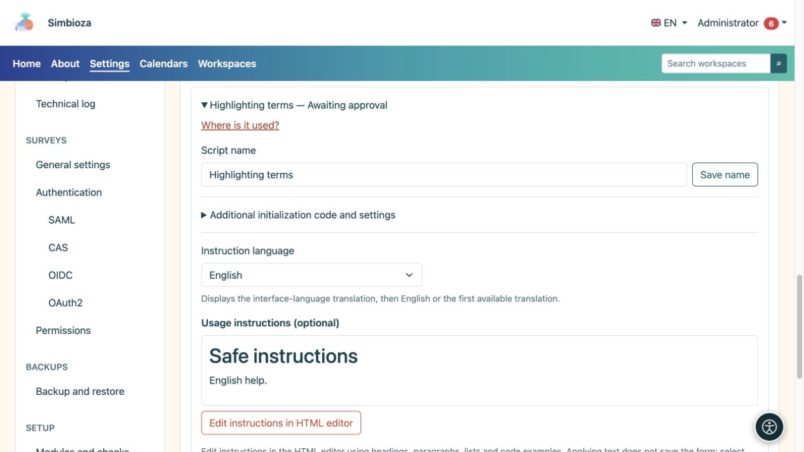

# External scripts and author instructions

**Audience:** the administrator of the entire installation. Open **Settings → HTML editor → External scripts**. This registry is for additional page-content code, not Simbioza's own scripts.

An approved script can run in the reader's browser with access to the displayed page. Approve only sources and code you trust. Approval does not load the script on every page: authors separately select an approved script for their page.

## Prepare a new script

*A new script has separate fields for its name, library loading, extra code, and instructions.*

1. Expand **New script**.
2. Enter a clear name authors will recognise.
3. Paste the supplier's snippet into **Loading code**: HTML `link` tags for CSS and `script` tags for JavaScript. Preserve dependency order.
4. If separate startup code is needed, enter it in **Additional startup code and settings**, without surrounding `script` tags. It belongs to this registry entry, not the CDN file.
5. Edit **Usage instructions** in the embedded HTML editor. Explain what an author must do on their page and provide the smallest useful code example.
6. Choose **Apply text** in the dialog, then **Save instructions** in the form, or **Add as pending** for a new entry.

**Result:** the entry is prepared but unavailable to authors until an administrator approves it. Applying text in the dialog alone does not save the administration form.

## Integrity verification

The system reads `integrity` and `crossorigin` from the snippet. **Integrity** specifies the expected file digest: the browser refuses to execute remote code that no longer matches. **Crossorigin** selects the cross-origin loading mode required for this verification; the remote server must permit the appropriate access.

SRI is optional. Without it, the system shows a warning because the remote URL's owner can later change the code. Make that decision deliberately for each entry. Adding an arbitrary digest or `crossorigin` attribute cannot fix the wrong file or a server that does not permit the required access.

## Approve, reject, or revoke

Open an entry, review its loading code, startup code, and instructions, then choose **Approve** or **Reject**. If an approved entry must no longer be used, choose **Revoke approval**. Changing executable code or its address requires a new approval process; the earlier approval should not be treated as approval of different content.

**Where is it used?** lists pages and languages referencing the selected entry. Include historical versions when required. A found reference and a script enabled on a page are different states; read the row's status before concluding that code executes.

## Instructions in several languages

*Instructions are selected and edited by language; their preview is separate from the script executable code.*

Select an installed instruction language, edit its content, and save. Authors receive the interface-language translation, then English, then the first available translation. A question mark beside the script name in the editor appears only when instructions are nonempty. The help modal explains use; it does not give the author script-approval rights.

Approved scripts are included in page HTML exports: remote addresses remain links and included local code is exported with the content. Check the exported page and the availability of its dependencies. Do not expect content scripts to run inside the editor itself or a historical preview.

For built-in interactive tables, use **Table settings** in the [editing guide](uredivanje-stranica_en.md); DataTables is not required for that feature.
