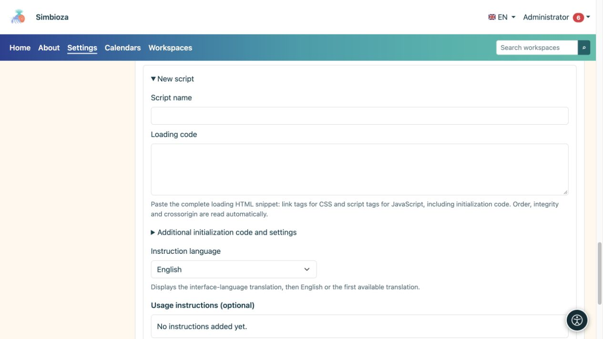
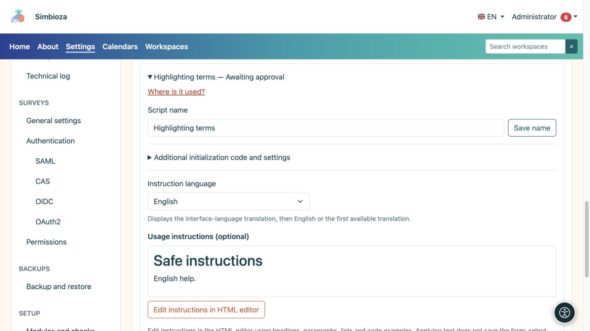

# Scripts externos e instrucciones para autores

> Las capturas de pantalla muestran la interfaz en inglés.

**Audiencia:** el administrador de toda la instalación. Abra **Configuración → HTML editor → Scripts externos**. Este registro es para código de contenido de página adicional, no para los propios scripts de Simbioza.

Se puede ejecutar un script aprobado en el navegador del lector con acceso a la página mostrada. Apruebe sólo fuentes y códigos en los que confíe. La aprobación no carga el script en cada página: los autores seleccionan por separado un script aprobado para su página.

## Preparar un nuevo script

*Un nuevo script tiene campos separados para su nombre, carga de biblioteca, código adicional e instrucciones.*

1. Expanda **Nuevo script**.
2. Introduzca un nombre claro que los autores reconozcan.
3. Pegue el fragmento del proveedor en **Código de carga**: etiquetas HTML `link` para CSS y etiquetas `script` para JavaScript. Preservar el orden de dependencia.
4. Si se necesita un código de inicio independiente, ingréselo en **Configuraciones y código de inicio adicionales**, sin rodear las etiquetas `script`. Pertenece a esta entrada del registro, no al archivo CDN.
5. Edite **Instrucciones de uso** en el editor integrado HTML. Explique lo que debe hacer un autor en su página y proporcione el ejemplo de código útil más pequeño.
6. Elija **Aplicar texto** en el cuadro de diálogo, luego **Guardar instrucciones** en el formulario o **Agregar como pendiente** para una nueva entrada.

**Resultado:** la entrada está preparada pero no está disponible para los autores hasta que un administrador la apruebe. La sola aplicación de texto en el cuadro de diálogo no guarda el formulario de administración.

## Verificación de integridad

El sistema lee `integrity` y `crossorigin` del fragmento. **Integridad** especifica el resumen de archivo esperado: el navegador se niega a ejecutar código remoto que ya no coincide. **Crossorigin** selecciona el modo de carga de origen cruzado requerido para esta verificación; el servidor remoto debe permitir el acceso adecuado.

El SRI es opcional. Sin él, el sistema muestra una advertencia porque el propietario de la URL remota puede cambiar el código más adelante. Tome esa decisión deliberadamente para cada entrada. Agregar un resumen arbitrario o el atributo `crossorigin` no puede corregir el archivo incorrecto o un servidor que no permite el acceso requerido.

## Aprobar, rechazar o revocar

Abra una entrada, revise su código de carga, código de inicio e instrucciones, luego elija **Aprobar** o **Rechazar**. Si ya no se debe utilizar una entrada aprobada, elija **Revocar aprobación**. Cambiar el código ejecutable o su dirección requiere un nuevo proceso de aprobación; la aprobación anterior no debe considerarse como una aprobación de contenido diferente.

**¿Dónde se usa?** enumera las páginas y los idiomas que hacen referencia a la entrada seleccionada. Incluir versiones históricas cuando sea necesario. Una referencia encontrada y un script habilitado en una página son estados diferentes; lea el estado de la fila antes de concluir que el código se ejecuta.

## Instrucciones en varios idiomas.

*Las instrucciones se seleccionan y editan por idioma; su vista previa está separada del código ejecutable del script.*

Seleccione un idioma de instrucción instalado, edite su contenido y guárdelo. Los autores reciben la traducción al idioma de la interfaz, luego al inglés y luego a la primera traducción disponible. Un signo de interrogación junto al nombre del script en el editor aparece sólo cuando las instrucciones no están vacías. El modal de ayuda explica el uso; no otorga al autor derechos de aprobación del script.

Los scripts aprobados se incluyen en las exportaciones de la página HTML: las direcciones remotas siguen siendo enlaces y el código local incluido se exporta con el contenido. Verifique la página exportada y la disponibilidad de sus dependencias. No espere que los scripts de contenido se ejecuten dentro del propio editor o una vista previa histórica.

Para tablas interactivas integradas, utilice **Configuración de tabla** en la [guía de edición](uredivanje-stranica_es.md); No se requiere DataTables para esa característica.
