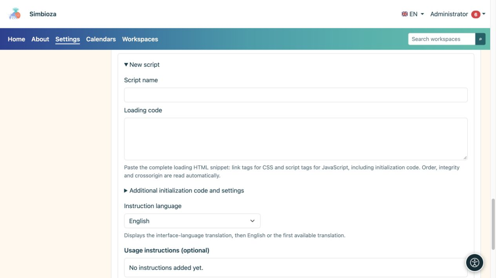
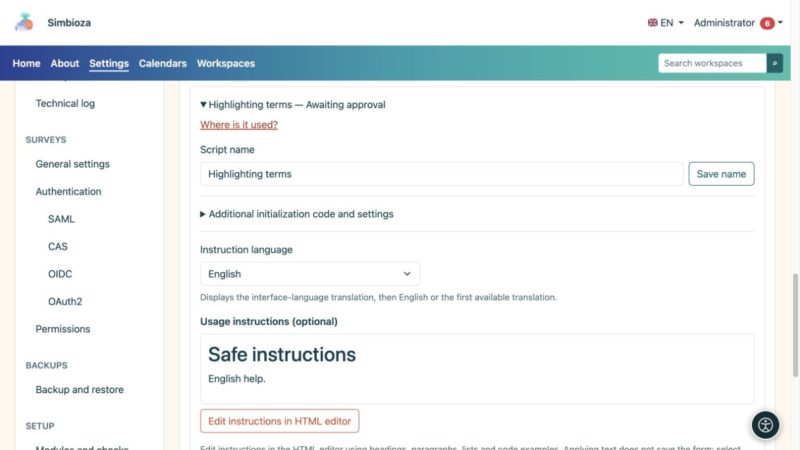

# Scripts externes et instructions pour les auteurs

> Les captures d’écran présentent l’interface en anglais.

**Public :** l'administrateur de l'ensemble de l'installation. Ouvrez **Paramètres → Éditeur HTML → Scripts externes**. Ce registre est destiné au code de contenu de page supplémentaire, et non aux propres scripts de Simbioza.

Un script approuvé peut s'exécuter dans le navigateur du lecteur avec accès à la page affichée. Approuvez uniquement les sources et le code auxquels vous faites confiance. L'approbation ne charge pas le script sur chaque page : les auteurs sélectionnent séparément un script approuvé pour leur page.

## Préparer un nouveau script

*Un nouveau script comporte des champs séparés pour son nom, le chargement de la bibliothèque, le code supplémentaire et les instructions.*

1. Développez **Nouveau script**.
2. Entrez un nom clair que les auteurs reconnaîtront.
3. Collez l'extrait du fournisseur dans **Code de chargement** : balises HTML `link` pour CSS et balises `script` pour JavaScript. Préserver l’ordre des dépendances.
4. Si un code de démarrage distinct est nécessaire, saisissez-le dans **Code de démarrage et paramètres supplémentaires**, sans entourer les balises `script`. Il appartient à cette entrée de registre, pas au fichier CDN.
5. Modifiez les **Instructions d'utilisation** dans l'éditeur HTML intégré. Expliquez ce qu'un auteur doit faire sur sa page et fournissez le plus petit exemple de code utile.
6. Choisissez **Appliquer le texte** dans la boîte de dialogue, puis **Enregistrer les instructions** dans le formulaire ou **Ajouter en attente** pour une nouvelle entrée.

**Résultat :** l'entrée est préparée mais n'est pas disponible pour les auteurs jusqu'à ce qu'un administrateur l'approuve. L'application seule de texte dans la boîte de dialogue n'enregistre pas le formulaire d'administration.

## Vérification de l'intégrité

Le système lit `integrity` et `crossorigin` à partir de l'extrait. **Intégrité** spécifie le résumé de fichier attendu : le navigateur refuse d'exécuter du code distant qui ne correspond plus. **Crossorigin** sélectionne le mode de chargement cross-origin requis pour cette vérification ; le serveur distant doit autoriser l'accès approprié.

L'ISR est facultatif. Sans cela, le système affiche un avertissement car le propriétaire de l'URL distante peut modifier le code ultérieurement. Prenez cette décision délibérément pour chaque entrée. L'ajout d'un résumé arbitraire ou d'un attribut `crossorigin` ne peut pas corriger le mauvais fichier ou un serveur qui n'autorise pas l'accès requis.

## Approuver, rejeter ou révoquer

Ouvrez une entrée, examinez son code de chargement, son code de démarrage et ses instructions, puis choisissez **Approuver** ou **Rejeter**. Si une entrée approuvée ne doit plus être utilisée, choisissez **Révoquer l'approbation**. La modification du code exécutable ou de son adresse nécessite un nouveau processus d'approbation ; l'approbation antérieure ne doit pas être considérée comme l'approbation d'un contenu différent.

**Où est-il utilisé ?** répertorie les pages et les langues faisant référence à l'entrée sélectionnée. Incluez des versions historiques si nécessaire. Une référence trouvée et un script activé sur une page sont des états différents ; lisez l'état de la ligne avant de conclure que le code s'exécute.

## Instructions en plusieurs langues

*Les instructions sont sélectionnées et éditées par langue ; leur aperçu est distinct du code exécutable du script.*

Sélectionnez une langue d'instruction installée, modifiez son contenu et enregistrez. Les auteurs reçoivent la traduction dans la langue de l'interface, puis l'anglais, puis la première traduction disponible. Un point d'interrogation à côté du nom du script dans l'éditeur apparaît uniquement lorsque les instructions ne sont pas vides. Le modal d'aide explique l'utilisation ; cela ne donne pas à l'auteur des droits d'approbation du scénario.

Les scripts approuvés sont inclus dans les exportations de la page HTML : les adresses distantes restent des liens et le code local inclus est exporté avec le contenu. Vérifiez la page exportée et la disponibilité de ses dépendances. Ne vous attendez pas à ce que les scripts de contenu s'exécutent dans l'éditeur lui-même ou dans un aperçu historique.

Pour les tableaux interactifs intégrés, utilisez les **Paramètres du tableau** dans le [guide d'édition](uredivanje-stranica_fr.md) ; DataTables n'est pas requis pour cette fonctionnalité.
