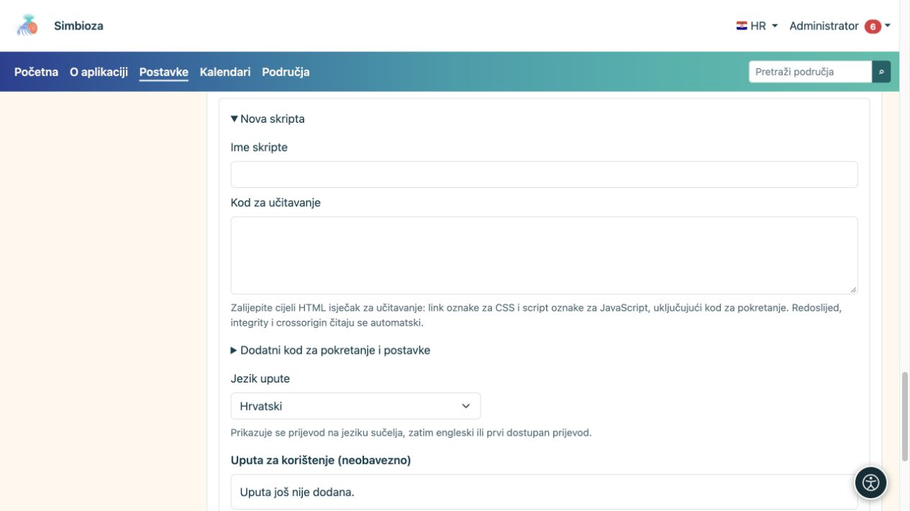
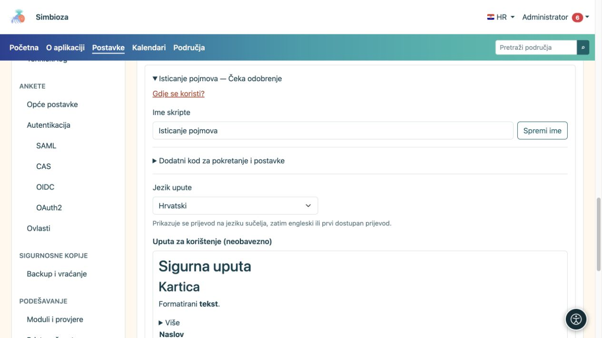

# Vanjske skripte i upute za autore

**Za koga:** administrator cijele instalacije. Otvorite **Postavke → HTML editor → Vanjske skripte**. Ovaj popis služi dodatnom kodu za sadržaj stranica, a ne Simbiozinim vlastitim skriptama.

Odobrena skripta može raditi u pregledniku čitatelja s pristupom prikazanoj stranici. Zato odobrite samo izvor i kod kojima vjerujete. Odobrenje nije automatsko učitavanje na svim stranicama: autor zatim zasebno bira odobrenu skriptu za svoju stranicu.

## Pripremite novu skriptu

*Nova skripta ima zasebna polja za naziv, učitavanje biblioteke, dodatni kod i uputu.*

1. Otvorite zatvoreni odjeljak **Nova skripta**.
2. Unesite jasan naziv koji će autor prepoznati.
3. U **Kod za učitavanje** zalijepite isječak dobavljača: HTML oznake `link` za CSS i `script` za JavaScript. Zadržite redoslijed ovisnosti.
4. Ako je potreban zaseban početni kod, unesite ga u **Dodatni kod za pokretanje i postavke**, bez vanjskih `script` oznaka. To je dodatni kod tog unosa, a ne dio CDN datoteke.
5. Uredite **Uputu za korištenje** u ugrađenom HTML editoru. Objasnite što autor treba napraviti na svojoj stranici i pokažite najmanji koristan primjer koda.
6. U dijalogu odaberite **Primijeni tekst**, a zatim u obrascu **Spremi uputu** odnosno **Dodaj na čekanje** za novi unos.

**Rezultat:** unos je pripremljen, ali još nije dopušten autorima dok ga administrator ne odobri. Primjena teksta u dijalogu sama ne sprema administratorski obrazac.

## Provjera integriteta

Sustav iz isječka čita `integrity` i `crossorigin`. **Integrity** je očekivani sažetak datoteke: ako udaljeni kod više ne odgovara sažetku, preglednik ga ne izvršava. **Crossorigin** određuje način međudomenskog učitavanja potreban za takvu provjeru; udaljeni poslužitelj mora omogućiti odgovarajući pristup.

SRI nije obavezan. Bez njega sustav prikazuje upozorenje jer vlasnik udaljene adrese može poslije promijeniti kod. Tu odluku donesite za svaki unos svjesno. Dodavanje proizvoljnog sažetka ili oznake `crossorigin` ne može popraviti netočnu datoteku ili poslužitelj koji ne dopušta potreban pristup.

## Odobrite, odbijte ili opozovite

Otvorite postojeći unos, pregledajte učitavanje, dodatni kod i uputu, pa odaberite **Odobri** ili **Odbij**. Ako se odobreni unos više ne smije koristiti, odaberite **Opozovi odobrenje**. Promjena izvršivog koda ili adrese zahtijeva novi postupak odobravanja; ranije odobrenje ne treba smatrati odobrenjem drugog sadržaja.

**Gdje se koristi?** prikazuje stranice i jezike s referencom na odabrani unos. Po potrebi uključite povijesne verzije. Pronađena referenca i oznaka da je skripta uključena na stranici nisu ista stvar; pročitajte status retka prije zaključka da se kod izvršava.

## Uputa na više jezika

*Uputa se bira i uređuje po jeziku; njezin pregled odvojen je od izvršnog koda skripte.*

Odaberite instalirani jezik upute, uredite njegov sadržaj i spremite. Autoru se nudi prijevod na jeziku sučelja, zatim engleski, a zatim prvi postojeći prijevod. Upitnik uz naziv skripte u editoru postoji samo kada uputa nije prazna. Modal upute objašnjava uporabu; ne daje autoru pravo odobravanja skripte.

Odobrene skripte uključuju se i u HTML izvoz stranice: vanjske adrese ostaju poveznice, a uključeni lokalni kod izvozi se uz sadržaj. Zato provjerite izvezenu stranicu i dostupnost njezinih ovisnosti. Skripte sadržaja ne treba očekivati kao aktivan prikaz unutar samog editora ili povijesnog pregleda.

Za ugrađene interaktivne tablice koristite **Postavke tablice** iz [vodiča za uređivanje](uredivanje-stranica_hr.md); nema potrebe dodavati DataTables za tu funkcionalnost.
