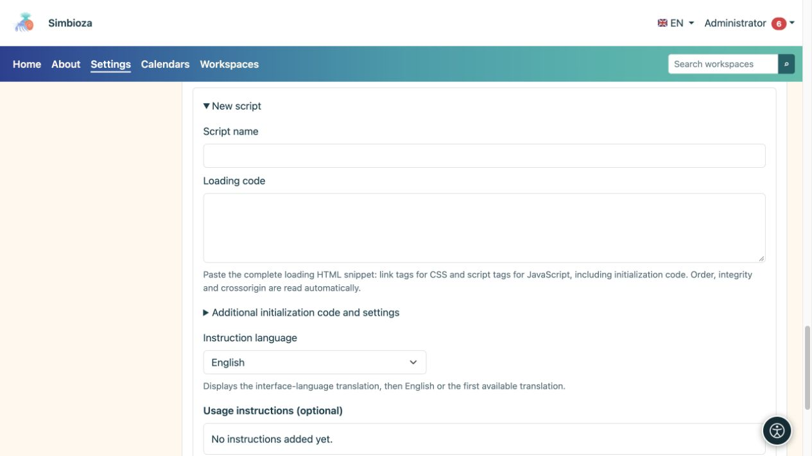
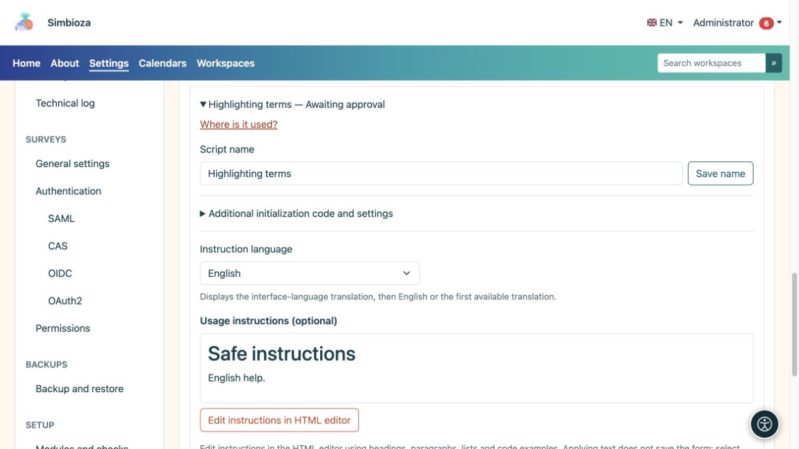

# Script esterni e istruzioni per l'autore

> Le schermate mostrano l’interfaccia in inglese.

**Pubblico:** l'amministratore dell'intera installazione. Apri **Impostazioni → HTML editor → Script esterni**. Questo registro è per il codice aggiuntivo del contenuto della pagina, non per gli script di Simbioza.

Uno script approvato può essere eseguito nel browser del lettore con accesso alla pagina visualizzata. Approva solo le fonti e il codice di cui ti fidi. L'approvazione non carica lo script su ogni pagina: gli autori selezionano separatamente uno script approvato per la loro pagina.

## Preparare un nuovo script

*Un nuovo script ha campi separati per nome, caricamento della libreria, codice aggiuntivo e istruzioni.*

1. Espandi **Nuovo script**.
2. Inserisci un nome chiaro che gli autori riconosceranno.
3. Incolla lo snippet del fornitore in **Codice di caricamento**: tag HTML `link` per CSS e tag `script` per JavaScript. Preserva l'ordine di dipendenza.
4. Se è necessario un codice di avvio separato, inserirlo in **Codice di avvio e impostazioni aggiuntive**, senza tag `script` circostanti. Appartiene a questa voce di registro, non al file CDN.
5. Modifica le **Istruzioni per l'uso** nell'editor HTML incorporato. Spiega cosa deve fare un autore sulla propria pagina e fornisci il più piccolo esempio di codice utile.
6. Scegli **Applica testo** nella finestra di dialogo, quindi **Salva istruzioni** nel modulo o **Aggiungi come in sospeso** per una nuova voce.

**Risultato:** la voce è preparata ma non disponibile per gli autori finché non viene approvata da un amministratore. L'applicazione del solo testo nella finestra di dialogo non salva il modulo di amministrazione.

## Verifica dell'integrità

Il sistema legge `integrity` e `crossorigin` dallo snippet. **Integrità** specifica il digest del file previsto: il browser rifiuta di eseguire il codice remoto che non corrisponde più. **Crossorigin** seleziona la modalità di caricamento multiorigine richiesta per questa verifica; il server remoto deve consentire l'accesso appropriato.

L'SRI è facoltativo. Senza di esso, il sistema mostra un avviso perché il proprietario dell'URL remoto può successivamente modificare il codice. Prendi questa decisione deliberatamente per ogni voce. L'aggiunta di un digest arbitrario o di un attributo `crossorigin` non può correggere il file sbagliato o un server che non consente l'accesso richiesto.

## Approvare, rifiutare o revocare

Apri una voce, esamina il codice di caricamento, il codice di avvio e le istruzioni, quindi scegli **Approva** o **Rifiuta**. Se una voce approvata non deve più essere utilizzata, scegli **Revoca approvazione**. La modifica del codice eseguibile o del suo indirizzo richiede un nuovo processo di approvazione; l'approvazione precedente non dovrebbe essere trattata come un'approvazione di contenuto diverso.

**Dove viene utilizzato?** elenca le pagine e le lingue che fanno riferimento alla voce selezionata. Includere versioni storiche quando richiesto. Un riferimento trovato e uno script abilitato su una pagina sono stati diversi; leggere lo stato della riga prima di concludere che il codice viene eseguito.

## Istruzioni in diverse lingue

*Le istruzioni sono selezionate e modificate in base alla lingua; la loro anteprima è separata dal codice eseguibile dello script.*

Seleziona una lingua di istruzione installata, modificane il contenuto e salva. Gli autori ricevono la traduzione nella lingua dell'interfaccia, poi in inglese, quindi la prima traduzione disponibile. Un punto interrogativo accanto al nome dello script nell'editor viene visualizzato solo quando le istruzioni non sono vuote. La modalità di aiuto spiega l'uso; non conferisce all'autore i diritti di approvazione dello script.

Gli script approvati sono inclusi nelle esportazioni della pagina HTML: gli indirizzi remoti rimangono collegamenti e il codice locale incluso viene esportato con il contenuto. Controlla la pagina esportata e la disponibilità delle sue dipendenze. Non aspettarti che gli script di contenuto vengano eseguiti all'interno dell'editor stesso o in un'anteprima storica.

Per le tabelle interattive integrate, utilizzare le **Impostazioni tabella** nella [guida alla modifica](uredivanje-stranica_it.md); DataTables non è richiesto per questa funzionalità.
