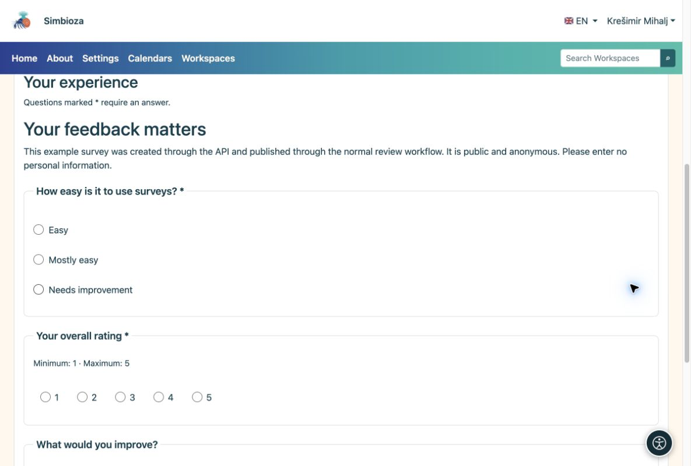

# API – cURL-Beispiele

> Die Bildschirmaufnahmen zeigen die englische Benutzeroberfläche.

[Für Entwickler – API](ankete-developeri_de.md)

## Vorbereitung

Der Administrator aktiviert API und stellt einen Schlüssel aus, dessen Besitzer Umfrageberechtigungen hat. Das vollständige Beispiel verwendet `surveys:read`, `surveys:write`, `surveys:publish` und `surveys:results`. Fügen Sie `surveys:export` nur für CSV hinzu. Gewähren Sie einer engeren Integration nur die erforderlichen Scopes.

Sie benötigen Curl und Python 3. Kopieren Sie die Vorlage und den Helfer aus [Vorlage und Beispiele](ankete-api-primjeri_de.md) in `api-feedback-template.json` und `prepare_api_survey.py` im selben Arbeitsordner. Vorlagensprachen müssen auf dem Ziel installiert und aktiv sein.

## 1. Erstellen Sie einen Entwurf und speichern Sie die Fragen

    export SURVEY_API_TOKEN='YOUR_SCOPED_API_KEY'
    BASE='https://simbioza.example/api/v1/surveys'
    curl --fail-with-body --silent --show-error \
      -H "Authorization: Bearer $SURVEY_API_TOKEN" \
      -H 'Content-Type: application/json' \
      -d '{"title":"Workshop feedback","primary_language":"en"}' \
      "$BASE" > created.json
    SURVEY_ID=$(python3 -c 'import json; print(json.load(open("created.json"))["data"]["uuid"])')
    curl --fail-with-body --silent --show-error \
      -H "Authorization: Bearer $SURVEY_API_TOKEN" "$BASE/$SURVEY_ID" > draft.json
    VERSION=$(python3 -c 'import json; print(json.load(open("draft.json"))["data"]["survey"]["lock_version"])')
    python3 prepare_api_survey.py --survey "$SURVEY_ID" --version "$VERSION" > definition.json
    curl --fail-with-body --silent --show-error -X PATCH \
      -H "Authorization: Bearer $SURVEY_API_TOKEN" -H 'Content-Type: application/json' \
      --data-binary @definition.json "$BASE/$SURVEY_ID" > saved.json

POST gibt HTTP 201 und die neue Umfrage UUID zurück. Verwenden Sie diesen Bezeichner und kein Dokumentationsbeispiel UUID. PATCH sendet eine vollständige Definition mit der aktuellen Version. Der Helfer weist neue Frage- und Auswahl-IDs zu.

## 2. Überprüfen und veröffentlichen

Öffnen Sie vor der Bestätigung den neuen Entwurf im Browser, indem Sie `/surveys/edit/` und dessen UUID an Ihre Installationsadresse anhängen. Überprüfen Sie den Inhalt und den Testablauf. Nach der Prüfung einreichen und als autorisiertes Konto veröffentlichen:

    python3 - <<'PY' > transition.json
    import json
    saved = json.load(open('saved.json'))['data']
    print(json.dumps({'version': saved['survey']['lock_version'],
                      'revision': saved['revision']['uuid'], 'confirmed': True}))
    PY
    curl --fail-with-body --silent --show-error \
      -H "Authorization: Bearer $SURVEY_API_TOKEN" -H 'Content-Type: application/json' \
      --data-binary @transition.json "$BASE/$SURVEY_ID/submit-review"
    curl --fail-with-body --silent --show-error \
      -H "Authorization: Bearer $SURVEY_API_TOKEN" "$BASE/$SURVEY_ID" > review.json
    python3 - <<'PY' > approval.json
    import json
    r = json.load(open('review.json'))['data']
    print(json.dumps({'version': r['survey']['lock_version'],
                      'revision': r['revision']['uuid'], 'confirmed': True}))
    PY
    curl --fail-with-body --silent --show-error \
      -H "Authorization: Bearer $SURVEY_API_TOKEN" -H 'Content-Type: application/json' \
      --data-binary @approval.json "$BASE/$SURVEY_ID/publish"

Lesen Sie die Version nach der Übermittlung erneut, da sie durch den Workflow geändert wurde. Wenn der Schlüssel nicht veröffentlicht werden kann, genehmigt eine autorisierte Person dies über die Schnittstelle.

## 3. Öffnen Sie die Umfrage und lesen Sie die Ergebnisse

Die veröffentlichte Umfrage finden Sie unter Umfragen. Bei Ihrer eigenen Installation lautet die Seite `/surveys/participate/` plus UUID. Dies erklärt das Adressmuster; es handelt sich nicht um einen Test-Umfrage-Link.

<figure>

<figcaption aria-hidden="true">Eine mit API erstellte Umfrage erscheint im Browser als normaler Fragebogen.</figcaption>
</figure>

    curl --fail-with-body --silent --show-error \
      -H "Authorization: Bearer $SURVEY_API_TOKEN" \
      "$BASE/$SURVEY_ID/results?lang=en&page=1&per_page=10"

**Ergebnis:** Ihre eigene neue Umfrage, veröffentlicht über den normalen Workflow. Beim Lesen der Ergebnisse werden weiterhin die Rechte, die Zielgruppe und das Timing des Schlüsseleigentümers überprüft. Echte Antworten werden über das reguläre Webformular gesammelt.
