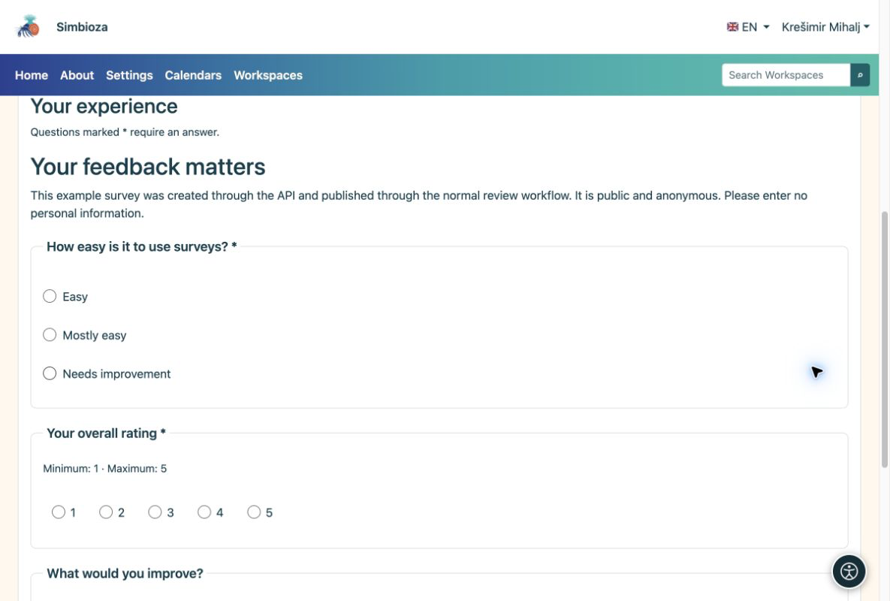

# API — cURL examples

[For developers — API](ankete-developeri_en.md)

## Preparation

The administrator enables API and issues a key whose owner has survey permissions. The full example uses `surveys:read`, `surveys:write`, `surveys:publish` and `surveys:results`. Add `surveys:export` only for CSV. Grant only necessary scopes to a narrower integration.

You need curl and Python 3. From [Template and examples](ankete-api-primjeri_en.md), copy the template and helper into `api-feedback-template.json` and `prepare_api_survey.py` in the same working folder. Template languages must be installed and active on the target.

## 1. Create a draft and save questions

    export SURVEY_API_TOKEN='YOUR_SCOPED_API_KEY'
    BASE='https://simbioza.example/api/v1/surveys'
    curl --fail-with-body --silent --show-error \
      -H "Authorization: Bearer $SURVEY_API_TOKEN" \
      -H 'Content-Type: application/json' \
      -d '{"title":"Workshop feedback","primary_language":"en"}' \
      "$BASE" > created.json
    SURVEY_ID=$(python3 -c 'import json; print(json.load(open("created.json"))["data"]["uuid"])')
    curl --fail-with-body --silent --show-error \
      -H "Authorization: Bearer $SURVEY_API_TOKEN" "$BASE/$SURVEY_ID" > draft.json
    VERSION=$(python3 -c 'import json; print(json.load(open("draft.json"))["data"]["survey"]["lock_version"])')
    python3 prepare_api_survey.py --survey "$SURVEY_ID" --version "$VERSION" > definition.json
    curl --fail-with-body --silent --show-error -X PATCH \
      -H "Authorization: Bearer $SURVEY_API_TOKEN" -H 'Content-Type: application/json' \
      --data-binary @definition.json "$BASE/$SURVEY_ID" > saved.json

POST returns HTTP 201 and the new survey UUID. Use that identifier, not a documentation example UUID. PATCH sends a complete definition with the current version. The helper assigns fresh question and choice identifiers.

## 2. Review and publish

Before confirming, open the new draft in the browser by appending `/surveys/edit/` and its UUID to your installation address. Check its content and trial flow. After review, submit and publish as an authorized account:

    python3 - <<'PY' > transition.json
    import json
    saved = json.load(open('saved.json'))['data']
    print(json.dumps({'version': saved['survey']['lock_version'],
                      'revision': saved['revision']['uuid'], 'confirmed': True}))
    PY
    curl --fail-with-body --silent --show-error \
      -H "Authorization: Bearer $SURVEY_API_TOKEN" -H 'Content-Type: application/json' \
      --data-binary @transition.json "$BASE/$SURVEY_ID/submit-review"
    curl --fail-with-body --silent --show-error \
      -H "Authorization: Bearer $SURVEY_API_TOKEN" "$BASE/$SURVEY_ID" > review.json
    python3 - <<'PY' > approval.json
    import json
    r = json.load(open('review.json'))['data']
    print(json.dumps({'version': r['survey']['lock_version'],
                      'revision': r['revision']['uuid'], 'confirmed': True}))
    PY
    curl --fail-with-body --silent --show-error \
      -H "Authorization: Bearer $SURVEY_API_TOKEN" -H 'Content-Type: application/json' \
      --data-binary @approval.json "$BASE/$SURVEY_ID/publish"

Read the version again after submission because the workflow changed it. If the key cannot publish, an authorized person approves through the interface.

## 3. Open the survey and read results

Find the published survey in Surveys. On your own installation its page is `/surveys/participate/` plus its UUID. This explains the address pattern; it is not a test-survey link.

<figure>

<figcaption aria-hidden="true">An API-created survey appears as a normal questionnaire in the browser.</figcaption>
</figure>

    curl --fail-with-body --silent --show-error \
      -H "Authorization: Bearer $SURVEY_API_TOKEN" \
      "$BASE/$SURVEY_ID/results?lang=en&page=1&per_page=10"

**Result:** your own new survey, published through the normal workflow. Reading results still checks the key owner's rights, audience and timing. Real answers are collected through the regular web form.
