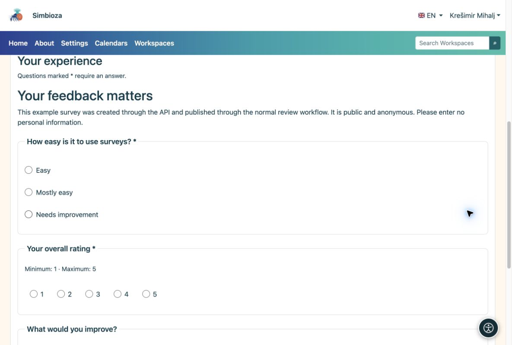

# API: ejemplos con cURL

> Las capturas de pantalla muestran la interfaz en inglés.

[Para desarrolladores: API](ankete-developeri_es.md)

## Preparación

El administrador habilita API y emite una clave cuyo propietario tiene permisos de encuesta. El ejemplo completo utiliza `surveys:read`, `surveys:write`, `surveys:publish` y `surveys:results`. Agregue `surveys:export` solo para CSV. Otorgar sólo los alcances necesarios para una integración más estrecha.

Necesita curl y Python 3. Desde [Plantilla y ejemplos](ankete-api-primjeri_es.md), copie la plantilla y el asistente en `api-feedback-template.json` y `prepare_api_survey.py` en la misma carpeta de trabajo. Los idiomas de plantilla deben estar instalados y activos en el destino.

## 1. Crea un borrador y guarda las preguntas.

    export SURVEY_API_TOKEN='YOUR_SCOPED_API_KEY'
    BASE='https://simbioza.example/api/v1/surveys'
    curl --fail-with-body --silent --show-error \
      -H "Authorization: Bearer $SURVEY_API_TOKEN" \
      -H 'Content-Type: application/json' \
      -d '{"title":"Workshop feedback","primary_language":"en"}' \
      "$BASE" > created.json
    SURVEY_ID=$(python3 -c 'import json; print(json.load(open("created.json"))["data"]["uuid"])')
    curl --fail-with-body --silent --show-error \
      -H "Authorization: Bearer $SURVEY_API_TOKEN" "$BASE/$SURVEY_ID" > draft.json
    VERSION=$(python3 -c 'import json; print(json.load(open("draft.json"))["data"]["survey"]["lock_version"])')
    python3 prepare_api_survey.py --survey "$SURVEY_ID" --version "$VERSION" > definition.json
    curl --fail-with-body --silent --show-error -X PATCH \
      -H "Authorization: Bearer $SURVEY_API_TOKEN" -H 'Content-Type: application/json' \
      --data-binary @definition.json "$BASE/$SURVEY_ID" > saved.json

POST devuelve HTTP 201 y la nueva encuesta UUID. Utilice ese identificador, no un ejemplo de documentación UUID. PATCH envíe una definición completa con la versión actual. El asistente asigna nuevos identificadores de preguntas y opciones.

## 2. Revisar y publicar

Antes de confirmar, abra el nuevo borrador en el navegador agregando `/surveys/edit/` y su UUID a su dirección de instalación. Consulte su contenido y flujo de prueba. Después de revisar, enviar y publicar como cuenta autorizada:

    python3 - <<'PY' > transition.json
    import json
    saved = json.load(open('saved.json'))['data']
    print(json.dumps({'version': saved['survey']['lock_version'],
                      'revision': saved['revision']['uuid'], 'confirmed': True}))
    PY
    curl --fail-with-body --silent --show-error \
      -H "Authorization: Bearer $SURVEY_API_TOKEN" -H 'Content-Type: application/json' \
      --data-binary @transition.json "$BASE/$SURVEY_ID/submit-review"
    curl --fail-with-body --silent --show-error \
      -H "Authorization: Bearer $SURVEY_API_TOKEN" "$BASE/$SURVEY_ID" > review.json
    python3 - <<'PY' > approval.json
    import json
    r = json.load(open('review.json'))['data']
    print(json.dumps({'version': r['survey']['lock_version'],
                      'revision': r['revision']['uuid'], 'confirmed': True}))
    PY
    curl --fail-with-body --silent --show-error \
      -H "Authorization: Bearer $SURVEY_API_TOKEN" -H 'Content-Type: application/json' \
      --data-binary @approval.json "$BASE/$SURVEY_ID/publish"

Lea la versión nuevamente después del envío porque el flujo de trabajo la cambió. Si la clave no se puede publicar, una persona autorizada la aprueba a través de la interfaz.

## 3. Abra la encuesta y lea los resultados.

Encuentra la encuesta publicada en Encuestas. En su propia instalación, su página es `/surveys/participate/` más su UUID. Esto explica el patrón de dirección; no es un vínculo prueba-encuesta.

<figure>

<figcaption aria-hidden="true">Una encuesta creada por API aparece como un cuestionario normal en el navegador.</figcaption>
</figure>

    curl --fail-with-body --silent --show-error \
      -H "Authorization: Bearer $SURVEY_API_TOKEN" \
      "$BASE/$SURVEY_ID/results?lang=en&page=1&per_page=10"

**Resultado:** su propia encuesta nueva, publicada mediante el flujo de trabajo normal. La lectura de los resultados aún verifica los derechos, la audiencia y el momento del propietario de la clave. Las respuestas reales se recopilan a través del formulario web habitual.
