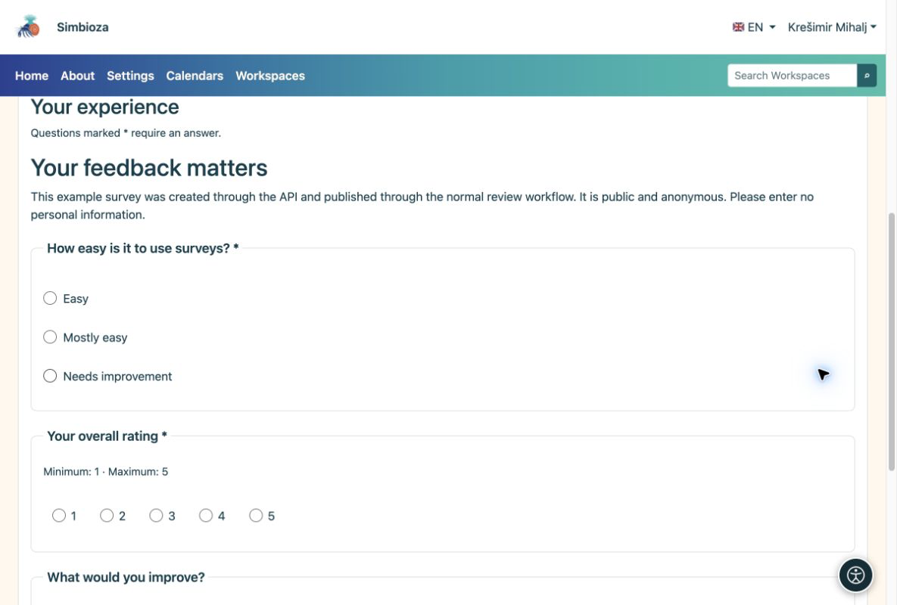

# API — exemples cURL

> Les captures d’écran présentent l’interface en anglais.

[Pour les développeurs — API](ankete-developeri_fr.md)

## Préparation

L'administrateur active API et émet une clé dont le propriétaire dispose des autorisations d'interrogation. L'exemple complet utilise `surveys:read`, `surveys:write`, `surveys:publish` et `surveys:results`. Ajoutez `surveys:export` uniquement pour CSV. Accordez uniquement les portées nécessaires à une intégration plus étroite.

Vous avez besoin de curl et de Python 3. À partir de [Modèle et exemples](ankete-api-primjeri_fr.md), copiez le modèle et l'assistant dans `api-feedback-template.json` et `prepare_api_survey.py` dans le même dossier de travail. Les langages de modèle doivent être installés et actifs sur la cible.

## 1. Créez un brouillon et enregistrez les questions

    export SURVEY_API_TOKEN='YOUR_SCOPED_API_KEY'
    BASE='https://simbioza.example/api/v1/surveys'
    curl --fail-with-body --silent --show-error \
      -H "Authorization: Bearer $SURVEY_API_TOKEN" \
      -H 'Content-Type: application/json' \
      -d '{"title":"Workshop feedback","primary_language":"en"}' \
      "$BASE" > created.json
    SURVEY_ID=$(python3 -c 'import json; print(json.load(open("created.json"))["data"]["uuid"])')
    curl --fail-with-body --silent --show-error \
      -H "Authorization: Bearer $SURVEY_API_TOKEN" "$BASE/$SURVEY_ID" > draft.json
    VERSION=$(python3 -c 'import json; print(json.load(open("draft.json"))["data"]["survey"]["lock_version"])')
    python3 prepare_api_survey.py --survey "$SURVEY_ID" --version "$VERSION" > definition.json
    curl --fail-with-body --silent --show-error -X PATCH \
      -H "Authorization: Bearer $SURVEY_API_TOKEN" -H 'Content-Type: application/json' \
      --data-binary @definition.json "$BASE/$SURVEY_ID" > saved.json

POST renvoie HTTP 201 et le nouveau sondage UUID. Utilisez cet identifiant, pas un exemple de documentation UUID. PATCH envoie une définition complète avec la version actuelle. L'assistant attribue de nouveaux identifiants de questions et de choix.

## 2. Examiner et publier

Avant de confirmer, ouvrez le nouveau brouillon dans le navigateur en ajoutant `/surveys/edit/` et son UUID à votre adresse d'installation. Vérifiez son contenu et son déroulement d'essai. Après examen, soumettez et publiez en tant que compte autorisé :

    python3 - <<'PY' > transition.json
    import json
    saved = json.load(open('saved.json'))['data']
    print(json.dumps({'version': saved['survey']['lock_version'],
                      'revision': saved['revision']['uuid'], 'confirmed': True}))
    PY
    curl --fail-with-body --silent --show-error \
      -H "Authorization: Bearer $SURVEY_API_TOKEN" -H 'Content-Type: application/json' \
      --data-binary @transition.json "$BASE/$SURVEY_ID/submit-review"
    curl --fail-with-body --silent --show-error \
      -H "Authorization: Bearer $SURVEY_API_TOKEN" "$BASE/$SURVEY_ID" > review.json
    python3 - <<'PY' > approval.json
    import json
    r = json.load(open('review.json'))['data']
    print(json.dumps({'version': r['survey']['lock_version'],
                      'revision': r['revision']['uuid'], 'confirmed': True}))
    PY
    curl --fail-with-body --silent --show-error \
      -H "Authorization: Bearer $SURVEY_API_TOKEN" -H 'Content-Type: application/json' \
      --data-binary @approval.json "$BASE/$SURVEY_ID/publish"

Relisez la version après l'envoi car le workflow l'a modifiée. Si la clé ne peut pas être publiée, une personne autorisée l'approuve via l'interface.

## 3. Ouvrez le sondage et lisez les résultats

Retrouvez le sondage publié dans Sondages. Sur votre propre installation, sa page est `/surveys/participate/` plus son UUID. Ceci explique le modèle d'adresse ; ce n'est pas un lien test-sondage.

<figure>

<figcaption aria-hidden="true">Un sondage créé par API apparaît comme un questionnaire normal dans le navigateur.</figcaption>
</figure>

    curl --fail-with-body --silent --show-error \
      -H "Authorization: Bearer $SURVEY_API_TOKEN" \
      "$BASE/$SURVEY_ID/results?lang=en&page=1&per_page=10"

**Résultat :** votre propre nouveau sondage, publié via le flux de travail normal. Les résultats de lecture vérifient toujours les droits, l'audience et le calendrier du propriétaire de la clé. Les vraies réponses sont collectées via le formulaire Web habituel.
