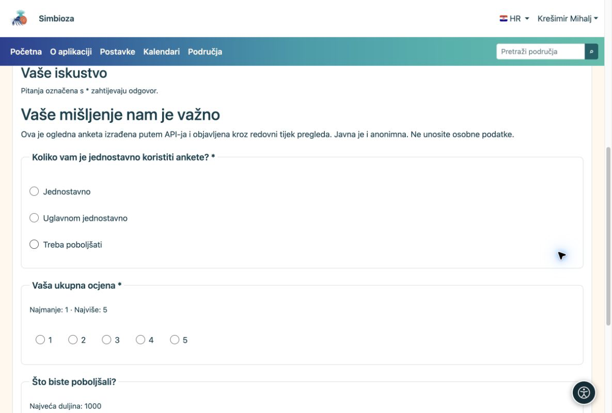

# API — cURL primjeri

[Za developere — API](ankete-developeri_hr.md)

## Priprema

Administrator treba uključiti API i izdati ključ čiji vlasnik ima prava na ankete. Cijeli postupak ispod koristi `surveys:read`, `surveys:write`, `surveys:publish` i `surveys:results`. Dodajte `surveys:export` samo ako trebate CSV. Za usku integraciju dodijelite samo potrebne opsege.

Potrebni su curl i Python 3. Sa stranice [Predložak i primjeri](ankete-api-primjeri_hr.md) kopirajte predložak i pomoćnu skriptu u `api-feedback-template.json` i `prepare_api_survey.py` u istoj radnoj mapi. Uključeni jezici predloška moraju biti instalirani i aktivni na cilju.

## 1. Kreirajte prazan nacrt i spremite pitanja

    export SURVEY_API_TOKEN='YOUR_SCOPED_API_KEY'
    BASE='https://simbioza.example/api/v1/surveys'
    curl --fail-with-body --silent --show-error \
      -H "Authorization: Bearer $SURVEY_API_TOKEN" \
      -H 'Content-Type: application/json' \
      -d '{"title":"Workshop feedback","primary_language":"en"}' \
      "$BASE" > created.json
    SURVEY_ID=$(python3 -c 'import json; print(json.load(open("created.json"))["data"]["uuid"])')
    curl --fail-with-body --silent --show-error \
      -H "Authorization: Bearer $SURVEY_API_TOKEN" "$BASE/$SURVEY_ID" > draft.json
    VERSION=$(python3 -c 'import json; print(json.load(open("draft.json"))["data"]["survey"]["lock_version"])')
    python3 prepare_api_survey.py --survey "$SURVEY_ID" --version "$VERSION" > definition.json
    curl --fail-with-body --silent --show-error -X PATCH \
      -H "Authorization: Bearer $SURVEY_API_TOKEN" -H 'Content-Type: application/json' \
      --data-binary @definition.json "$BASE/$SURVEY_ID" > saved.json

POST vraća HTTP 201 i UUID nove ankete. Koristite upravo tu oznaku, ne UUID iz dokumentacije. PATCH šalje cijelu definiciju uz aktualnu verziju. Pomoćna skripta dodjeljuje nove oznake pitanjima i odgovorima.

## 2. Pregledajte pa objavite

Prije potvrde otvorite novi nacrt u pregledniku: iza vlastite adrese instalacije upišite `/surveys/edit/` i dobiveni UUID. Pregledajte sadržaj i probno ispunjavanje. Nakon provjere pošaljite na pregled pa objavite ovlaštenim računom:

    python3 - <<'PY' > transition.json
    import json
    saved = json.load(open('saved.json'))['data']
    print(json.dumps({'version': saved['survey']['lock_version'],
                      'revision': saved['revision']['uuid'], 'confirmed': True}))
    PY
    curl --fail-with-body --silent --show-error \
      -H "Authorization: Bearer $SURVEY_API_TOKEN" -H 'Content-Type: application/json' \
      --data-binary @transition.json "$BASE/$SURVEY_ID/submit-review"
    curl --fail-with-body --silent --show-error \
      -H "Authorization: Bearer $SURVEY_API_TOKEN" "$BASE/$SURVEY_ID" > review.json
    python3 - <<'PY' > approval.json
    import json
    r = json.load(open('review.json'))['data']
    print(json.dumps({'version': r['survey']['lock_version'],
                      'revision': r['revision']['uuid'], 'confirmed': True}))
    PY
    curl --fail-with-body --silent --show-error \
      -H "Authorization: Bearer $SURVEY_API_TOKEN" -H 'Content-Type: application/json' \
      --data-binary @approval.json "$BASE/$SURVEY_ID/publish"

Verzija se ponovno čita nakon slanja jer se stanje promijenilo. Ako ključ nema pravo objave, odobrenje radi ovlaštena osoba kroz sučelje.

## 3. Otvorite anketu i pročitajte rezultate

Objavljenu anketu pronađite u popisu Ankete. Njezina je stranica na vlastitoj instalaciji `/surveys/participate/` + UUID. To je objašnjenje obrasca adrese, ne poveznica na testnu anketu.

<figure>

<figcaption aria-hidden="true">Anketa izrađena kroz API prikazuje se kao obična anketa u pregledniku.</figcaption>
</figure>

    curl --fail-with-body --silent --show-error \
      -H "Authorization: Bearer $SURVEY_API_TOKEN" \
      "$BASE/$SURVEY_ID/results?lang=en&page=1&per_page=10"

**Rezultat:** vlastita nova anketa, objavljena redovnim tijekom. Čitanje rezultata i dalje provjerava pravo vlasnika ključa, publiku i vrijeme dostupnosti. Stvarne odgovore prikuplja redovni web obrazac.
