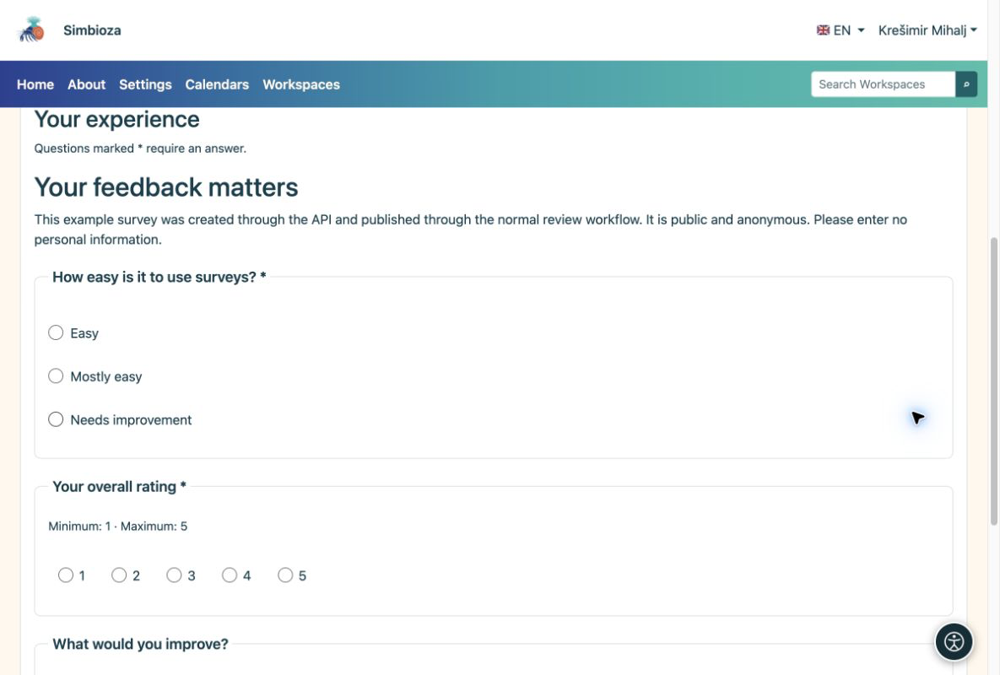

# API: esempi di cURL

> Le schermate mostrano l’interfaccia in inglese.

[Per sviluppatori — API](ankete-developeri_it.md)

## Preparazione

L'amministratore abilita API ed emette una chiave il cui proprietario dispone delle autorizzazioni di sondaggio. L'esempio completo utilizza `surveys:read`, `surveys:write`, `surveys:publish` e `surveys:results`. Aggiungi `surveys:export` solo per CSV. Concedere solo gli ambiti necessari a un'integrazione più ristretta.

Sono necessari curl e Python 3. Da [Modello ed esempi](ankete-api-primjeri_it.md), copiare il modello e l'helper in `api-feedback-template.json` e `prepare_api_survey.py` nella stessa cartella di lavoro. Le lingue del modello devono essere installate e attive sulla destinazione.

## 1. Crea una bozza e salva le domande

    export SURVEY_API_TOKEN='YOUR_SCOPED_API_KEY'
    BASE='https://simbioza.example/api/v1/surveys'
    curl --fail-with-body --silent --show-error \
      -H "Authorization: Bearer $SURVEY_API_TOKEN" \
      -H 'Content-Type: application/json' \
      -d '{"title":"Workshop feedback","primary_language":"en"}' \
      "$BASE" > created.json
    SURVEY_ID=$(python3 -c 'import json; print(json.load(open("created.json"))["data"]["uuid"])')
    curl --fail-with-body --silent --show-error \
      -H "Authorization: Bearer $SURVEY_API_TOKEN" "$BASE/$SURVEY_ID" > draft.json
    VERSION=$(python3 -c 'import json; print(json.load(open("draft.json"))["data"]["survey"]["lock_version"])')
    python3 prepare_api_survey.py --survey "$SURVEY_ID" --version "$VERSION" > definition.json
    curl --fail-with-body --silent --show-error -X PATCH \
      -H "Authorization: Bearer $SURVEY_API_TOKEN" -H 'Content-Type: application/json' \
      --data-binary @definition.json "$BASE/$SURVEY_ID" > saved.json

POST restituisce HTTP 201 e il nuovo sondaggio UUID. Utilizza questo identificatore, non un esempio di documentazione UUID. PATCH invia una definizione completa con la versione corrente. L'aiutante assegna nuove domande e identificatori di scelta.

## 2. Rivedi e pubblica

Prima di confermare, apri la nuova bozza nel browser aggiungendo `/surveys/edit/` e il relativo UUID al tuo indirizzo di installazione. Controllane il contenuto e il flusso di prova. Dopo la revisione, invia e pubblica come account autorizzato:

    python3 - <<'PY' > transition.json
    import json
    saved = json.load(open('saved.json'))['data']
    print(json.dumps({'version': saved['survey']['lock_version'],
                      'revision': saved['revision']['uuid'], 'confirmed': True}))
    PY
    curl --fail-with-body --silent --show-error \
      -H "Authorization: Bearer $SURVEY_API_TOKEN" -H 'Content-Type: application/json' \
      --data-binary @transition.json "$BASE/$SURVEY_ID/submit-review"
    curl --fail-with-body --silent --show-error \
      -H "Authorization: Bearer $SURVEY_API_TOKEN" "$BASE/$SURVEY_ID" > review.json
    python3 - <<'PY' > approval.json
    import json
    r = json.load(open('review.json'))['data']
    print(json.dumps({'version': r['survey']['lock_version'],
                      'revision': r['revision']['uuid'], 'confirmed': True}))
    PY
    curl --fail-with-body --silent --show-error \
      -H "Authorization: Bearer $SURVEY_API_TOKEN" -H 'Content-Type: application/json' \
      --data-binary @approval.json "$BASE/$SURVEY_ID/publish"

Leggi di nuovo la versione dopo l'invio perché il flusso di lavoro l'ha modificata. Se la chiave non può essere pubblicata, una persona autorizzata approva tramite l'interfaccia.

## 3. Apri il sondaggio e leggi i risultati

Trova il sondaggio pubblicato in Sondaggi. Nella tua installazione la sua pagina è `/surveys/participate/` più UUID. Questo spiega il modello di indirizzo; non è un collegamento a un sondaggio di prova.

<figure>

<figcaption aria-hidden="true">Un sondaggio creato da API appare come un normale questionario nel browser.</figcaption>
</figure>

    curl --fail-with-body --silent --show-error \
      -H "Authorization: Bearer $SURVEY_API_TOKEN" \
      "$BASE/$SURVEY_ID/results?lang=en&page=1&per_page=10"

**Risultato:** il tuo nuovo sondaggio, pubblicato tramite il normale flusso di lavoro. La lettura dei risultati controlla comunque i diritti, il pubblico e i tempi del proprietario della chiave. Le risposte reali vengono raccolte tramite il normale modulo web.
